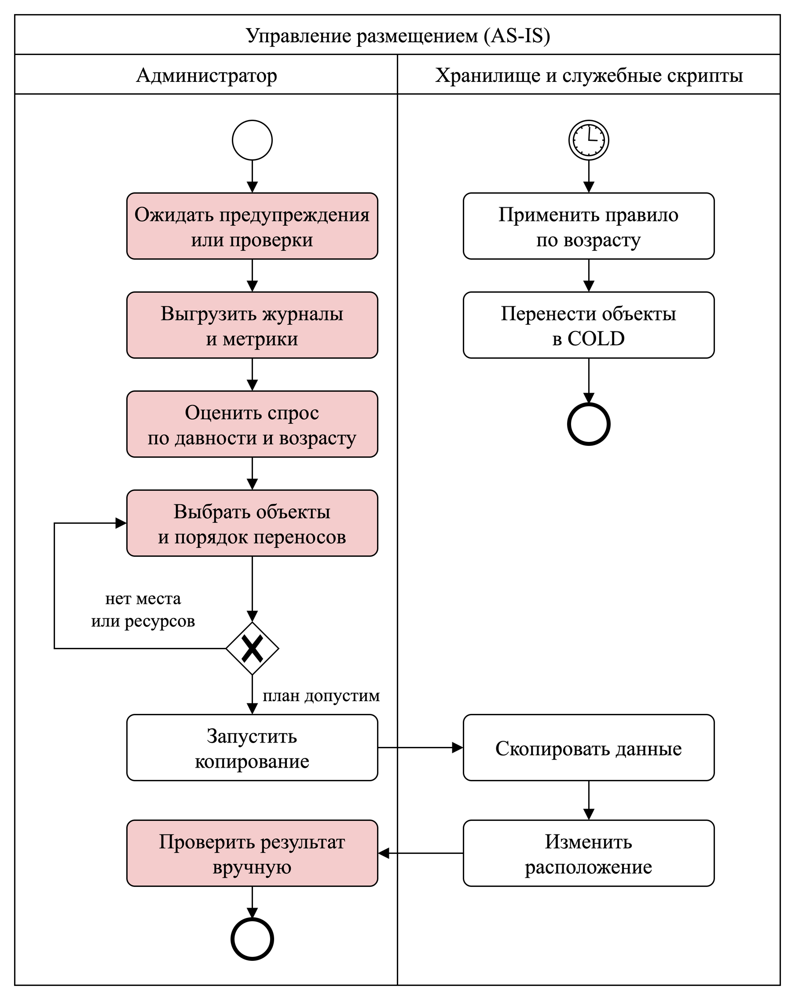
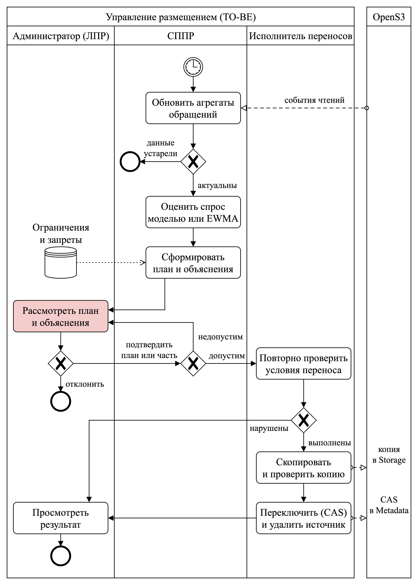
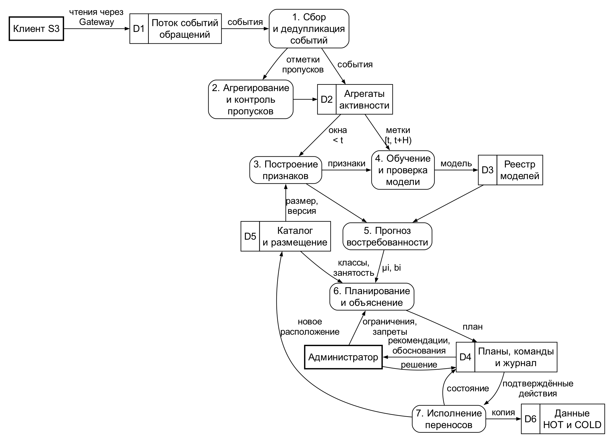
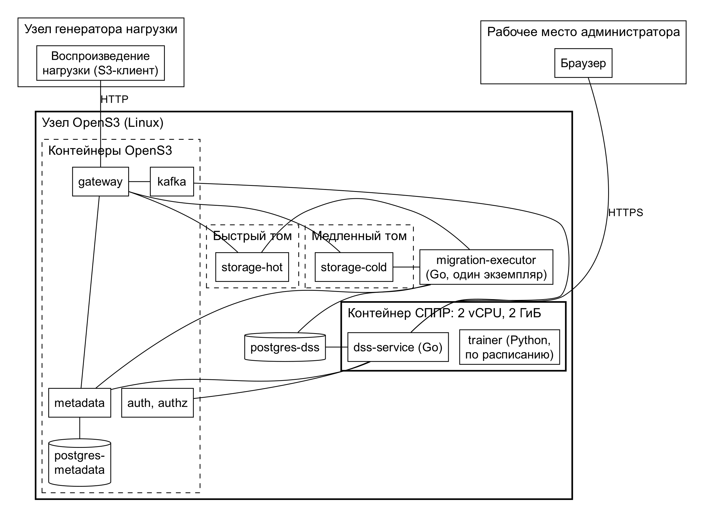

# Аннотация

В настоящей выпускной квалификационной работе представлена интеллектуальная система поддержки принятия решений о размещении объектов между классами S3-совместимого объектного хранилища. На основе метаданных объектов и истории клиентских обращений модель машинного обучения прогнозирует их будущую востребованность. Полученный прогноз используется при выборе между горячим и холодным классами хранения с учётом доступной ёмкости, характеристик производительности, модели затрат и ограничений на миграцию. Система формирует ранжированный набор рекомендаций по размещению объектов, предоставляет обоснование предложенных решений и позволяет администратору подтвердить их выполнение.

В результате работы разрабатывается СППР, интегрированная с компонентами Metadata и Storage системы OpenS3, включающая сбор и подготовку данных, прогнозирование востребованности, формирование рекомендаций и безопасное перемещение объектов между классами хранения. Эффективность предложенного подхода оценивается путём воспроизводимого проигрывания нагрузки и сравнения с эвристическими политиками размещения.

Ключевые слова: объектное хранилище, S3, система поддержки принятия решений, машинное обучение, прогнозирование востребованности, классы хранения, HOT, COLD.

# Введение

Объектные хранилища могут использовать классы накопителей с разной ёмкостью и производительностью. Хранить все данные в быстром классе не всегда целесообразно: редко читаемые объекты занимают дорогой ресурс, который мог бы обслуживать более востребованные данные. При этом спрос меняется, поэтому размещение необходимо пересматривать [1], [2].

Проблема заключается в выборе класса при неизвестной будущей востребованности объекта. Решение должно учитывать историю обращений, ёмкость классов, задержку доступа и затраты переноса. Правила жизненного цикла (англ. Lifecycle) используют возраст и другие заданные условия, а реактивные политики используют давность и частоту обращений. Методы машинного обучения (англ. Machine Learning, далее ML) позволяют прогнозировать спрос, но требуют дополнительных ресурсов и не гарантируют преимущества на любой нагрузке [1]–[4].

В работе разрабатывается система поддержки принятия решений (далее СППР), которая прогнозирует востребованность по метаданным и истории обращений, а затем формирует рекомендации с учётом ресурсов и затрат. Администратор рассматривает обоснование и подтверждает перенос. Программной основой служит хранилище OpenS3, совместимое с интерфейсом Amazon Simple Storage Service (далее S3). Рассматриваются два класса хранения. Параметры затрат задаются администратором.

Целью работы является разработка интеллектуальной системы поддержки принятия решений о размещении объектов между классами хранилища OpenS3.

Объектом исследования является S3-совместимое объектное хранилище с несколькими классами хранения.

Предметом исследования являются методы прогнозирования востребованности объектов и принятия решений об их размещении между классами хранения.

Для достижения поставленной цели необходимо решить следующие задачи:

1. Проанализировать способы управления классами хранения и формализовать критерии и ограничения выбора размещения.
2. Спроектировать СППР и её взаимодействие с компонентами OpenS3.
3. Разработать сбор истории и метаданных, подготовку признаков и обучающих примеров.
4. Обучить и сравнить модели востребованности, определить порядок их обновления.
5. Разработать планировщик размещения, объяснимые рекомендации и подтверждение через программный интерфейс (англ. Application Programming Interface, далее API) и веб-интерфейс.
6. Интегрировать СППР с OpenS3, реализовать безопасные переносы и проверить сохранность данных и восстановление после сбоев.
7. Сравнить прогнозный подход с эвристическими политиками и установить условия его применимости.

# Литературный обзор

Литературный обзор охватывает исследования прогнозного размещения, документацию Amazon S3 и подход к выбору уровня хранения по нечётким правилам [1]–[4].

Обзор Savva, Kakoulli и Herodotou [1] сопоставляет традиционные политики многоуровневого хранения с методами машинного обучения. Он показывает, что прогнозирование обращений может улучшить выбор класса, но требует дополнительных затрат на сбор данных и работу модели.

Документация Amazon S3 [2] описывает переходы между классами по заранее заданным правилам S3 Lifecycle и автоматическое перемещение по истории обращений в S3 Intelligent-Tiering. Эти механизмы служат основой для сравнения с прогнозным методом.

Motta и соавторы [3] объединяют прогнозирование обращений и выбор между классами Cold, Warm и Hot с учётом стоимости и задержки доступа. Далее в работе эта схема обозначается как методология Motta. Для OpenS3 полезна связь прогноза с решением о размещении. При этом исполнение должно учитывать ёмкость физических ресурсов и конкретные версии объектов.

Татарникова и Архипцев [4] предлагают выбирать уровень хранения с помощью нечётких правил на основе метаданных файла. Метод учитывает несколько характеристик объекта, но не выделяет прогноз его будущей востребованности как отдельный этап.

Рассмотренные источники показывают, что прогнозирование востребованности уже применяется для выбора класса хранения. В настоящей работе акцент сделан на интеграции прогноза с принятием решений в OpenS3, объяснимых рекомендациях и оценке результата по показателям хранилища в сравнении с простыми политиками размещения.

## Исследовательский раздел

Анализ предметной области и существующих решений служит основой для требований к СППР и критериев оценки её эффективности.

### Анализ предметной области

#### Предметная область и участники процесса

Предметной областью является управление размещением объектов в многоуровневом хранилище на основе анализа и прогнозирования клиентских обращений. В работе рассматривается самостоятельно развёрнутое OpenS3, для которого необходимо выбирать размещение объектов с учётом их ожидаемой востребованности и доступных ресурсов.

Клиенты обращаются к объектам и формируют нагрузку на хранилище, а история этих обращений служит основой для прогнозирования спроса. СППР использует прогноз для подготовки рекомендаций по размещению, которые администратор рассматривает и подтверждает с учётом заданных им ограничений.

#### Объектная модель и единица размещения

Объект S3 состоит из содержимого и метаданных и определяется бакетом и ключом. При включённом версионировании перезапись создаёт новую версию с собственным идентификатором [6]. Поскольку объект может измениться между расчётом рекомендации и переносом, единицей размещения принимается конкретная версия. Изменение класса должно сохранять её содержимое и клиентский адрес.

В рассмотренной версии OpenS3 реализованы запись и чтение через шлюз [7]. Прогнозирование и управление классами хранения предстоит разработать в рамках диплома.

#### Классы хранения и характеристики ресурсов

Класс хранения объединяет ресурсы с заданными ёмкостью, производительностью и условиями доступа. В работе быстрый HOT предназначен для востребованных объектов, а более медленный и ёмкий COLD предназначен для редко читаемых. Выбор зависит от ожидаемого спроса и размера объекта.

Условия доступа различаются между системами: Amazon S3 предусматривает в том числе архивные классы [2], [12], Ceph связывает размещение с пулами и устройствами [8], [9], а удалённый уровень MinIO AIStor допускает временное восстановление вместо постоянного обратного переноса [10], [11]. Для OpenS3 принимается непосредственное чтение из обоих классов и перемещение в обоих направлениях. Характеристики этой модели приведены в @tbl:storage_classes.

: Характеристики классов хранения в исследуемом сценарии {#tbl:storage_classes}

| Характеристика | HOT | COLD |
|---|---|---|
| Ёмкость | Ограниченный быстрый ресурс | Более ёмкий ресурс |
| Производительность | Более быстрое чтение | Более медленное чтение |
| Получение данных | Непосредственное чтение | Непосредственное чтение |
| Затраты | Задаваемые параметры | Задаваемые параметры |
| Перемещение | Из COLD и обратно | Из HOT и обратно |

Различие производительности классов измеряется на стенде либо явно задаётся при моделировании. HOT и COLD обозначают относительные роли ресурсов, а не конкретные типы накопителей.

#### Востребованность и история обращений

Востребованность характеризует ожидаемое использование объекта за будущий интервал. Она не определяется только возрастом: старые данные могут регулярно читаться, а новые могут быстро терять спрос. Для прогноза используются давность, частота и объём чтений, а также их изменение во времени. Отсутствие истории у нового объекта не означает отсутствие спроса.

Модель может оценивать вероятность или число будущих чтений. При этом размер объекта и переданный объём учитываются раздельно, поскольку S3 поддерживает чтение диапазона [13], [14]. История должна отражать клиентский спрос по каждому объекту: внутренние переносы, обращения за метаданными и ошибки учитываются отдельно, дубли исключаются, пропуски отмечаются.

#### Способы управления размещением

При ручном размещении класс определяет администратор или приложение. Lifecycle автоматизирует статические условия перехода, например возраст и фильтры [2], [12]. Реактивные политики используют прошлые обращения: принцип давности (англ. Least Recently Used, далее LRU), частоты (англ. Least Frequently Used, далее LFU) или экспоненциально взвешенное скользящее среднее (англ. Exponentially Weighted Moving Average, далее EWMA). Они дают понятные базовые решения, но могут запаздывать при смене спроса.

При прогнозном управлении модель машинного обучения оценивает будущие обращения, а отдельный механизм использует этот прогноз для выбора размещения с учётом ресурсов и затрат. Такое разделение применяется в SCOPe [15], а методология Motta [3] связывает прогноз с выбором класса хранения с учётом стоимости и задержки доступа. Разделение прогнозирования и принятия решений позволяет менять модель и условия планирования независимо.

Кэш обычно хранит копию данных из основного хранилища. Здесь выбирается место хранения самого объекта, поэтому нужно оценивать задержку чтения, затраты переноса и сохранность данных. ML также не гарантирует преимущества на непредсказуемой нагрузке и расходует ресурсы. Как показывает системная оценка Baleen [16], проверять следует влияние политики на хранилище, поэтому для OpenS3 оценивается вся цепочка до выполненного размещения.

#### Ресурсные ограничения и затраты

Ограниченная ёмкость HOT связывает решения по объектам: размещение одного может потребовать переноса других в COLD. Во время миграции нужны место для обеих копий и ресурсы сети, чтения и записи, поэтому выбор размещения должен учитывать размеры объектов, свободную ёмкость и бюджет переносов.

Затраты облачных сервисов включают хранение и запросы [12], [17]. Для самостоятельно развёрнутого OpenS3 они зависят от оборудования и условий эксплуатации. В исследовании затраты задаются коэффициентами в условных единицах, а основным показателем эффективности остаётся задержка чтения при фиксированных ресурсах.

#### Согласованность и безопасное перемещение

Перемещение должно сохранять содержимое версии и доступ к данным. Ошибка копирования или изменение объекта после формирования рекомендации не должны приводить к потере данных или переносу другой версии. Поэтому при выборе решения необходимо учитывать согласованность каталога с фактическим расположением и конкурентные операции. Протокол переноса определяется при проектировании.

Изменение класса сохраняет владельца и разрешения на чтение. Рекомендации раскрывают имена и статистику объектов, поэтому доступны администраторам. Для прогноза содержимое не требуется: используются метаданные и история.

#### Источники данных и условия исследования

Собственная промышленная история OpenS3 отсутствует, поэтому рассматриваются синтетическая нагрузка и открытые трассы. Их назначение и ограничения приведены в @tbl:data_sources.

: Источники экспериментальных данных и их назначение {#tbl:data_sources}

| Источник | Применение | Ограничение |
|---|---|---|
| Синтетическая нагрузка | Размещение и безопасные переносы | Выводы относятся к заданным сценариям |
| Meta CDN / CacheLib [23], [24] | Прогнозирование спроса | Выборочные наблюдения без S3-версий и результатов запросов |
| IBM Cloud Object Storage [20] | Резервная трасса объектных операций | Один бакет, одна неделя |
| IBM Docker Registry [21], [22] | Резервная трасса изменения спроса | Обращения к реестру отличаются от S3 |
| CILES / Baleen [16], [25] | Методическая база | Блоковые обращения отличаются от объектных |

Основным источником выбрана синтетическая нагрузка с известными объектами и операциями: она позволяет воспроизводить спрос и проверять сохранность при переносах. Трасса Meta CDN используется дополнительно для изучения востребованности. Разбор её фрагмента подтвердил возможность подготовки обучающих примеров, но не эффективность модели. Отсутствие S3-версий и результатов запросов ограничивает применение этой трассы к проверке миграций.

### Анализ существующих решений

Сравнение аналогов позволяет выбрать подходы, применимые к OpenS3, и определить требования к разрабатываемой системе.

#### Анализ критериев

Сопоставляются прогноз спроса, критерии выбора, ограничения ресурсов, исполнение переносов и участие администратора. Численные результаты не сравниваются из-за различий данных и условий. Обозначение «Н/У» означает, что возможность не установлена по рассмотренным источникам, а не доказанное отсутствие функции.

#### Обзор аналогов

Рассматриваются Octopus++, методология Motta [3] и SCOPe как прогнозные подходы, а также Amazon S3 и Ceph RGW как системы управления классами. Они различаются средой и единицей размещения.

**Octopus++** прогнозирует повторные обращения и управляет переносами файлов и их копий между уровнями OctopusFS [28]. Система обновляет модель и учитывает состояние ресурсов, связывая прогноз с исполнением переносов. Для OpenS3 существенное различие состоит в единице размещения: здесь перемещается целая версия S3-объекта с сохранением её содержимого и идентификатора.

**Методология Motta** [3] связывает прогноз обращений с выбором между Cold, Warm и Hot с учётом затрат, задержки и предпочтений администратора, развивая предыдущую работу авторов [29]. Она показывает, как оценивать последствия выбора класса, однако объектный протокол переноса в рассмотренном описании не определён.

**SCOPe** использует прогноз обращений для выбора размещения и сжатия частей наборов данных при ограничениях производительности [15]. Для OpenS3 применимо разделение прогнозирования и выбора размещения, однако сжатие и переразбиение данных не входят в рассматриваемую задачу переноса целых объектов.

**Amazon S3** управляет переходами через Lifecycle и Intelligent-Tiering: первый механизм использует заданные правила, второй – наблюдаемую историю доступа [2], [12]. Для сравнения с OpenS3 интерес представляет реактивный выбор класса, но условия облачного сервиса отличаются от ограничений ёмкости самостоятельно развёрнутого хранилища.

**Ceph RGW** (англ. RADOS Gateway) связывает классы хранения с пулами данных и поддерживает Lifecycle-переходы [8], а правила размещения позволяют выбирать типы устройств [9]. Для OpenS3 полезна связь классов с физическими ресурсами. Прогнозирование и административное подтверждение рекомендаций рассматриваются отдельно.

#### Сопоставление аналогов

Сопоставление по выбранным критериям приведено в @tbl:analogues. В строке об исполнении проверяется сохранение конкретной версии при применении рекомендации.

: Сравнение аналогов управления размещением объектов {#tbl:analogues}

| Критерий | Octopus++ [28] | Motta [3], [29] | SCOPe [15] | Amazon S3 [2], [12] | Ceph RGW [8], [30] |
|---|---|---|---|---|---|
| Решение и прогноз | Прогноз повторного чтения | Прогноз обращений | Входной прогноз доступа | Lifecycle или давность доступа | Настройки классов и Lifecycle |
| Критерии выбора | Скорость и баланс | Затраты и задержка | Затраты, размещение и сжатие | Условия перехода | Выбор ресурсов [9] |
| Ёмкость классов в плане | Занятость и пороги | Н/У | Н/У | Физическая ёмкость не задаётся | Общий прогнозный план Н/У |
| Общий бюджет переносов | Лимит только входа в быстрый уровень | Н/У | Н/У | Н/У | Н/У |
| Перенос в обе стороны | Перенос файловых копий | Протокол Н/У | Объектный протокол Н/У | Возврат в Intelligent-Tiering | Полный цикл Н/У |
| Версия при исполнении | Контроль S3-версии Н/У | Н/У | Управление разделом данных | План для S3-версии Н/У | Версия плана Н/У |
| Обоснование | Вероятность чтения | Затраты и задержка | Результат оптимизации | Условие политики | Правила размещения |
| Ручное решение | Не требуется | Н/У | Н/У | Не требуется | Не требуется |

Прогнозирование уже применяется для размещения данных. Для OpenS3 выбран подход, объединяющий прогноз с проверкой ресурсов, объяснением рекомендаций, подтверждением администратора и безопасным переносом версии объекта. Его преимущество предстоит проверить относительно простых политик. При непредсказуемом спросе или дорогой миграции оно может отсутствовать, поэтому необходим режим без модели.

### Требования к разрабатываемой системе

Результаты анализа предметной области и аналогов позволяют сформулировать требования к СППР. Далее определяются назначение и границы расширения OpenS3, требования к функциям, надёжности, доступу, ресурсам и жизненному циклу модели, а также измеримые критерии проверки эффективности.

#### Назначение и границы разрабатываемого расширения

СППР предоставляет администратору настройку размещения, объяснимые рекомендации и управление переносами через API и веб-интерфейс. Разработка включает необходимые изменения компонентов OpenS3.

Прототип ограничивается одним развёртыванием, двумя классами и одним исполнителем миграций. Целиком переносится текущая версия объекта после завершения загрузки. Загрузка, полное и диапазонное чтение, получение метаданных, перезапись и удаление должны сохранять совместимость. Исторические версии, незавершённые составные загрузки, архивное восстановление и согласование нескольких исполнителей не входят в обязательный объём.

Рекомендация содержит версию объекта, исходный и целевой классы, время расчёта, горизонт прогноза и основание выбора. Изменённый состав плана требует нового подтверждения.

#### Требования к выполняемым функциям

Функциональные требования приведены в @tbl:functional_requirements.

: Функциональные требования {#tbl:functional_requirements}

| Код | Требование |
|---|---|
| F-01 | Регистрировать время, объект и версию, операцию, результат и объём клиентских обращений отдельно от миграций |
| F-02 | Получать каталог, размеры и размещение объектов, состояние классов |
| F-03 | Готовить признаки из прошлой истории с обработкой новых объектов и неполных данных |
| F-04 | Обучать, обновлять и вводить в работу модель, а при ошибке обновления сохранять пригодную модель |
| F-05 | Ранжировать рекомендации с учётом ёмкости, размеров, доступа, запретов и бюджета миграций |
| F-06 | Объяснять прогноз спроса, ожидаемый эффект и ограничения рекомендации |
| F-07 | Подтверждать весь план или допустимую часть, отклонять план, отменять ожидающие действия и приостанавливать новые переносы |
| F-08 | Перед копированием проверять версию, расположение, запреты и доступные ресурсы |
| F-09 | Переносить версии в обоих направлениях с проверкой копии до изменения расположения |
| F-10 | Сохранять состояние миграции и безопасно продолжать её после ошибки или перезапуска |
| F-11 | Хранить историю рекомендаций, действий администратора, переносов и ошибок |
| F-12 | Поддерживать базовую политику без пригодной модели и воспроизводимое сравнение политик |

Дубли событий не должны увеличивать спрос, а пропуски не должны восприниматься как отсутствие обращений [31], [14]. Выбранные переносы проверяются совместно: если для входа в HOT требуется освобождение места, подтверждение без необходимого предшествующего действия отклоняется. План не дополняется автоматически.

#### Требования к надёжности и сохранности данных

Миграция сохраняет содержимое и идентификатор версии. Расположение меняется только после проверки целевой копии. Устаревшие рекомендации отклоняются без изменения нового содержимого. Ошибка или перезапуск не должны приводить к потере данных, успешной выдаче неполного содержимого или созданию новой миграции при повторе команды.

После восстановления связи и перезапуска исполнителя состояние операции должно быть доступно в течение 60 с. Отказ модели не блокирует чтение. При недостатке актуальных данных прогнозные действия приостанавливаются. Требования проверяются для одиночных отказов. Одновременная необратимая потеря обоих классов и журнала операций не входит в сценарии проверки.

#### Требования к доступу и интерфейсу администратора

Управление размещением требует аутентификации и административных полномочий с проверкой на сервере. Действия сохраняются в журнале, секреты не используются для обучения.

Интерфейс показывает состояние классов, истории и модели, рекомендации, зависимости плана, ход переносов и причины отказов. Администратор может фильтровать рекомендации и выполнять операции F-07. Ожидаемый эффект отделяется от измеренного результата. API предоставляет те же операции, статус длительного действия и постраничную выдачу.

#### Требования к ресурсам, совместимости и контролю выполнения

Администратор задаёт допустимую занятость классов, бюджет копирования за интервал, параллелизм и частоту повторных переносов. При проверке ресурсов учитываются выполняемые операции и временные копии, а общий бюджет расходуется в обоих направлениях, включая неуспешные попытки. При нехватке ресурсов действие не запускается с указанием причины.

Проектные критерии приёмки приведены в @tbl:acceptance_profile и фиксируются до итогового сравнения.

: Измеримые требования к прототипу и условия их проверки {#tbl:acceptance_profile}

| Параметр | Требование и условия проверки |
|---|---|
| Масштаб проверки | Каталог из 10 000 текущих завершённых объектов по 1 МиБ |
| Клиентская нагрузка | 20 полных чтений в секунду при ограничении числа одновременных запросов до 8. В задержке учитываются очередь и ожидание |
| Время планирования | Полный расчёт рекомендаций занимает не более 30 с при цикле планирования каждые 300 с и указанном масштабе проверки |
| Вычислительные ресурсы | Подготовка признаков, обучение и применение модели совместно используют не более двух виртуальных процессорных ядер и 2 ГиБ памяти. Для процесса расчёта плана допускается не более 512 МиБ в пределах этой общей квоты |
| Подготовка модели | Первоначальная подготовка занимает не более 30 мин, а обновление – не более 300 с в установленной ресурсной квоте |
| Влияние на чтение | При фиксированном размещении и отключённых миграциях рост средней задержки и её 95-го перцентиля (p95) составляет не более 5 % относительно режима без расширения. Условие проверяется без обучения и при обновлении модели |
| Ответ административного API | p95 получения первой страницы из 100 рекомендаций и принятия команды составляет не более 2 с при одном администраторе и 20 запросах в минуту. Принятие команды не требует ожидания завершения миграции |

Перенос сохраняет клиентский ключ. Конфигурация и версии компонентов фиксируются для воспроизводимости. Дополнительно проверяются разные размеры объектов и диапазонное чтение.

#### Требования к жизненному циклу модели

Обучение и обновление используют доступную прошлую историю и примеры с известными метками. Параметры и расписание фиксируются до итоговой проверки. Новая модель вводится с совместимыми правилами признаков после проверки корректности. При ошибке сохраняется пригодная модель, а после установленного срока устаревания применяется F-12. Версия, актуальность и причины ошибок доступны администратору.

#### Требования к проверке эффективности и минимальному результату

Основным показателем является средняя задержка завершённого чтения от заданного момента поступления запроса до последнего байта, включая очередь и миграции. Прогноз сравнивается с настроенными политиками по возрасту, давности и частоте обращений и вариантом без модели с тем же планировщиком и исполнителем. Нагрузка, начальное размещение, ресурсы, бюджет и условия подтверждения одинаковы. Параметры подбираются до итогового теста.

Преимущество признаётся для конкретного сценария и бюджета, если нижняя граница 95-процентного доверительного интервала уменьшения средней задержки составляет не менее 5 % относительно каждой базовой политики, а p95 не ухудшается более чем на 5 % относительно каждой из них. Обязательны сохранность данных, соблюдение ёмкости, бюджета и ресурсной квоты. Без внедрённых отказов неуспешные чтения не допускаются. Ошибки регистрируются отдельно. Это проектные критерии, принятые до эксперимента.

Оценка охватывает весь цикл до фактического размещения, включая ожидание подтверждения и влияние обучения на чтение. Результаты показываются по сценариям, расчётные и стендовые показатели разделяются. Качество прогноза, время адаптации, доля чтений из HOT и затраты служат дополнительными показателями. Процедура повторных прогонов фиксируется в методике.

Минимальный результат включает выполнение требований прототипом и воспроизводимое сравнение политик. Работоспособность и преимущество прогнозирования оцениваются отдельно. Отсутствие выигрыша требует вывода о границах метода.

### Выводы по исследовательскому разделу

Для OpenS3 выбрана модель двух классов с непосредственным чтением и переносами в обоих направлениях. Размещение определяется ожидаемым спросом и размерами объектов при ограничениях ёмкости и миграций. Перенос должен сохранять содержимое версии и клиентский доступ.

Сравнение аналогов обосновало разделение прогнозирования и выбора размещения. Разрабатываемая СППР объединяет их с объяснимыми рекомендациями, подтверждением администратора и безопасным исполнением. Требования определяют функции, ограничения ресурсов и критерии приёмки прототипа.

Основная проверка проводится на синтетической нагрузке, Meta CDN используется дополнительно для изучения спроса. Преимущество оценивается по задержке чтения относительно простых политик при одинаковых ресурсах. На следующем этапе предстоит выбрать модель, спроектировать систему и зафиксировать методику испытаний, которая должна выявить как условия выигрыша, так и границы применимости прогноза.

## Аналитический раздел

Раздел превращает требования раздела 1.3 пояснительной записки в проект СППР: формализует задачу размещения, описывает модель прогноза, алгоритмы и протокол переноса, затем процессы, архитектуру и инструменты реализации.

### Математическое и алгоритмическое обеспечение

В подразделе формализуется задача выбора класса хранения, затем описываются модель прогноза, подготовка данных, обучение, алгоритм планирования, объяснение рекомендаций и протокол переноса.

#### Постановка задачи размещения

Решение принимается в моменты $T$ с шагом цикла планирования 300 с для множества $I$ объектов хранилища. Для каждого объекта рассматривается текущая версия, которую клиент получает при чтении без указания версии. Предыдущие версии в выборе не участвуют, но их место учитывается в ограничениях ёмкости. Для объекта $i$ известны размер текущей версии $s_i$ и текущее размещение $h_i^{\mathrm{тек}}$, а переменная решения $h_i$ равна 1 для HOT и 0 для COLD. Остальные обозначения приведены в @tbl:notation.

: Обозначения модели размещения {#tbl:notation}

| Обозначение | Смысл |
|---|---|
| $H$, $N_i(T)$, $\hat N_i$ | Горизонт прогноза, фактическое и прогнозируемое число клиентских чтений объекта на $[T, T+H)$ |
| $r_i$, $\hat D_i$ | Средняя доля объекта за одно чтение и прогноз прочитанного объёма $\hat N_i r_i s_i$ |
| $c_{\mathrm{HOT}}$, $v_{\mathrm{HOT}}$ | Постоянная часть времени чтения и скорость передачи HOT, для COLD аналогично |
| $C_{\mathrm{HOT}}$, $u_{\mathrm{HOT}}$ | Ёмкость и допустимая доля занятости HOT, для COLD аналогично |
| $S_{\mathrm{HOT}}^{\mathrm{tmp}}$, $S_{\mathrm{HOT}}^{\mathrm{old}}$ | Объём временных копий и предыдущих версий в HOT, для COLD аналогично |
| $B$, $P$, $\Delta_{\min}$ | Бюджет копирования за цикл, штраф за 1 МиБ переноса, минимальный выигрыш обмена |

Основной показатель – средняя задержка конечного чтения. Число чтений от размещения не зависит, поэтому её уменьшение равносильно уменьшению суммарной задержки за горизонт. Время чтения объёма $d$ в HOT аппроксимируется формулой @eq:service_time_hot.

$$
t_{\mathrm{HOT}}(d) = c_{\mathrm{HOT}} + \frac{d}{v_{\mathrm{HOT}}}
$$ {#eq:service_time_hot}

Для COLD время чтения записывается аналогично формулой @eq:service_time_cold.

$$
t_{\mathrm{COLD}}(d) = c_{\mathrm{COLD}} + \frac{d}{v_{\mathrm{COLD}}}
$$ {#eq:service_time_cold}

Здесь $c_{\mathrm{HOT}}$ и $c_{\mathrm{COLD}}$ – постоянная часть времени чтения: обращение к каталогу и установление потока, а $d / v_{\mathrm{HOT}}$ и $d / v_{\mathrm{COLD}}$ – время передачи данных. Второе слагаемое нужно потому, что S3 допускает чтение диапазона [13]. Значения $c$ и $v$ определяются накопителями, на которых размещён класс. Время доступа и скорость передачи приводятся в технических характеристиках устройств, а итоговые значения с учётом программной части измеряются на стенде.

Если за горизонт ожидается $\hat N_i$ чтений общим объёмом $\hat D_i$, то сумма времени этих чтений по формуле @eq:service_time_hot даёт ожидаемую суммарную задержку объекта в HOT, записанную формулой @eq:latency_hot.

$$
L_i^{\mathrm{HOT}} = \hat N_i \, c_{\mathrm{HOT}} + \frac{\hat D_i}{v_{\mathrm{HOT}}}
$$ {#eq:latency_hot}

Аналогично по формуле @eq:service_time_cold ожидаемая суммарная задержка объекта в COLD определяется формулой @eq:latency_cold.

$$
L_i^{\mathrm{COLD}} = \hat N_i \, c_{\mathrm{COLD}} + \frac{\hat D_i}{v_{\mathrm{COLD}}}
$$ {#eq:latency_cold}

Выигрыш от размещения объекта в HOT равен разнице задержек в двух классах и определяется формулой @eq:gain.

$$
\Delta_i = L_i^{\mathrm{COLD}} - L_i^{\mathrm{HOT}}
$$ {#eq:gain}

Очередь запросов здесь не учитывается: формула служит для ранжирования, а ожидание входит в измеряемую задержку.

Задача одного цикла состоит в выборе плана $h = (h_i)_{i \in I}$, при котором максимален чистый выигрыш $G(h)$, то есть суммарный выигрыш за вычетом штрафа за переносы. Чистый выигрыш задаётся целевой функцией @eq:objective.

$$
G(h) = \sum_{i \in I} h_i \Delta_i - P \sum_{i \in I} s_i \left|h_i - h_i^{\mathrm{тек}}\right|
$$ {#eq:objective}

Первая сумма – выигрыш от объектов, оставленных или поднятых в HOT. Во второй сумме $\left|h_i - h_i^{\mathrm{тек}}\right|$ равно 1 только для переносимых объектов, поэтому она равна объёму копирования, а $P$ переводит его в миллисекунды задержки и отражает конкуренцию копирования с клиентскими чтениями.

План выбирается так, чтобы значение $G(h)$ было наибольшим при ограничениях ёмкости и бюджета, приведённых ниже. Выбор ограничен ёмкостью классов. Объекты HOT по плану вместе с временными копиями $S_{\mathrm{HOT}}^{\mathrm{tmp}}$ и предыдущими версиями $S_{\mathrm{HOT}}^{\mathrm{old}}$ не должны превышать допустимую долю ёмкости, что задаёт условие @eq:capacity_hot.

$$
\sum_{i \in I} h_i s_i + S_{\mathrm{HOT}}^{\mathrm{tmp}} + S_{\mathrm{HOT}}^{\mathrm{old}} \le u_{\mathrm{HOT}} C_{\mathrm{HOT}}
$$ {#eq:capacity_hot}

Временные копии создаются выполняемыми и незавершёнными переносами и учитываются по записям в Metadata. Предыдущие версии остаются в классе, где были записаны, поэтому занимают место, хотя в план не входят. Для COLD учитываются объекты с $h_i = 0$, и аналогичное условие записывается как @eq:capacity_cold.

$$
\sum_{i \in I} (1 - h_i) s_i + S_{\mathrm{COLD}}^{\mathrm{tmp}} + S_{\mathrm{COLD}}^{\mathrm{old}} \le u_{\mathrm{COLD}} C_{\mathrm{COLD}}
$$ {#eq:capacity_cold}

Объём копирования за цикл не превышает бюджет $B$, как требует условие @eq:budget.

$$
\sum_{i \in I} s_i \left|h_i - h_i^{\mathrm{тек}}\right| \le B
$$ {#eq:budget}

Объекты, перенос которых запрещён администратором, участвующие в выполняемом переносе или перенесённые раньше минимального интервала между переносами, заданного администратором, в план не включаются и сохраняют текущее размещение согласно требованиям раздела 1.3.5 пояснительной записки. Вместе с минимальным выигрышем $\Delta_{\min}$ это защищает от постоянного переключения объекта между классами. Затраты в условных единицах на хранение, чтения и копирование в целевую функцию не входят и рассчитываются отдельно как дополнительный показатель.

Задача является вариантом задачи о ранце с дополнительным ограничением и в общем случае NP-трудна [32]. Поэтому для 10 000 объектов используется жадный алгоритм из раздела 2.1.5 пояснительной записки, а точное решение применяется только для его проверки на малых выборках.

#### Модель прогнозирования востребованности

Выигрыш @eq:gain пропорционален числу чтений, поэтому вероятности хотя бы одного чтения недостаточно. На часовом горизонте у большинства объектов чтений нет, и используется двухэтапная модель с барьером (англ. Hurdle Model) [33], показанная на @fig:forecast_model.

{#fig:forecast_model width=12cm}

Классификатор оценивает вероятность спроса $p_i$, регрессор – ожидаемое число чтений $m_i$ при возникшем спросе, их произведение даёт прогноз $\hat N_i$. Объём $\hat D_i$ получается умножением $\hat N_i$ на размер $s_i$ и среднюю долю объекта за чтение $r_i$. Пунктиром показаны базовые оценки, которые подаются в тот же планировщик в режиме F-12.

Обе части строятся методом градиентного бустинга деревьев решений (англ. Gradient Boosting Decision Tree, далее GBDT) [34]. Модель GBDT является суммой деревьев решений, записанной формулой @eq:gbdt.

$$
F(x) = F_0 + \eta \sum_{k=1}^{M} f_k(x)
$$ {#eq:gbdt}

Здесь $x$ – вектор признаков, $F_0$ – начальное приближение, $f_k$ – дерево, построенное на шаге $k$, $M$ – число деревьев, $\eta$ – коэффициент обучения. Каждое следующее дерево исправляет ошибку суммы предыдущих, приближая антиградиент функции потерь. Классификатор и регрессор – две такие суммы $F_{\mathrm{кл}}$ и $F_{\mathrm{рег}}$ с разными функциями потерь.

Выход классификатора переводится в вероятность спроса логистической функцией по формуле @eq:prob.

$$
p_i = \frac{1}{1 + e^{-F_{\mathrm{кл}}(x_i)}}
$$ {#eq:prob}

Выход регрессора переводится в ожидаемое число чтений при возникшем спросе по формуле @eq:count.

$$
m_i = 1 + e^{F_{\mathrm{рег}}(x_i)}
$$ {#eq:count}

Экспонента делает прогноз положительным, а единица учитывает, что при возникшем спросе чтений не меньше одного. Итоговый прогноз числа чтений получается по формуле @eq:hurdle.

$$
\hat N_i = p_i m_i
$$ {#eq:hurdle}

Классификатор обучается на всех примерах с логистической функцией потерь. Регрессор обучается только на примерах с $N_i > 0$, предсказывая величину $y = N_i - 1$, с функцией потерь Пуассона [35], [36], которая задаётся формулой @eq:poisson_loss.

$$
\ell(y, \hat y) = \hat y - y \ln \hat y
$$ {#eq:poisson_loss}

Здесь $\hat y = e^{F_{\mathrm{рег}}(x_i)}$ – прогноз регрессора. Эта функция потерь соответствует предположению, что число событий за интервал распределено по закону Пуассона, и поэтому подходит для счётчиков чтений.

GBDT выбран потому, что признаки табличные, а на таких данных ансамбли деревьев обычно не уступают нейронным сетям при меньших затратах [37], не требуют масштабирования, обучаются на процессоре в квоте 2 ГиБ и позволяют показать значимость признаков. Близкий подход применён в Octopus++ [28].

Чтобы отделить пользу машинного обучения от пользы планировщика, сравниваются три уровня прогноза: эвристики по возрасту, давности и частоте, экспоненциально сглаженная частота EWMA и модель GBDT. EWMA с периодом полураспада, подобранным на данных настройки, также служит базовой политикой F-12.

Ограничения модели известны заранее. Однократный всплеск без предшествующих признаков не предсказывается. Новый объект оценивается грубо, по размеру и активности бакета. Текущий класс, задержка и ошибки чтения в признаки не входят, иначе модель приняла бы последствия медленного COLD за снижение спроса. На равномерной случайной нагрузке преимущества у прогноза быть не должно, и этот сценарий служит отрицательным контролем.

#### Обработка данных и формирование обучающих примеров

В рассмотренной версии Gateway собирает метрики по методу, маршруту и коду ответа, но не сохраняет обращения к отдельным объектам [7]. Поэтому история формируется заново из событий клиентских чтений с номером Gateway, порядковым номером, временем, объектом, версией, результатом и объёмом. Исполнитель переносов читает Storage напрямую, минуя Gateway, поэтому внутренние чтения в поток спроса не попадают. Подготовка выполняется в четыре шага.

1. Дедупликация. Доставка событий выполняется по схеме «не менее одного раза» [38], поэтому повтор события отбрасывается по его идентификатору.
2. Контроль пропусков. Разрыв порядковых номеров отмечается как интервал неполной истории. Отметка актуальности $W$ – момент, до которого события всех Gateway получены без пропусков.
3. Агрегирование. Чтения, объём, ошибки и записи суммируются по ключу объекта в интервалах фиксированной длительности, не превышающей наименьшего окна признаков. Неуспешное чтение учитывается как попытка обращения без прочитанных байтов.
4. Построение признаков. Признаки рассчитываются по агрегатам и сохраняются с версией правил расчёта.

История ведётся по ключу, а прогноз относится к текущей версии, поскольку клиент читает ключ и после перезаписи спрос переходит к новой версии. Состав признаков приведён в @tbl:features.

: Признаки модели прогнозирования {#tbl:features}

| Группа | Признаки |
|---|---|
| Объект | Логарифм размера, возраст версии, число перезаписей за окно |
| Давность | Время с последнего и предпоследнего чтения |
| Частота и сглаживание | Чтения за окна длительностью от минут до суток, EWMA с несколькими периодами полураспада |
| Динамика и повторяемость | Отношение частоты за короткое окно к частоте за длинное, чтения в окне длительностью $H$ сутки назад |
| Объём и бакет | Средняя доля объекта за чтение, чтения бакета за окно, доля активных объектов бакета |
| Полнота | Наблюдаемая длительность истории, ограниченная наибольшим окном |

Окна разной длины различают устойчивую популярность и недавний рост, а суточный сдвиг нужен для периодического сценария. Длительности окон и периоды полураспада подбираются на данных настройки. Признак полноты одинаково описывает новый объект и начало работы стенда, поэтому отсутствие данных не смешивается с отсутствием спроса. Временные границы признаков и меток исключают утечку будущего в обучающие примеры [26], [27]. Признаки объекта в момент $T$ вычисляются только по событиям до этого момента согласно формуле @eq:features.

$$
x_i(T) = \mathrm{Признаки}\bigl(\{e : T_e < T\}\bigr)
$$ {#eq:features}

Здесь $e$ – событие обращения, $T_e$ – его время, а «Признаки» – правила расчёта из @tbl:features. Метка того же примера считается только по событиям следующего интервала длительностью $H$ по формуле @eq:label.

$$
N_i(T) = \bigl|\{e : T \le T_e < T + H\}\bigr|
$$ {#eq:label}

Пример с моментом $T$ можно использовать для обучения в момент $T'$ только при выполнении условия @eq:availability.

$$
T + H \le W(T')
$$ {#eq:availability}

Здесь $W(T')$ – отметка актуальности в момент $T'$. Условие означает, что весь интервал метки уже завершился и события за него получены без пропусков. Примеры, пересекающиеся с пропусками, исключаются. Поэтому последний обучающий момент отстоит от конца обучающего периода не меньше чем на $H$. Признаки строятся по агрегатам, а не по исходным событиям, поэтому объём обучающей выборки определяется числом срезов и объектов, а не интенсивностью чтений.

#### Обучение, проверка и ввод модели в работу

Первоначальная подготовка делит историю по времени на период обучения и следующий за ним период подбора гиперпараметров по пуассоновскому отклонению. Качество классификатора оценивается площадью под кривой точности и полноты (англ. Precision-Recall Area Under Curve, далее PR-AUC), устойчивой к преобладанию нулевых меток [39], и оценкой Брайера для калибровки [40]. Пригодность к размещению оценивается долей покрытия будущих чтений по формуле @eq:capture.

$$
\mathrm{Cov}_K = \frac{\sum_{i \in \mathrm{top}_K} N_i}{\sum_{i \in I} N_i}
$$ {#eq:capture}

Здесь $\mathrm{top}_K$ – $K$ объектов с наибольшим прогнозом $\hat N_i$, а $K$ равно вместимости HOT. Для объектов одинакового размера $s$ это $K = \lfloor u_{\mathrm{HOT}} C_{\mathrm{HOT}} / s \rfloor$. Показатель связывает модель с ограничением ёмкости: высокая PR-AUC при низком покрытии означает, что модель отличает читаемые объекты, но плохо выбирает самые востребованные.

Модель обновляется по расписанию на примерах из окна недавней истории с завершённой меткой. Период обновления и длина окна подбираются экспериментально. Перед вводом проверяются совпадение версии правил признаков, конечность и неотрицательность прогнозов, совпадение прогнозов Go и Python на контрольной выборке и укладывание обучения в 300 с. Третья проверка нужна потому, что модель обучается на Python, а применяется в Go. Модель и правила признаков вводятся вместе, начатый расчёт плана завершается с прежней моделью. При неудаче сохраняется пригодная модель, а когда её возраст превышает заданный предел, применяется F-12.

#### Алгоритм формирования плана размещения

Алгоритм решает задачу @eq:objective–@eq:budget жадным выбором наборов переносов. Если отметка актуальности отстаёт больше допустимого порога или на последнем интервале длительностью $H$ есть пропуск, прогнозные действия приостанавливаются с указанием причины. При непригодной модели спрос оценивается базовой политикой. Затем кандидаты COLD упорядочиваются по убыванию удельного выигрыша $\Delta_i / s_i$, а объекты HOT – по возрастанию. Закреплённые объекты в выборе не участвуют. Для кандидата без свободного места подбираются вытесняемые объекты с наименьшей удельной ценностью. Набор принимается, если выигрыш превышает потери вытесняемых объектов, штраф и минимальный выигрыш $\Delta_{\min}$, а бюджет покрывает копирование. Перенос в HOT получает зависимость от вытеснений, освобождающих для него место.

При равных размерах алгоритм точен для заполненного HOT. План из $n$ замен даёт сумму $\Delta$ поднятых объектов за вычетом суммы $\Delta$ опущенных и штрафа за $2n$ переносов. При фиксированном $n$ максимум достигается для $n$ лучших объектов COLD и $n$ худших объектов HOT, а выигрыш каждой следующей замены не возрастает, поэтому остановка жадного алгоритма даёт оптимальное $n$. Основной сценарий с объектами по 1 МиБ относится к этому случаю. Для разных размеров жадный выбор по удельной ценности является эвристикой [32], [41], и его потери проверяются точным решением на малых выборках, для которых оно вычислимо.

Блок-схема алгоритма приведена на @fig:planner_algorithm.

{#fig:planner_algorithm width=13.5cm}

Сложность алгоритма $O(|I| \log |I|)$ определяется сортировкой, поэтому основное время 30-секундного цикла приходится на каталог и признаки. Замена в заполненном HOT требует двух переносов, поэтому при бюджете $B$ и объектах размера $s$ за цикл выполняется не более $B / (2s)$ замен, а полная смена востребованного набора из $K$ объектов требует не менее $2Ks / B$ циклов без учёта ожидания подтверждения.

#### Объяснение рекомендаций

Объяснение строится из тех же величин, которые использовал планировщик, поэтому не может противоречить решению. Его состав приведён в @tbl:explanation.

: Состав объяснения рекомендации {#tbl:explanation}

| Элемент | Содержание |
|---|---|
| Действие | Объект и версия, исходный и целевой классы, время расчёта, горизонт, версия модели |
| Прогноз | $p_i$, $m_i$, $\hat N_i$ и оценка EWMA для сравнения |
| Основание | Давность, частоты по окнам и динамика с процентилем в каталоге |
| Эффект | Расчётное изменение суммарной задержки за горизонт |
| Ресурсы | Занятость класса до и после, объём копирования, остаток бюджета |
| Ограничения | Зависимости, запреты, минимальный интервал переноса |

Сравнение с EWMA показывает, когда модель расходится с простой оценкой, а расчётный эффект отделён от измеренного результата. Например, если в заполненном HOT свободного места меньше размера объекта А, его подъём зависит от опускания объекта Б. Подтверждение только А отклоняется с указанием недостающего действия, а запрет переноса Б приводит к новой ревизии плана, а не к её автоматическому дополнению.

#### Протокол безопасного переноса

Протокол обеспечивает требования F-08–F-10 и раздела 1.3.3 пояснительной записки и построен на четырёх инвариантах.

1. У версии всегда ровно одна действующая запись расположения, и чтение использует только её.
2. Расположение меняется только после проверки размера и контрольной суммы MD5 целевой копии.
3. Переключение выполняется операцией сравнения с обменом (англ. Compare-And-Swap, далее CAS) [42]: только если версия текущая, а поколение записи и исходный класс совпадают с проверенными.
4. Источник удаляется после паузы, превышающей предельное время чтения в Gateway.

Исполнитель повторно проверяет версию, поколение, запреты, ресурсы и бюджет, и нарушение любого условия ведёт к отклонению без изменения данных. Затем он резервирует место, создавая запись временной копии с заранее выбранным идентификатором blob, поэтому резерв виден планировщику, а копия не теряется после сбоя. При копировании MD5 и размер вычисляются по данным, а не берутся из ETag, который при составной загрузке не является суммой объекта [18]. Ошибка, несовпадение или конфликт CAS из-за перезаписи или удаления объекта ведут к удалению целевой копии при сохранении прежнего расположения. Неудачная очистка оставляет копию учтённой в занятости.

Описанные состояния и переходы показаны на @fig:migration_states в нотации диаграммы состояний UML [43].

{#fig:migration_states width=10cm}

Диаграмма показывает, что любой путь без успешного CAS заканчивается при прежнем расположении. После переключения новые чтения идут в целевой класс, а начатые завершаются из источника, поэтому до удаления источника обе копии учитываются. Идентификатор команды администратора служит ключом идемпотентности, и повтор команды не создаёт новой миграции. Состояние сохраняется до каждого внешнего действия, а после перезапуска исполнитель определяет, выполнено ли переключение, по поколению и blob в записи расположения.

### Модели процессов

У процесса несколько исполнителей, поэтому исходный и проектируемый процессы сравниваются в нотации моделирования бизнес-процессов (англ. Business Process Model and Notation, далее BPMN) [44]. Дорожки обозначают исполнителей, сплошные стрелки – последовательность действий, пунктирные – сообщения, ромб – исключающий шлюз, двойной круг – таймер, жирный круг – завершение. Красным выделены действия с ожиданием или ручным трудом.

#### Исходный процесс управления размещением

В рассмотренной версии OpenS3 классов хранения нет [7]. Поэтому модель AS-IS описывает обобщённое ручное управление с правилами по возрасту из раздела 1.1.5 пояснительной записки и служит точкой отсчёта, а не описанием конкретной организации.

После предупреждения о заполнении или плановой проверки администратор выгружает журналы, вручную оценивает спрос по давности и возрасту, выбирает объекты, запускает копирование и вручную проверяет результат. Независимо от него правило по таймеру переносит старые объекты в COLD.

Модель процесса приведена на @fig:bpmn_asis.

{#fig:bpmn_asis width=10cm}

Процесс реагирует на уже возникшую проблему, правило не возвращает востребованные объекты, а проверка версии и копии не встроена в процесс.

#### Проектируемый процесс

Модель TO-BE приведена на @fig:bpmn_tobe. Администратор остаётся лицом, принимающим решение (далее ЛПР): система готовит и проверяет план, а он решает, применять ли его.

{#fig:bpmn_tobe width=14.5cm}

OpenS3 публикует события чтений. По таймеру СППР обновляет агрегаты, проверяет данные и модель, прогнозирует спрос, формирует и объясняет план. Администратор подтверждает план целиком или частично либо отклоняет его. СППР проверяет зависимости выбора и возвращает недопустимый выбор с причиной, а допустимый передаёт исполнителю, который повторно проверяет условия, копирует, проверяет копию, переключает расположение и откладывает удаление источника. В экспериментальном сравнении роль администратора выполняет сценарий, подтверждающий весь допустимый план через фиксированную задержку, одинаковую для всех политик. Ручной частичный выбор и отклонение проверяются отдельно.

#### Сравнение процессов

Изменения сведены в @tbl:process_compare. Время исходного процесса не измерялось, поэтому сравнение качественное.

: Сравнение исходного и проектируемого процессов {#tbl:process_compare}

| Аспект | AS-IS | TO-BE |
|---|---|---|
| Запуск | Предупреждение или проверка | Таймер цикла планирования |
| Оценка спроса | Вручную по давности и возрасту | Прогноз с базовой политикой при сбое |
| Учёт ресурсов | Вручную, повтор выбора | Ёмкость, бюджет и запреты в плане |
| Роль администратора | Анализ, выбор, запуск, проверка | Решение по объяснённому плану, ограничения |
| Направление | Правило только в COLD | В обе стороны |
| Проверка данных | Вручную после переноса | Версия, копия и CAS до переключения |
| Журнал | Не предусмотрен | Рекомендации, решения, миграции, ошибки |

У администратора исключаются выгрузка журналов, ручная оценка спроса и проверка копий, а сохраняются функции ЛПР: настройка ограничений, решение и контроль результата. Новое ожидание подтверждения входит во время применения действий и учитывается в эксперименте.

#### Потоки данных

BPMN не показывает, где хранятся данные и какие из них попадают в модель. Для этого используется диаграмма потоков данных (англ. Data Flow Diagram, далее DFD) [45] на @fig:dfd: жирные прямоугольники – внешние сущности, скруглённые – процессы, прямоугольники с номером D – хранилища.

{#fig:dfd width=16.5cm}

События проходят дедупликацию и контроль пропусков и сохраняются в агрегатах D2, из которых строятся признаки по окнам до $T$ и метки за $[T, T+H)$. Модель хранится в реестре D3. Планирование объединяет прогнозы с классами и занятостью из каталога D5 и ограничениями администратора, а план, решения и состояние миграций хранятся в D4. Содержимое объектов проходит только через исполнитель и в обучение не попадает. Каталог D5 – единственный источник истины о расположении, а D4 хранит лишь версию и поколение, поэтому расхождения обнаруживаются повторной проверкой перед переносом.

### Архитектура системы

#### Изменения компонентов OpenS3

Рассмотренная версия OpenS3 включает Gateway, Metadata, Storage, Auth, AuthZ, Kafka и PostgreSQL [7]. Gateway обслуживает PUT и GET, Metadata хранит бакеты, объекты и версии, Storage хранит blob в одном каталоге и поддерживает чтение со смещением. Необходимые изменения сведены в @tbl:opens3_changes.

: Изменения компонентов OpenS3 {#tbl:opens3_changes}

| Компонент | Изменение |
|---|---|
| Metadata | Классы и расположение версий, условное переключение CAS, учёт временных копий |
| Storage | Два экземпляра на разных томах, необязательный идентификатор blob при записи |
| Gateway | Выбор экземпляра Storage по классу, публикация событий, диапазонное чтение |
| Auth, AuthZ | Без изменений, проверка прав администратора |

Классы реализуются двумя экземплярами Storage, поскольку Storage уже работает с одним каталогом данных. Новая версия записывается в COLD, который вмещает весь набор: это исключает переполнение HOT вне плана, но новый популярный объект обслуживается из COLD до ближайшего применённого плана.

#### Компонентная модель

Сервис СППР на Go включает Ingestor, Feature Builder, Predictor, Planner с Explainer, Admin API с веб-интерфейсом и Model Manager, который запускает Trainer на Python и публикует проверенные модели. Обязанности следуют из процесса TO-BE: действия дорожки СППР выполняет сервис, решения ЛПР поступают через Admin API, а переносы выполняет Migration Executor. Исполнитель вынесен в отдельный процесс, потому что только он имеет право записи в Storage и изменения расположения.

Компоненты показаны на @fig:components в нотации диаграммы компонентов UML [43]: пунктирной рамкой выделены существующие компоненты OpenS3, сплошной – новые компоненты СППР.

{#fig:components width=16.5cm}

Admin API проверяет токен через Auth и права через AuthZ, принимает команды с ключом идемпотентности, отвечает кодом 202 со ссылкой на состояние длительного действия и выдаёт рекомендации постранично. Веб-интерфейс формирует страницы на сервере теми же обработчиками, поэтому его возможности совпадают с API.

#### Модель данных

Структура хранимых данных показана на @fig:er. В Metadata добавляются три таблицы, остальные относятся к базе СППР.

{#fig:er width=16.5cm}

Таблица `version_placements` хранит одну действующую запись расположения на версию с полем `generation` для CAS, а `placement_copies` учитывает временные и ожидающие очистки копии. Расположение вынесено в отдельную таблицу, а не в `objects`, поскольку переносится версия, а указатель текущей версии не меняется. В базе СППР события, отметки актуальности и агрегаты хранятся раздельно, модели образуют реестр с интервалами обучения и метриками, планы имеют ревизии, а команды и миграции образуют журнал полного цикла объекта.

#### Развёртывание

Размещение компонентов на стенде показано на @fig:deployment в нотации диаграммы развёртывания UML [43].

{#fig:deployment width=16.5cm}

Компоненты работают в контейнерах на узле Linux. Storage HOT и COLD размещены на разных томах, а искусственное замедление COLD при одинаковых устройствах фиксируется в протоколе. Сервис СППР и процесс обучения находятся в одном контейнере с квотой 2 ядра и 2 ГиБ, поэтому влияние обучения на чтения входит в измерения. Генератор нагрузки вынесен на отдельный узел.

#### Анализ архитектуры

Узкие места, точки отказа и принятые решения сведены в @tbl:arch_analysis.

: Анализ архитектуры {#tbl:arch_analysis}

| Место | Риск | Решение |
|---|---|---|
| Публикация событий | Рост задержки чтения | Асинхронная ограниченная очередь, проверка порога 5 % |
| Kafka | Потеря событий | Чтения не блокируются, пропуск виден по номерам, прогноз приостанавливается |
| Сервис СППР | Единственный экземпляр | Отказ останавливает только новые планы |
| Исполнитель | Одна миграция одновременно | Нет конфликтов, скорость ограничена бюджетом |
| Storage COLD | Копирование конкурирует с чтением | Бюджет, штраф $P$, измерение задержки при миграциях |
| Две базы данных | Нет общей транзакции | Metadata – источник истины, повторная проверка и CAS |
| Admin API | Раскрытие имён и статистики | Доступ только администраторам с проверкой на сервере |

СППР не входит в путь клиентского чтения, поэтому отказ модели, сервиса или Kafka ухудшает только качество размещения. Цена решения – компонент с правом записи данных, который поэтому отделён от сервиса СППР и выполняет только подтверждённые действия. Узким местом является применение плана: если спрос меняется быстрее, чем бюджет позволяет переносить объекты, даже точный прогноз не уменьшит задержку. Эта граница проверяется прогонами с несколькими значениями бюджета $B$.

#### Соответствие требованиям

Связь функциональных требований раздела 1.3.2 пояснительной записки с проектом приведена в @tbl:traceability.

: Соответствие требований проектным решениям {#tbl:traceability}

| Код | Проектное решение | Компонент |
|---|---|---|
| F-01 | События с номерами, происхождение по пути запроса | Gateway, Ingestor |
| F-02 | Классы, расположение, занятость с копиями | Metadata |
| F-03 | Окна до $T$, полнота истории, контроль пропусков | Feature Builder |
| F-04 | Расписание, проверки ввода, сохранение модели | Model Manager, Trainer |
| F-05 | Задача @eq:objective–@eq:budget и жадный алгоритм | Planner |
| F-06 | Объяснение из величин планировщика | Explainer |
| F-07 | Ревизии плана, проверка зависимостей, пауза | Admin API |
| F-08–F-10 | Повторная проверка, MD5, CAS, идемпотентность | Migration Executor, Metadata |
| F-11 | Журнал рекомендаций, команд и миграций | База СППР |
| F-12 | EWMA и эвристики с тем же планировщиком | Predictor, Planner |

### Обоснование инструментов реализации

Инструменты выбраны под модель, архитектуру и совместимость с OpenS3, сервисы которого написаны на Go и общаются по gRPC [7]. Выбор приведён в @tbl:tools.

: Выбор инструментов реализации {#tbl:tools}

| Задача | Инструмент | Обоснование |
|---|---|---|
| Сервис СППР, исполнитель | Go | Язык OpenS3, общие клиенты gRPC, журналирование и метрики |
| Обучение | Python, LightGBM | GBDT с логистической и пуассоновской потерями, обучение на процессоре [36], [46] |
| Применение модели | leaves | Чтение модели LightGBM на Go без нативных библиотек [47] |
| Хранение СППР | PostgreSQL | Используется в OpenS3, транзакции для команд и миграций [48] |
| Поток событий | Kafka | Развёрнут в OpenS3, отделяет публикацию от обработки [38] |
| Веб-интерфейс | Шаблоны HTML на сервере | Без отдельной сборки клиента, общие обработчики с API |

Обучение вынесено в Python, поскольку там развиты библиотеки бустинга, а оно выполняется по расписанию вне обработки запросов. LightGBM строит деревья по гистограммам, что уменьшает время обучения и расход памяти [46]. Для применения модели отдельный сервис на Python добавил бы сетевой вызов и вторую постоянную среду в квоту, а ONNX требует для Go нативной библиотеки. Поэтому выбрана библиотека leaves на чистом Go, поддерживающая сигмоидное преобразование, а преобразование регрессора выполняется в коде сервиса. Последние изменения leaves относятся к 2024 г., поэтому версия LightGBM фиксируется, а совпадение прогнозов проверяется перед вводом каждой модели. Стек не требует отдельной платформы машинного обучения, и собственный вклад сосредоточен в модели, планировщике, протоколе переноса и изменениях OpenS3.

### Выводы по аналитическому разделу

Задача размещения сведена к максимизации ожидаемого уменьшения суммарной задержки чтения при ограничениях ёмкости, бюджета и закреплений. Двухэтапная модель GBDT оценивает и вероятность спроса, и число чтений, как требует формула выигрыша, а базовые политики используют тот же планировщик, что отделяет эффект прогноза от эффекта алгоритма. Жадный алгоритм работает за $O(|I| \log |I|)$ и точен для объектов одинакового размера.

Данные дедуплицируются, пропуски обнаруживаются по номерам, а признаки и метки разделены по времени с учётом отметки актуальности, что исключает утечку будущего. Протокол переноса с проверкой копии, CAS по поколению, отложенным удалением и идемпотентностью сохраняет данные при одиночных отказах и конкурентной перезаписи.

Администратор остаётся ЛПР и вместо ручного анализа и проверки копий принимает решение по объяснённому плану. Архитектура не добавляет СППР в путь чтения, требует изменений Metadata, Storage и Gateway и имеет главные ограничения в единственных экземплярах сервиса и исполнителя и в скорости применения плана. На следующем этапе предстоит реализовать спроектированные компоненты и сравнить прогнозную политику с базовыми на синтетической нагрузке.

# Список использованных источников

1. Savva G., Kakoulli E., Herodotou H. *Machine Learning-Based Caching and Tiering in Modern Data Storage Systems: A Survey* // ACM Computing Surveys. 2026. Vol. 58, no. 11, article 295. 36 p. DOI: [10.1145/3803857](https://doi.org/10.1145/3803857).
2. Amazon Web Services. *Amazon S3 User Guide*: [Understanding and managing Amazon S3 storage classes](https://docs.aws.amazon.com/AmazonS3/latest/userguide/storage-class-intro.html), а также [Managing the lifecycle of objects](https://docs.aws.amazon.com/AmazonS3/latest/userguide/object-lifecycle-mgmt.html), а также [How S3 Intelligent-Tiering works](https://docs.aws.amazon.com/AmazonS3/latest/userguide/intelligent-tiering-overview.html). Дата обращения: 09.10.2026.
3. Motta F. A. A., Villela S. M., Bernardino H. S., Gonçalves G. D., Vieira A. B. *A multiclass cost–latency aware framework for multi-tiered cloud storage optimization via access pattern forecasting* // Computer Communications. 2026. Vol. 249. Article 108437. DOI: [10.1016/j.comcom.2026.108437](https://doi.org/10.1016/j.comcom.2026.108437).
4. Татарникова Т. М., Архипцев Е. Д. Алгоритм контроллера нечеткой логики для размещения файлов в системе хранения данных // Научно-технический вестник информационных технологий, механики и оптики. 2023. Т. 23, № 6. С. 1171–1177. DOI: [10.17586/2226-1494-2023-23-6-1171-1177](https://doi.org/10.17586/2226-1494-2023-23-6-1171-1177).
5. Amazon Web Services. Naming Amazon S3 objects [Электронный ресурс]. URL: [документация Amazon S3](https://docs.aws.amazon.com/AmazonS3/latest/userguide/object-keys.html) (дата обращения: 01.10.2026).
6. Amazon Web Services. Retaining multiple versions of objects with S3 Versioning [Электронный ресурс]. URL: [документация Amazon S3](https://docs.aws.amazon.com/AmazonS3/latest/userguide/Versioning.html) (дата обращения: 01.10.2026).
7. OpenS3-ReBAC. Исходный код и документация проекта. Рассмотренная версия: `ac858c748b5d3af96f0440864f4b299e7b617d76`, 20.09.2026 [Электронный ресурс]. URL: [исходный код рассмотренной версии](https://github.com/alesplll/opens3-rebac/tree/ac858c748b5d3af96f0440864f4b299e7b617d76) (дата обращения: 01.10.2026).
8. Ceph. Pool Placement and Storage Classes. Документация версии Squid [Электронный ресурс]. URL: [документация Ceph](https://docs.ceph.com/en/squid/radosgw/placement/) (дата обращения: 01.10.2026).
9. Ceph. Manually editing the CRUSH Map. Документация версии Squid [Электронный ресурс]. URL: [документация Ceph](https://docs.ceph.com/en/squid/rados/operations/crush-map-edits/) (дата обращения: 01.10.2026).
10. MinIO. Object Lifecycle Management. AIStor Documentation [Электронный ресурс]. URL: [документация MinIO AIStor](https://docs.min.io/aistor/administration/object-lifecycle-management/) (дата обращения: 01.10.2026).
11. MinIO. Object Tiering. AIStor Documentation [Электронный ресурс]. URL: [документация MinIO AIStor](https://docs.min.io/aistor/administration/object-lifecycle-management/object-tiering/) (дата обращения: 01.10.2026).
12. Amazon Web Services. Transitioning objects using Amazon S3 Lifecycle [Электронный ресурс]. URL: [документация Amazon S3](https://docs.aws.amazon.com/AmazonS3/latest/userguide/lifecycle-transition-general-considerations.html) (дата обращения: 01.10.2026).
13. Amazon Web Services. GetObject. Amazon S3 API Reference [Электронный ресурс]. URL: [описание операции](https://docs.aws.amazon.com/AmazonS3/latest/API/API_GetObject.html) (дата обращения: 01.10.2026).
14. Amazon Web Services. Amazon S3 server access log format [Электронный ресурс]. URL: [документация Amazon S3](https://docs.aws.amazon.com/AmazonS3/latest/userguide/LogFormat.html) (дата обращения: 01.10.2026).
15. Mukherjee K., Shah R., Saini S. K. [et al.]. Towards Optimizing Storage Costs on the Cloud. 2023. Препринт arXiv:2305.14818 [Электронный ресурс]. URL: [текст статьи](https://arxiv.org/abs/2305.14818) (дата обращения: 01.10.2026).
16. Wong D. L.-K., Wu H., Molder C. [et al.]. Baleen: ML Admission & Prefetching for Flash Caches // Proceedings of the 22nd USENIX Conference on File and Storage Technologies (FAST 24). 2024. P. 347–371. URL: [страница публикации USENIX](https://www.usenix.org/conference/fast24/presentation/wong) (дата обращения: 01.10.2026).
17. Amazon Web Services. Amazon S3 pricing [Электронный ресурс]. URL: [тарифы Amazon S3](https://aws.amazon.com/s3/pricing/) (дата обращения: 01.10.2026).
18. Amazon Web Services. Checking object integrity for data uploads in Amazon S3 [Электронный ресурс]. URL: [документация Amazon S3](https://docs.aws.amazon.com/AmazonS3/latest/userguide/checking-object-integrity-upload.html) (дата обращения: 01.10.2026).
19. Amazon Web Services. What is Amazon S3? Разделы Strong consistency и Amazon S3 data consistency model [Электронный ресурс]. URL: [документация Amazon S3](https://docs.aws.amazon.com/AmazonS3/latest/userguide/Welcome.html) (дата обращения: 01.10.2026).
20. Ofer E. Evaluating cache performance using cloud storage traces. IBM Research, Storage Developer Conference EMEA. 2021. Презентация [Электронный ресурс]. URL: [материалы SNIA](https://www.snia.org/sites/default/files/SDCEMEA/2021/snia-evaluating-cache-performance-using-cloud-storage-traces.pdf), а также [указанный авторами каталог объектных трасс SNIA IOTTA](https://iotta.snia.org/tracetypes/17) (дата обращения к презентации: 01.10.2026).
21. Anwar A., Mohamed M., Tarasov V. [et al.]. Improving Docker Registry Design Based on Production Workload Analysis // Proceedings of the 16th USENIX Conference on File and Storage Technologies (FAST 18). 2018. P. 265–278. URL: [страница публикации USENIX](https://www.usenix.org/conference/fast18/presentation/anwar) (дата обращения: 01.10.2026).
22. DS2 Lab. IBM-docker-registry-traces. Авторский репозиторий с описанием доступа к данным [Электронный ресурс]. URL: [GitHub](https://github.com/ds2-lab/IBM-docker-registry-traces) (дата обращения: 01.10.2026).
23. Meta. Evaluating SSD hardware for Facebook workloads. Раздел Running cachebench with the trace workload. CacheLib Documentation [Электронный ресурс]. URL: [первичная публикация и условия использования трасс](https://cachelib.org/docs/Cache_Library_User_Guides/Cachebench_FB_HW_eval/), а также [объявление типов операций, версия `0f7e808335599ca5d0e935d35aad75db8dc63f16`](https://github.com/facebook/CacheLib/blob/0f7e808335599ca5d0e935d35aad75db8dc63f16/cachelib/cachebench/util/Request.h) (дата обращения: 01.10.2026).
24. CacheMon. Open-source Cache Dataset. Раздел Meta CDN request traces [Электронный ресурс]. URL: [описание коллекции и полей трассы](https://github.com/cacheMon/cache_dataset), а также [открытый архив файлов](https://s3.amazonaws.com/cache-datasets/index.html) (дата обращения: 01.10.2026).
25. Carnegie Mellon University, Parallel Data Laboratory. Caching to Improve Latency and Efficiency at Scale (CILES) [Электронный ресурс]. URL: [страница исследовательского проекта](https://www.pdl.cmu.edu/CILES/) (дата обращения: 01.10.2026).
26. Scikit-learn developers. Common pitfalls and recommended practices. Раздел Data leakage [Электронный ресурс]. URL: [документация scikit-learn](https://scikit-learn.org/stable/common_pitfalls.html) (дата обращения: 01.10.2026).
27. Scikit-learn developers. TimeSeriesSplit [Электронный ресурс]. URL: [документация scikit-learn](https://scikit-learn.org/stable/modules/generated/sklearn.model_selection.TimeSeriesSplit.html) (дата обращения: 01.10.2026).
28. Herodotou H., Kakoulli E. Automating Distributed Tiered Storage Management in Cluster Computing // Proceedings of the VLDB Endowment. 2019. Vol. 13, no. 1. P. 43–56. DOI: [10.14778/3357377.3357381](https://doi.org/10.14778/3357377.3357381). URL: [текст публикации](https://www.vldb.org/pvldb/vol13/p43-herodotou.pdf) (дата обращения: 04.10.2026).
29. Motta F. A. A., Gonçalves G. D., Bernardino H. S., Villela S. M., Vieira A. B. A Cost-Latency Aware Framework for Tiered Cloud Storage via Access Frequency Prediction // Proceedings of the 2025 12th International Conference on Future Internet of Things and Cloud (FiCloud). 2025. P. 112–119. DOI: [10.1109/FiCloud66139.2025.00024](https://doi.org/10.1109/FiCloud66139.2025.00024).
30. Ceph. Rados Gateway Data Layout. Документация версии Squid [Электронный ресурс]. URL: [документация Ceph](https://docs.ceph.com/en/squid/radosgw/layout/) (дата обращения: 01.10.2026).
31. Amazon Web Services. Logging requests with server access logging [Электронный ресурс]. URL: [документация Amazon S3](https://docs.aws.amazon.com/AmazonS3/latest/userguide/ServerLogs.html) (дата обращения: 01.10.2026).
32. Kellerer H., Pferschy U., Pisinger D. Knapsack Problems. Berlin; Heidelberg: Springer, 2004. 546 p. DOI: [10.1007/978-3-540-24777-7](https://doi.org/10.1007/978-3-540-24777-7).
33. Mullahy J. Specification and testing of some modified count data models // Journal of Econometrics. 1986. Vol. 33, no. 3. P. 341–365. DOI: [10.1016/0304-4076(86)90002-3](https://doi.org/10.1016/0304-4076(86)90002-3).
34. Friedman J. H. Greedy function approximation: A gradient boosting machine // The Annals of Statistics. 2001. Vol. 29, no. 5. P. 1189–1232. DOI: [10.1214/aos/1013203451](https://doi.org/10.1214/aos/1013203451).
35. Nelder J. A., Wedderburn R. W. M. Generalized Linear Models // Journal of the Royal Statistical Society. Series A (General). 1972. Vol. 135, no. 3. P. 370–384. DOI: [10.2307/2344614](https://doi.org/10.2307/2344614).
36. LightGBM. Parameters. Разделы objective: binary и poisson. LightGBM Documentation [Электронный ресурс]. URL: [документация LightGBM](https://lightgbm.readthedocs.io/en/latest/Parameters.html) (дата обращения: 15.10.2026).
37. Grinsztajn L., Oyallon E., Varoquaux G. Why do tree-based models still outperform deep learning on typical tabular data? // Advances in Neural Information Processing Systems 35 (NeurIPS 2022). Datasets and Benchmarks Track. 2022. Препринт arXiv:2207.08815 [Электронный ресурс]. URL: [текст статьи](https://arxiv.org/abs/2207.08815) (дата обращения: 15.10.2026).
38. Apache Software Foundation. Apache Kafka Documentation. Раздел Message Delivery Semantics [Электронный ресурс]. URL: [документация Apache Kafka](https://kafka.apache.org/documentation/#semantics) (дата обращения: 15.10.2026).
39. Davis J., Goadrich M. The Relationship Between Precision-Recall and ROC Curves // Proceedings of the 23rd International Conference on Machine Learning (ICML 2006). 2006. P. 233–240. DOI: [10.1145/1143844.1143874](https://doi.org/10.1145/1143844.1143874).
40. Brier G. W. Verification of forecasts expressed in terms of probability // Monthly Weather Review. 1950. Vol. 78, no. 1. P. 1–3. DOI: [10.1175/1520-0493(1950)078<0001:VOFEIT>2.0.CO;2](https://doi.org/10.1175/1520-0493(1950)078%3C0001:VOFEIT%3E2.0.CO;2).
41. Dantzig G. B. Discrete-Variable Extremum Problems // Operations Research. 1957. Vol. 5, no. 2. P. 266–288. DOI: [10.1287/opre.5.2.266](https://doi.org/10.1287/opre.5.2.266).
42. Kleppmann M. Designing Data-Intensive Applications. Sebastopol: O'Reilly Media, 2017. 616 p.
43. Object Management Group. OMG Unified Modeling Language (OMG UML). Version 2.5.1. 2017 [Электронный ресурс]. URL: [спецификация UML](https://www.omg.org/spec/UML/2.5.1/) (дата обращения: 15.10.2026).
44. Object Management Group. Business Process Model and Notation (BPMN). Version 2.0.2. 2013 [Электронный ресурс]. URL: [спецификация BPMN](https://www.omg.org/spec/BPMN/2.0.2/) (дата обращения: 15.10.2026).
45. DeMarco T. Structured Analysis and System Specification. Englewood Cliffs: Prentice Hall, 1979. 352 p.
46. Ke G., Meng Q., Finley T. [et al.]. LightGBM: A Highly Efficient Gradient Boosting Decision Tree // Advances in Neural Information Processing Systems 30 (NIPS 2017). 2017. P. 3146–3154. URL: [страница публикации NeurIPS](https://papers.nips.cc/paper/6907-lightgbm-a-highly-efficient-gradient-boosting-decision-tree) (дата обращения: 15.10.2026).
47. leaves – pure Go implementation of prediction part for GBRT models. Репозиторий исходного кода [Электронный ресурс]. URL: [GitHub](https://github.com/dmitryikh/leaves) (дата обращения: 15.10.2026).
48. PostgreSQL Global Development Group. PostgreSQL 16 Documentation. Chapter 13. Concurrency Control [Электронный ресурс]. URL: [документация PostgreSQL](https://www.postgresql.org/docs/16/mvcc.html) (дата обращения: 15.10.2026).
