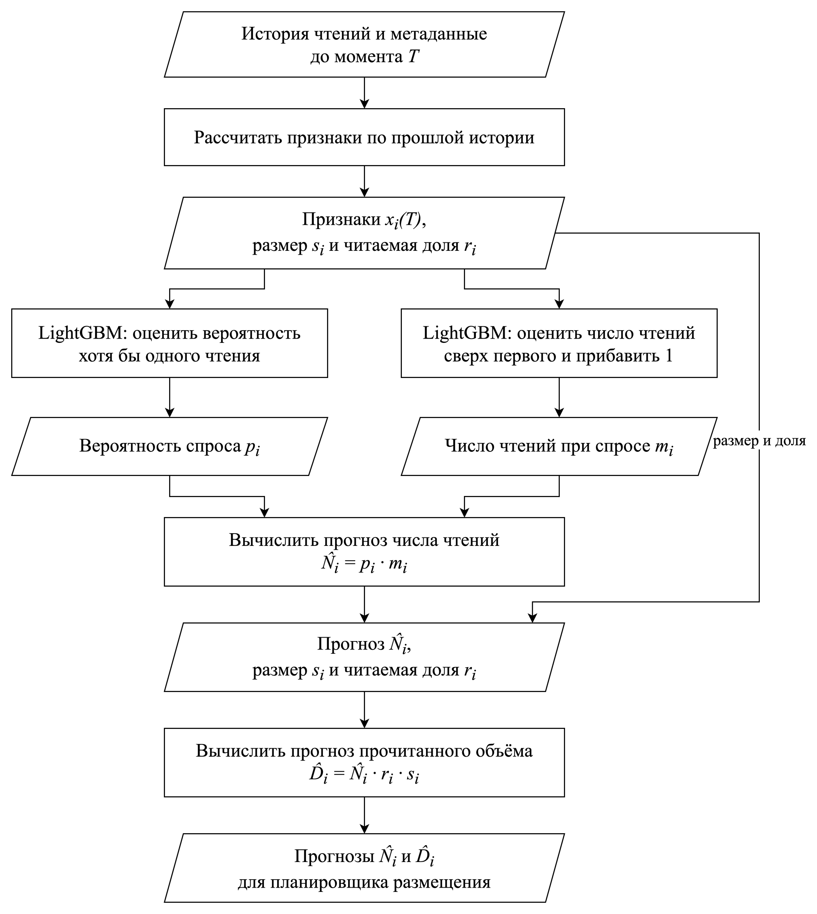
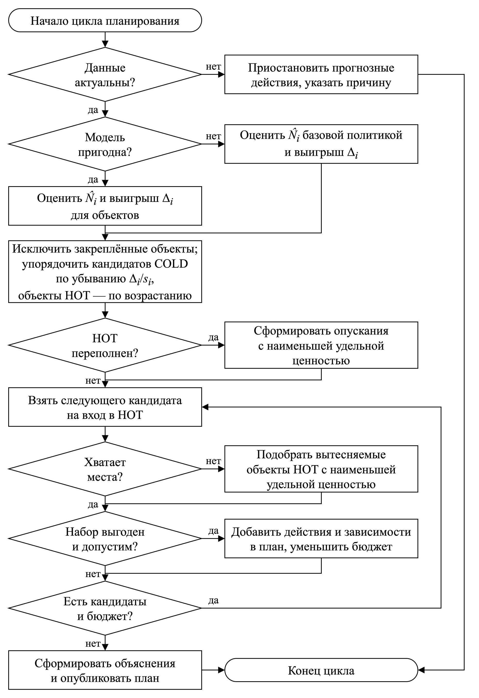
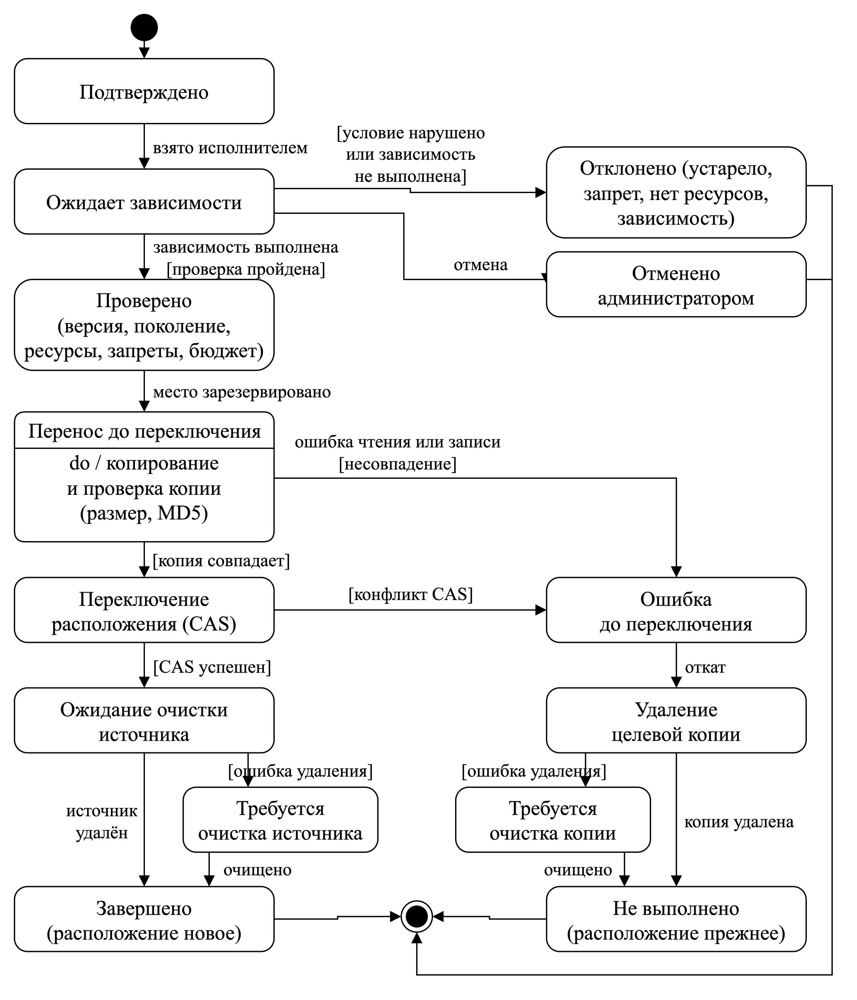
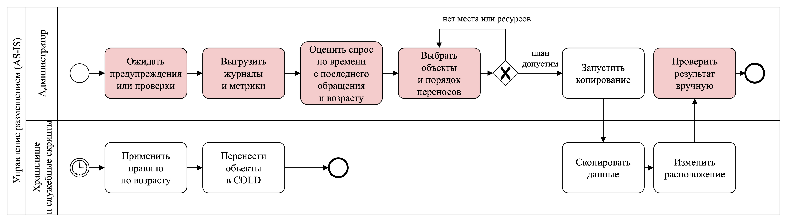
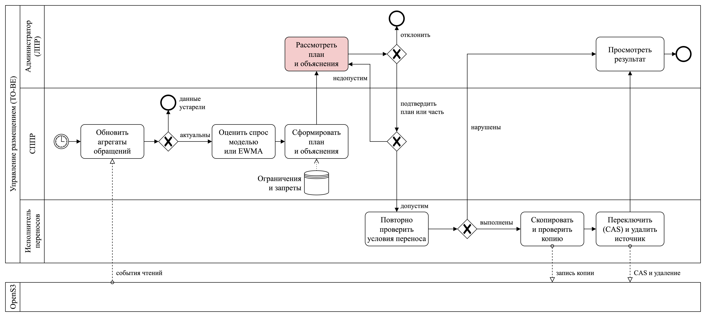
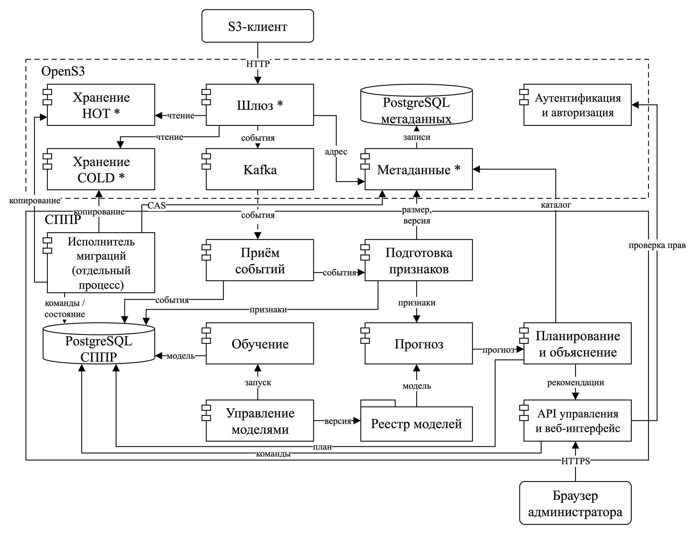
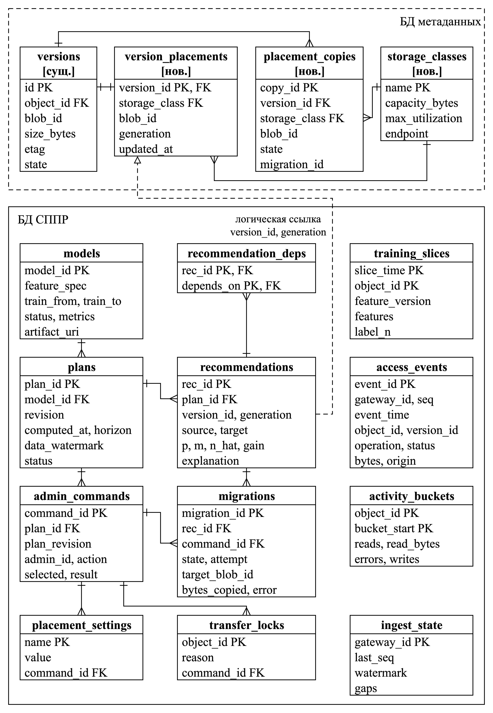

# Аннотация

В настоящей выпускной квалификационной работе представлена интеллектуальная система поддержки принятия решений о размещении объектов между классами S3-совместимого объектного хранилища. На основе метаданных объектов и истории клиентских обращений модель машинного обучения прогнозирует их будущую востребованность. Полученный прогноз используется при выборе между горячим и холодным классами хранения с учётом доступной ёмкости, характеристик производительности, модели затрат и ограничений на миграцию. Система формирует ранжированный набор рекомендаций по размещению объектов, предоставляет обоснование предложенных решений и позволяет администратору подтвердить их выполнение.

В результате работы разрабатывается СППР, интегрированная с компонентами Metadata и Storage системы OpenS3, включающая сбор и подготовку данных, прогнозирование востребованности, формирование рекомендаций и безопасное перемещение объектов между классами хранения. Эффективность предложенного подхода оценивается путём воспроизводимого проигрывания нагрузки и сравнения с эвристическими политиками размещения.

Ключевые слова: объектное хранилище, S3, система поддержки принятия решений, машинное обучение, прогнозирование востребованности, классы хранения, HOT, COLD.

# Введение

Объектные хранилища могут использовать классы накопителей с разной ёмкостью и производительностью. Хранить все данные в быстром классе не всегда целесообразно: редко читаемые объекты занимают дорогой ресурс, который мог бы обслуживать более востребованные данные. При этом спрос меняется, поэтому размещение необходимо пересматривать [1], [2].

Проблема заключается в выборе класса при неизвестной будущей востребованности объекта. Решение должно учитывать историю обращений, ёмкость классов, задержку доступа и затраты переноса. Правила жизненного цикла (англ. Lifecycle) используют возраст и другие заданные условия, а реактивные политики используют время с последнего обращения и частоту обращений. Методы машинного обучения (англ. Machine Learning, далее ML) позволяют прогнозировать спрос, но требуют дополнительных ресурсов и не гарантируют преимущества на любой нагрузке [1], [2], [3], [4].

В работе разрабатывается система поддержки принятия решений (далее СППР), которая прогнозирует востребованность по метаданным и истории обращений, а затем формирует рекомендации с учётом ресурсов и затрат. Администратор рассматривает обоснование и подтверждает перенос. Программной основой служит хранилище OpenS3, совместимое с интерфейсом Amazon Simple Storage Service (далее S3). Рассматриваются два класса хранения. Параметры затрат задаются администратором.

Целью работы является разработка интеллектуальной системы поддержки принятия решений о размещении объектов между классами хранилища OpenS3.

Объектом исследования является S3-совместимое объектное хранилище с несколькими классами хранения.

Предметом исследования являются методы прогнозирования востребованности объектов и принятия решений об их размещении между классами хранения.

Для достижения поставленной цели необходимо решить следующие задачи:

1. Проанализировать способы управления классами хранения и формализовать критерии и ограничения выбора размещения.
2. Спроектировать СППР и её взаимодействие с компонентами OpenS3.
3. Разработать сбор истории и метаданных, подготовку признаков и обучающих примеров.
4. Обучить и сравнить модели востребованности, определить порядок их обновления.
5. Разработать планировщик размещения, объяснимые рекомендации и подтверждение через программный интерфейс (англ. Application Programming Interface, далее API) и веб-интерфейс.
6. Интегрировать СППР с OpenS3, реализовать безопасные переносы и проверить сохранность данных и восстановление после сбоев.
7. Сравнить прогнозный подход с эвристическими политиками и установить условия его применимости.

# Литературный обзор

Литературный обзор охватывает исследования прогнозного размещения, документацию Amazon S3 и подход к выбору уровня хранения по нечётким правилам [1], [2], [3], [4].

Обзор Savva, Kakoulli и Herodotou [1] сопоставляет традиционные политики многоуровневого хранения с методами машинного обучения. Он показывает, что прогнозирование обращений может улучшить выбор класса, но требует дополнительных затрат на сбор данных и работу модели.

Документация Amazon S3 [2] описывает переходы между классами по заранее заданным правилам S3 Lifecycle и автоматическое перемещение по истории обращений в S3 Intelligent-Tiering. Эти механизмы служат основой для сравнения с прогнозным методом.

Motta и соавторы [3] объединяют прогнозирование обращений и выбор между классами Cold, Warm и Hot с учётом стоимости и задержки доступа. Далее в работе эта схема обозначается как методология Motta. Для OpenS3 полезна связь прогноза с решением о размещении. При этом исполнение должно учитывать ёмкость физических ресурсов и конкретные версии объектов.

Татарникова и Архипцев [4] предлагают выбирать уровень хранения с помощью нечётких правил на основе метаданных файла. Метод учитывает несколько характеристик объекта, но не выделяет прогноз его будущей востребованности как отдельный этап.

Рассмотренные источники показывают, что прогнозирование востребованности уже применяется для выбора класса хранения. В настоящей работе акцент сделан на интеграции прогноза с принятием решений в OpenS3, объяснимых рекомендациях и оценке результата по показателям хранилища в сравнении с простыми политиками размещения.

## Исследовательский раздел

Анализ предметной области и существующих решений служит основой для требований к СППР и критериев оценки её эффективности.

### Анализ предметной области

Анализ предметной области определяет понятия, ресурсы и условия, от которых зависит выбор размещения версий объектов в OpenS3. Далее рассматриваются участники процесса, объектная модель и классы хранения, признаки востребованности, способы управления размещением, ресурсные ограничения, условия безопасного перемещения и источники данных для исследования.

#### Предметная область и участники процесса

Предметной областью является управление размещением объектов в многоуровневом хранилище на основе анализа и прогнозирования клиентских обращений. В работе рассматривается самостоятельно развёрнутое OpenS3, для которого необходимо выбирать размещение объектов с учётом их ожидаемой востребованности и доступных ресурсов.

Клиенты обращаются к объектам и формируют нагрузку на хранилище, а история этих обращений служит основой для прогнозирования спроса. СППР использует прогноз для подготовки рекомендаций по размещению, которые администратор рассматривает и подтверждает с учётом заданных им ограничений.

#### Объектная модель и единица размещения

Объект S3 состоит из содержимого и метаданных и определяется бакетом и ключом [5]. При включённом версионировании перезапись создаёт новую версию с собственным идентификатором [6]. Поскольку объект может измениться между расчётом рекомендации и переносом, единицей размещения принимается конкретная версия. Изменение класса должно сохранять её содержимое и клиентский адрес.

В рассмотренной версии OpenS3 реализованы запись и чтение через шлюз [7]. Прогнозирование и управление классами хранения предстоит разработать в рамках диплома.

#### Классы хранения и характеристики ресурсов

Класс хранения объединяет ресурсы с заданными ёмкостью, производительностью и условиями доступа. В работе быстрый HOT предназначен для востребованных объектов, а более медленный и ёмкий COLD предназначен для редко читаемых. Выбор зависит от ожидаемого спроса и размера объекта.

Условия доступа различаются между системами: Amazon S3 предусматривает в том числе архивные классы [2], [8], Ceph связывает размещение с пулами и устройствами [9], [10], а удалённый уровень MinIO AIStor допускает временное восстановление вместо постоянного обратного переноса [11], [12]. Для OpenS3 принимается непосредственное чтение из обоих классов и перемещение в обоих направлениях. Характеристики этой модели приведены в Таблице @tbl:storage_classes.

: Характеристики классов хранения в исследуемом сценарии {#tbl:storage_classes}

| Характеристика | HOT | COLD |
|---|---|---|
| Ёмкость | Ограниченный быстрый ресурс | Более ёмкий ресурс |
| Производительность | Более быстрое чтение | Более медленное чтение |
| Получение данных | Непосредственное чтение | Непосредственное чтение |
| Затраты | Задаваемые параметры | Задаваемые параметры |
| Перемещение | Из COLD и обратно | Из HOT и обратно |

Различие производительности классов измеряется на стенде либо явно задаётся при моделировании. HOT и COLD обозначают относительные роли ресурсов, а не конкретные типы накопителей.

#### Востребованность и история обращений

Востребованность характеризует ожидаемое использование объекта за будущий интервал. Она не определяется только возрастом: старые данные могут регулярно читаться, а новые могут быстро терять спрос. Для прогноза используются время с последнего обращения, частота и объём чтений, а также их изменение во времени. Отсутствие истории у нового объекта не означает отсутствие спроса.

Модель может оценивать вероятность или число будущих чтений. При этом размер объекта и переданный объём учитываются раздельно, поскольку интерфейс S3 объектного хранилища поддерживает чтение диапазона [13], [14]. История должна отражать клиентский спрос по каждому объекту: внутренние переносы, обращения за метаданными и ошибки учитываются отдельно, дубли исключаются, пропуски отмечаются.

#### Способы управления размещением

При ручном размещении класс определяет администратор или приложение. Lifecycle автоматизирует статические условия перехода, например возраст и фильтры [2], [8]. Реактивные политики используют прошлые обращения: время с последнего обращения (англ. Least Recently Used, далее LRU), частоту обращений (англ. Least Frequently Used, далее LFU) или экспоненциально взвешенное скользящее среднее (англ. Exponentially Weighted Moving Average, далее EWMA) [50]. Они дают понятные базовые решения, но могут запаздывать при смене спроса.

При прогнозном управлении модель машинного обучения оценивает будущие обращения, а отдельный механизм использует этот прогноз для выбора размещения с учётом ресурсов и затрат. Такое разделение применяется в SCOPe [15], а методология Motta [3] связывает прогноз с выбором класса хранения с учётом стоимости и задержки доступа. Разделение прогнозирования и принятия решений позволяет менять модель и условия планирования независимо.

Кэш обычно хранит копию данных из основного хранилища. Здесь выбирается место хранения самого объекта, поэтому нужно оценивать задержку чтения, затраты переноса и сохранность данных. ML также не гарантирует преимущества на непредсказуемой нагрузке и расходует ресурсы. Как показывает системная оценка Baleen [16], проверять следует влияние политики на хранилище, поэтому для OpenS3 оценивается вся цепочка до выполненного размещения.

#### Ресурсные ограничения и затраты

Ограниченная ёмкость HOT связывает решения по объектам: размещение одного может потребовать переноса других в COLD. Во время миграции нужны место для обеих копий и ресурсы сети, чтения и записи, поэтому выбор размещения должен учитывать размеры объектов, свободную ёмкость и бюджет переносов.

Затраты облачных сервисов включают хранение и запросы [8], [17]. Для самостоятельно развёрнутого OpenS3 они зависят от оборудования и условий эксплуатации. В исследовании затраты задаются коэффициентами в условных единицах, а основным показателем эффективности остаётся задержка чтения при фиксированных ресурсах.

#### Согласованность и безопасное перемещение

Перемещение должно сохранять содержимое версии и доступ к данным. Ошибка копирования или изменение объекта после формирования рекомендации не должны приводить к потере данных или переносу другой версии. Поэтому при выборе решения необходимо учитывать согласованность каталога с фактическим расположением и конкурентные операции. В Amazon S3 чтение после успешной записи возвращает записанные данные [18], и перенос между классами не должен нарушать это свойство. Протокол переноса определяется при проектировании.

Изменение класса сохраняет владельца и разрешения на чтение. Рекомендации раскрывают имена и статистику объектов, поэтому доступны администраторам. Для прогноза содержимое не требуется: используются метаданные и история.

#### Источники данных и условия исследования

Собственная промышленная история OpenS3 отсутствует, поэтому рассматриваются синтетическая нагрузка и открытые трассы. Их назначение и ограничения приведены в Таблице @tbl:data_sources.

: Источники экспериментальных данных и их назначение {#tbl:data_sources}

| Источник | Применение | Ограничение |
|---|---|---|
| Синтетическая нагрузка | Размещение и безопасные переносы | Выводы относятся к заданным сценариям |
| Meta CDN / CacheLib [19], [20] | Прогнозирование спроса | Выборочные наблюдения без S3-версий и результатов запросов |
| IBM Cloud Object Storage [21] | Резервная трасса объектных операций | Один бакет, одна неделя |
| IBM Docker Registry [22], [23] | Резервная трасса изменения спроса | Обращения к реестру отличаются от S3 |
| CILES / Baleen [16], [24] | Методическая база | Блоковые обращения отличаются от объектных |

Основным источником выбрана синтетическая нагрузка с известными объектами и операциями: она позволяет воспроизводить спрос и проверять сохранность при переносах. Трасса Meta CDN используется дополнительно для изучения востребованности. Разбор её фрагмента подтвердил возможность подготовки обучающих примеров, но не эффективность модели. Отсутствие S3-версий и результатов запросов ограничивает применение этой трассы к проверке миграций.

### Анализ существующих решений

Сравнение аналогов позволяет выбрать подходы, применимые к OpenS3, и определить требования к разрабатываемой системе.

#### Анализ критериев

Сопоставляются прогноз спроса, критерии выбора, ограничения ресурсов, исполнение переносов и участие администратора. Численные результаты не сравниваются из-за различий данных и условий. Обозначение «Н/У» означает, что возможность не установлена по рассмотренным источникам, а не доказанное отсутствие функции.

#### Обзор аналогов

Рассматриваются Octopus++, методология Motta [3] и SCOPe как прогнозные подходы, а также Amazon S3 и Ceph RGW как системы управления классами. Они различаются средой и единицей размещения.

**Octopus++** прогнозирует повторные обращения и управляет переносами файлов и их копий между уровнями OctopusFS [25]. Система обновляет модель и учитывает состояние ресурсов, связывая прогноз с исполнением переносов. Для OpenS3 существенное различие состоит в единице размещения: здесь перемещается целая версия S3-объекта с сохранением её содержимого и идентификатора.

**Методология Motta** [3] связывает прогноз обращений с выбором между Cold, Warm и Hot с учётом затрат, задержки и предпочтений администратора, развивая предыдущую работу авторов [26]. Она показывает, как оценивать последствия выбора класса, однако объектный протокол переноса в рассмотренном описании не определён.

**SCOPe** использует прогноз обращений для выбора размещения и сжатия частей наборов данных при ограничениях производительности [15]. Для OpenS3 применимо разделение прогнозирования и выбора размещения, однако сжатие и переразбиение данных не входят в рассматриваемую задачу переноса целых объектов.

**Amazon S3** управляет переходами через Lifecycle и Intelligent-Tiering: первый механизм использует заданные правила, второй – наблюдаемую историю доступа [2], [8]. Для сравнения с OpenS3 интерес представляет реактивный выбор класса, но условия облачного сервиса отличаются от ограничений ёмкости самостоятельно развёрнутого хранилища.

**Ceph RGW** (англ. RADOS Gateway) связывает классы хранения с пулами данных и поддерживает Lifecycle-переходы [9], а правила размещения позволяют выбирать типы устройств [10]. Для OpenS3 полезна связь классов с физическими ресурсами. Прогнозирование и административное подтверждение рекомендаций рассматриваются отдельно.

#### Сопоставление аналогов

Сопоставление по выбранным критериям приведено в Таблице @tbl:analogues. В строке об исполнении проверяется сохранение конкретной версии при применении рекомендации.

: Сравнение аналогов управления размещением объектов {#tbl:analogues}

| Критерий | Octopus++ [25] | Motta [3], [26] | SCOPe [15] | Amazon S3 [2], [8] | Ceph RGW [9], [27] |
|---|---|---|---|---|---|
| Решение и прогноз | Прогноз повторного чтения | Прогноз обращений | Входной прогноз доступа | Lifecycle или время с последнего обращения | Настройки классов и Lifecycle |
| Критерии выбора | Скорость и баланс | Затраты и задержка | Затраты, размещение и сжатие | Условия перехода | Выбор ресурсов [10] |
| Ёмкость классов в плане | Занятость и пороги | Н/У | Н/У | Физическая ёмкость не задаётся | Общий прогнозный план Н/У |
| Общий бюджет переносов | Лимит только входа в быстрый уровень | Н/У | Н/У | Н/У | Н/У |
| Перенос в обе стороны | Перенос файловых копий | Протокол Н/У | Объектный протокол Н/У | Возврат в Intelligent-Tiering | Полный цикл Н/У |
| Версия при исполнении | Контроль S3-версии Н/У | Н/У | Управление разделом данных | План для S3-версии Н/У | Версия плана Н/У |
| Обоснование | Вероятность чтения | Затраты и задержка | Результат оптимизации | Условие политики | Правила размещения |
| Ручное решение | Не требуется | Н/У | Н/У | Не требуется | Не требуется |

Прогнозирование уже применяется для размещения данных. Для OpenS3 выбран подход, объединяющий прогноз с проверкой ресурсов, объяснением рекомендаций, подтверждением администратора и безопасным переносом версии объекта. Его преимущество предстоит проверить относительно простых политик. При непредсказуемом спросе или дорогой миграции оно может отсутствовать, поэтому необходим режим без модели.

### Требования к разрабатываемой системе

Результаты анализа предметной области и аналогов позволяют сформулировать требования к СППР. Далее определяются назначение и границы расширения OpenS3, требования к функциям, надёжности, доступу, ресурсам и жизненному циклу модели, а также измеримые критерии проверки эффективности.

#### Назначение и границы разрабатываемого расширения

СППР предоставляет администратору настройку размещения, объяснимые рекомендации и управление переносами через API и веб-интерфейс. Разработка включает необходимые изменения компонентов OpenS3.

Разрабатываемая система ограничивается одним развёртыванием, двумя классами и одним исполнителем миграций. Целиком переносится текущая версия объекта после завершения загрузки. Загрузка, полное и диапазонное чтение, получение метаданных, перезапись и удаление должны сохранять совместимость. Исторические версии, незавершённые составные загрузки, архивное восстановление и согласование нескольких исполнителей не входят в обязательный объём.

Рекомендация содержит версию объекта, исходный и целевой классы, время расчёта, горизонт прогноза и основание выбора. Изменённый состав плана требует нового подтверждения.

#### Требования к выполняемым функциям

Функциональные требования приведены в Таблице @tbl:functional_requirements.

: Функциональные требования {#tbl:functional_requirements}

| Код | Требование |
|---|---|
| F-01 | Регистрировать время, объект и версию, операцию, результат и объём клиентских обращений отдельно от миграций |
| F-02 | Получать каталог, размеры и размещение объектов, состояние классов |
| F-03 | Готовить признаки из прошлой истории с обработкой новых объектов и неполных данных |
| F-04 | Обучать, обновлять и вводить в работу модель, а при ошибке обновления сохранять пригодную модель |
| F-05 | Ранжировать рекомендации с учётом ёмкости, размеров, доступа, запретов и бюджета миграций |
| F-06 | Объяснять прогноз спроса, ожидаемый эффект и ограничения рекомендации |
| F-07 | Подтверждать весь план или допустимую часть, отклонять план, отменять ожидающие действия и приостанавливать новые переносы |
| F-08 | Перед копированием проверять версию, расположение, запреты и доступные ресурсы |
| F-09 | Переносить версии в обоих направлениях с проверкой копии до изменения расположения |
| F-10 | Сохранять состояние миграции и безопасно продолжать её после ошибки или перезапуска |
| F-11 | Хранить историю рекомендаций, действий администратора, переносов и ошибок |
| F-12 | Поддерживать базовую политику без пригодной модели и воспроизводимое сравнение политик |

Дубли событий не должны увеличивать спрос, а пропуски не должны восприниматься как отсутствие обращений [14], [28]. Выбранные переносы проверяются совместно: если для входа в HOT требуется освобождение места, подтверждение без необходимого предшествующего действия отклоняется. План не дополняется автоматически.

#### Требования к надёжности и сохранности данных

Миграция сохраняет содержимое и идентификатор версии. Расположение меняется только после проверки целевой копии. Устаревшие рекомендации отклоняются без изменения нового содержимого. Ошибка или перезапуск не должны приводить к потере данных, успешной выдаче неполного содержимого или созданию новой миграции при повторе команды.

После восстановления связи и перезапуска исполнителя состояние операции должно быть доступно в течение 60 с. Отказ модели не блокирует чтение. При недостатке актуальных данных прогнозные действия приостанавливаются. Требования проверяются для одиночных отказов. Одновременная необратимая потеря обоих классов и журнала операций не входит в сценарии проверки.

#### Требования к доступу и интерфейсу администратора

Управление размещением требует аутентификации и административных полномочий с проверкой на сервере. Действия сохраняются в журнале, секреты не используются для обучения.

Интерфейс показывает состояние классов, истории и модели, рекомендации, зависимости плана, ход переносов и причины отказов. Администратор может фильтровать рекомендации и выполнять операции из функционального требования F-07. Ожидаемый эффект отделяется от измеренного результата. API предоставляет те же операции, статус длительного действия и постраничную выдачу.

#### Требования к ресурсам, совместимости и контролю выполнения

Администратор задаёт допустимую занятость классов, бюджет копирования за интервал, параллелизм и частоту повторных переносов. При проверке ресурсов учитываются выполняемые операции и временные копии, а общий бюджет расходуется в обоих направлениях, включая неуспешные попытки. При нехватке ресурсов действие не запускается с указанием причины.

Проектные критерии приёмки приведены в Таблице @tbl:acceptance_profile и фиксируются до итогового сравнения.

: Измеримые требования к системе и условия их проверки {#tbl:acceptance_profile}

| Параметр | Требование и условия проверки |
|---|---|
| Масштаб проверки | Каталог из 10 000 текущих завершённых объектов по 1 МиБ |
| Клиентская нагрузка | 20 полных чтений в секунду при ограничении числа одновременных запросов до 8. В задержке учитываются очередь и ожидание |
| Время планирования | Полный расчёт рекомендаций занимает не более 30 с при цикле планирования каждые 300 с и указанном масштабе проверки |
| Вычислительные ресурсы | Подготовка признаков, обучение и применение модели совместно используют не более двух виртуальных процессорных ядер и 2 ГиБ памяти. Для процесса расчёта плана допускается не более 512 МиБ в пределах этой общей квоты |
| Подготовка модели | Первоначальная подготовка занимает не более 30 мин, а обновление – не более 300 с в установленной ресурсной квоте |
| Влияние на чтение | При фиксированном размещении и отключённых миграциях рост средней задержки и её 95-го перцентиля (p95) составляет не более 5 % относительно режима без расширения. Условие проверяется без обучения и при обновлении модели |
| Ответ административного API | p95 получения первой страницы из 100 рекомендаций и принятия команды составляет не более 2 с при одном администраторе и 20 запросах в минуту. Принятие команды не требует ожидания завершения миграции |

Перенос сохраняет клиентский ключ. Конфигурация и версии компонентов фиксируются для воспроизводимости. Дополнительно проверяются разные размеры объектов и диапазонное чтение.

#### Требования к жизненному циклу модели

Обучение и обновление используют доступную прошлую историю и примеры с известными метками. Параметры и расписание фиксируются до итоговой проверки. Новая модель вводится с совместимыми правилами признаков после проверки корректности. При ошибке сохраняется пригодная модель, а после установленного срока устаревания спрос оценивает базовая политика (функциональное требование F-12). Версия, актуальность и причины ошибок доступны администратору.

#### Требования к проверке эффективности и минимальному результату

Основным показателем является средняя задержка завершённого чтения от заданного момента поступления запроса до последнего байта, включая очередь и миграции. Прогноз сравнивается с настроенными политиками по возрасту, времени с последнего обращения и частоте обращений и вариантом без модели с тем же планировщиком и исполнителем. Нагрузка, начальное размещение, ресурсы, бюджет и условия подтверждения одинаковы. Параметры подбираются до итогового теста.

Преимущество признаётся для конкретного сценария и бюджета, если нижняя граница 95-процентного доверительного интервала уменьшения средней задержки составляет не менее 5 % относительно каждой базовой политики, а p95 не ухудшается более чем на 5 % относительно каждой из них. Обязательны сохранность данных, соблюдение ёмкости, бюджета и ресурсной квоты. Без внедрённых отказов неуспешные чтения не допускаются. Ошибки регистрируются отдельно. Это проектные критерии, принятые до эксперимента.

Оценка охватывает весь цикл до фактического размещения, включая ожидание подтверждения и влияние обучения на чтение. Результаты показываются по сценариям, расчётные и стендовые показатели разделяются. Качество прогноза, время адаптации, доля чтений из HOT и затраты служат дополнительными показателями. Процедура повторных прогонов фиксируется в методике.

Минимальный результат включает выполнение требований разработанной системой и воспроизводимое сравнение политик. Работоспособность и преимущество прогнозирования оцениваются отдельно. Отсутствие выигрыша требует вывода о границах метода.

### Выводы по исследовательскому разделу

Для OpenS3 выбрана модель двух классов с непосредственным чтением и переносами в обоих направлениях. Размещение определяется ожидаемым спросом и размерами объектов при ограничениях ёмкости и миграций. Перенос должен сохранять содержимое версии и клиентский доступ.

Сравнение аналогов обосновало разделение прогнозирования и выбора размещения. Разрабатываемая СППР объединяет их с объяснимыми рекомендациями, подтверждением администратора и безопасным исполнением. Требования определяют функции, ограничения ресурсов и критерии приёмки системы.

Основная проверка проводится на синтетической нагрузке, Meta CDN используется дополнительно для изучения спроса. Преимущество оценивается по задержке чтения относительно простых политик при одинаковых ресурсах. На следующем этапе предстоит выбрать модель, спроектировать систему и зафиксировать методику испытаний, которая должна выявить как условия выигрыша, так и границы применимости прогноза.

## Аналитический раздел

В аналитическом разделе требования из исследовательского раздела преобразуются в проект СППР: описываются математическое и алгоритмическое обеспечение, модели процессов управления размещением и архитектура системы, обосновывается выбор инструментов реализации. Проектируемая СППР связывает прогноз клиентского спроса с планом размещения, а применение плана требует решения администратора и безопасного изменения расположения версий.

### Математическое и алгоритмическое обеспечение

Математическая модель определяет ожидаемый эффект размещения и ограничения, а алгоритмы преобразуют оценки спроса в план переносов и безопасно применяют его.

#### Постановка задачи размещения

В каждом цикле планирования для текущей версии каждого объекта выбирается горячий класс HOT или холодный класс COLD, определённые в разделе 1.1.3 пояснительной записки, так, чтобы уменьшить ожидаемую суммарную задержку клиентских чтений за горизонт прогноза. На входе задачи прогноз спроса и метаданные хранилища о версиях объектов, их размерах, размещении и занятости классов, на выходе план переносов. Выбор ограничен ёмкостью классов, бюджетом копирования и закреплёнными объектами: объекты с запретом переноса, участвующие в выполняемом переносе или перенесённые раньше минимального интервала, сохраняют текущее размещение. Предыдущие версии в задачу не входят, но их объём учитывается в ограничениях ёмкости. Задача реализует требование F-05 из Таблицы @tbl:functional_requirements с учётом ограничений ресурсов и периода цикла планирования из раздела 1.3.5 пояснительной записки. Обозначения модели размещения приведены в Таблице @tbl:notation.

: Обозначения модели размещения {#tbl:notation}

| Обозначение | Смысл |
|---|---|
| $T$ | Момент начала цикла планирования |
| $I$ | Множество объектов, текущие версии которых зарегистрированы в хранилище в момент $T$; $i$ – номер объекта в $I$ |
| $n$ | Число объектов в множестве $I$ |
| $j$ | Класс хранения, HOT или COLD |
| $s_i$ | Размер текущей версии объекта $i$, МиБ |
| $h_i^{\mathrm{тек}}$ | Текущее размещение объекта $i$, HOT или COLD |
| $h_i$ | Размещение объекта $i$ по плану, HOT или COLD |
| $H$ | Горизонт прогноза |
| $N_i(T)$ | Фактическое число клиентских чтений объекта $i$ на интервале $[T, T+H)$, далее $N_i$ |
| $\hat N_i$ | Прогноз числа клиентских чтений объекта $i$ на интервале $[T, T+H)$ по формуле @eq:hurdle |
| $r_i$ | Средняя доля объекта $i$, читаемая за одно чтение, по истории обращений; 1 при полном чтении |
| $\hat D_i$ | Прогноз прочитанного объёма объекта $i$ за горизонт, равный $\hat N_i r_i s_i$, МиБ |
| $c_j$ | Постоянная часть времени чтения в классе $j$, мс |
| $v_j$ | Скорость передачи данных в классе $j$, МиБ/мс |
| $C_j$ | Ёмкость класса $j$, МиБ |
| $u_j$ | Допустимая доля занятости класса $j$ |
| $S^{\mathrm{tmp}}_j$ | Объём временных копий в классе $j$, МиБ |
| $S^{\mathrm{old}}_j$ | Объём предыдущих версий в классе $j$, МиБ |
| $B$ | Остаток бюджета копирования на цикл за вычетом выполняемых переносов и неуспешных попыток, МиБ |
| $P$ | Штраф за перенос 1 МиБ, мс/МиБ |
| $\Delta_{\min}$ | Минимальный выигрыш набора переносов, мс |

Параметры $c_j$ и $v_j$ измеряются на стенде, долю $u_j$ и бюджет копирования задаёт администратор, а $H$, $P$ и $\Delta_{\min}$ подбираются на данных настройки. Ёмкость ограничивает размещение с учётом временных копий и предыдущих версий, а бюджет – объём переносов за цикл, поэтому при выборе плана проверяются оба ограничения.

Основной показатель – средняя задержка завершённого чтения. Число чтений задаётся нагрузкой и от размещения не зависит, поэтому достаточно уменьшать суммарную задержку за горизонт. В работе вводится упрощение: время чтения из класса линейно зависит от объёма и задаётся формулой @eq:service_time.

$$
t_j(d) = c_j + \frac{d}{v_j},
$$ {#eq:service_time}

где $t_j(d)$ – время одного чтения объёма $d$ из класса $j$, мс;
$j$ – класс хранения, HOT или COLD;
$d$ – объём одного чтения, МиБ;
$c_j$ – постоянная часть времени чтения в классе $j$, мс;
$v_j$ – скорость передачи данных в классе $j$, МиБ/мс.

Второе слагаемое равно времени передачи данных. Два слагаемых нужны, так как объекты имеют разный размер, а интерфейс S3 объектного хранилища допускает чтение диапазона [13]. Сумма времени чтения @eq:service_time по $\hat N_i$ ожидаемым чтениям общим объёмом $\hat D_i$ даёт ожидаемую задержку объекта в классе по формуле @eq:latency.

$$
L_i^j = \hat N_i \, c_j + \frac{\hat D_i}{v_j},
$$ {#eq:latency}

где $L_i^j$ – ожидаемая суммарная задержка чтений объекта $i$ в классе $j$ за горизонт, мс;
$\hat N_i$ – прогноз числа клиентских чтений объекта $i$ за горизонт;
$\hat D_i$ – прогноз прочитанного объёма объекта $i$ за горизонт, МиБ.

Выигрыш от размещения объекта в HOT равен разности его задержек в COLD и HOT по формуле @eq:latency и вычисляется по формуле @eq:gain.

$$
\Delta_i = L_i^{\mathrm{COLD}} - L_i^{\mathrm{HOT}},
$$ {#eq:gain}

где $\Delta_i$ – уменьшение суммарной задержки чтений объекта $i$ за горизонт при размещении в HOT, мс.

Предполагается, что HOT не медленнее COLD, поэтому $\Delta_i \ge 0$. Из-за линейной модели времени чтения формула не учитывает очередь, загрузку класса и время переноса: она служит для ранжирования объектов, а влияние этих факторов входит в измеряемую задержку.

Задача цикла записывается в форме задачи о ранце [29], в которой вместимостью служит ёмкость HOT, весами – размеры $s_i$, а ценностями – выигрыши $\Delta_i$. Требуется выбрать план $h$ с наибольшим чистым выигрышем по формуле @eq:objective.

$$
G(h) = \sum_{i \in I_{\mathrm{HOT}}} \Delta_i - P \sum_{i \in I_{\mathrm{пер}}} s_i,
$$ {#eq:objective}

где $G(h)$ – чистый выигрыш плана за горизонт, мс;
$h$ – план, то есть размещения $h_i$ всех объектов из $I$;
$I_{\mathrm{HOT}}$ – множество объектов, размещённых по плану в HOT;
$P$ – штраф за перенос 1 МиБ, мс/МиБ;
$I_{\mathrm{пер}}$ – множество переносимых объектов, у которых $h_i \ne h_i^{\mathrm{тек}}$.

Вводимый в работе штраф $P$ переводит объём копирования в миллисекунды задержки из-за конкуренции копирования с чтениями. Ёмкость каждого класса с учётом временных копий и предыдущих версий ограничена условием @eq:capacity.

$$
\sum_{i \in I_j} s_i + S^{\mathrm{tmp}}_j + S^{\mathrm{old}}_j \le u_j C_j,
$$ {#eq:capacity}

где $I_j$ – множество объектов, размещённых по плану в классе $j$;
$S^{\mathrm{tmp}}_j$ – объём временных копий в классе $j$: целевых копий выполняемых переносов, источников до удаления и неудалённых копий, МиБ;
$S^{\mathrm{old}}_j$ – объём предыдущих версий в классе $j$, МиБ;
$u_j$ – допустимая доля занятости класса $j$;
$C_j$ – ёмкость класса $j$, МиБ.

Объём копирования за цикл ограничен бюджетом из раздела 1.3.5 пояснительной записки по условию @eq:budget.

$$
\sum_{i \in I_{\mathrm{пер}}} s_i \le B,
$$ {#eq:budget}

где $B$ – остаток бюджета копирования на цикл, МиБ.

Вводимый в работе порог $\Delta_{\min}$ в целевую функцию не входит: набор переносов принимается, только если его выигрыш превышает штраф не менее чем на $\Delta_{\min}$, что вместе с закреплением исключает постоянное переключение объектов. Ограничение бюджета делает задачу вариантом задачи о ранце с дополнительным ограничением, который в общем случае NP-труден [29], поэтому для 10 000 объектов используется жадный алгоритм, а точное решение служит только для его проверки на малых задачах.

#### Модель прогнозирования востребованности

Выигрыш @eq:gain пропорционален числу чтений, а на коротком горизонте у большинства объектов чтений нет. Поэтому используется двухэтапная модель с барьером (англ. Hurdle Model) [30]: классификатор оценивает вероятность хотя бы одного чтения $p_i$, регрессор – число чтений $m_i$ при возникшем спросе. Преобразование истории в прогноз показано на Рисунке @fig:forecast_model в нотации схемы данных по ГОСТ 19.701-90 [49] (разделы 2.1, 3.1–3.3). Параллелограммы обозначают данные, прямоугольники – операции обработки, сплошные стрелки – потоки данных.

{#fig:forecast_model width=14.5cm}

История до момента $T$ преобразуется в признаки $x_i(T)$ из Таблицы @tbl:features. Они поступают в обе модели, а их выходы объединяются в прогноз числа чтений; вместе с размером объекта $s_i$ и средней читаемой долей $r_i$ он определяет прогноз объёма $\hat D_i$. Эти величины передаются планировщику.

Обе части реализуются библиотекой LightGBM, использующей градиентный бустинг деревьев решений (англ. Gradient Boosting Decision Tree, далее GBDT) [31], [32], [44]. Для классификатора выбирается функция потерь `binary`, для регрессора – `poisson`; стандартные алгоритмы обучения и преобразования выходов определены в документации библиотеки [32]. Классификатор обучается на всех примерах с меткой наличия чтения и выдаёт вероятность $p_i = \Pr(N_i > 0 \mid x_i)$. Регрессор обучается только на примерах с $N_i > 0$ и прогнозирует $y_i = N_i - 1$, то есть число чтений сверх первого. Условное число чтений восстанавливается по формуле @eq:count.

$$
m_i = 1 + \hat y_i,
$$ {#eq:count}

где $m_i$ – прогноз числа чтений объекта $i$ при возникшем спросе;
$\hat y_i$ – неотрицательный прогноз регрессора для числа чтений сверх первого.

Сдвиг на единицу сохраняет нижнюю границу одного чтения при возникшем спросе и позволяет использовать стандартную пуассоновскую функцию потерь [32], [33]. В отличие от исходной модели с барьером [30], здесь применяется сдвинутая, а не усечённая в нуле положительная часть. Итоговый прогноз задаётся формулой @eq:hurdle.

$$
\hat N_i = p_i m_i,
$$ {#eq:hurdle}

где $\hat N_i$ – прогноз числа клиентских чтений объекта $i$ за горизонт;
$p_i$ – прогноз вероятности хотя бы одного чтения объекта $i$ за горизонт.

Для сравнения используются базовые оценки из раздела 1.1.5 пояснительной записки: частота, возраст, время с последнего чтения и EWMA [50]. Последнее сглаживает частоту, уменьшая вес старых наблюдений. Частота и EWMA пересчитываются в ожидаемое число чтений за $H$, а возраст и давность преобразуются монотонной функцией, подобранной на периоде настройки. Базовые оценки используют тот же интерфейс прогноза, планировщик и исполнитель; EWMA также обеспечивает работу без пригодной модели по требованию F-12 из Таблицы @tbl:functional_requirements. Так сравнение отделяет вклад прогноза от алгоритма размещения.

GBDT выбран для табличных признаков с учётом результатов сравнения деревьев и нейронных сетей [34]; применимость к нашей нагрузке проверяется экспериментом. Однократный всплеск без предвестников модель не предсказывает, а новый объект оценивает грубо. При равномерном независимом выборе объектов прошлые обращения не дают устойчивого преимущества в прогнозе; систематический выигрыш в таком сценарии требует проверки утечки будущих данных и равенства условий сравнения.

#### Обработка данных и формирование обучающих примеров

Признаки и метки строятся по истории клиентских чтений каждого объекта, подготовленной по правилам раздела 1.1.4 пояснительной записки. Текущий класс и задержка чтения в признаки не входят, так как отражают прежнее решение о размещении, а не спрос: иначе модель связала бы медленные чтения из COLD с низкой востребованностью и закрепляла бы объекты в COLD.

По агрегатам событий строятся признаки с версией правил расчёта, состав которых приведён в Таблице @tbl:features.

: Признаки модели прогнозирования {#tbl:features}

| Группа | Признаки |
|---|---|
| Объект | Логарифм размера, возраст версии, число перезаписей за окно |
| Последние чтения | Время с последнего и предпоследнего чтения |
| Частота и сглаживание | Чтения за окна длительностью от минут до суток, EWMA с несколькими периодами полураспада |
| Динамика и повторяемость | Отношение частоты за короткое окно к частоте за длинное, чтения за интервал длительностью $H$, сдвинутый на сутки назад |
| Объём и бакет | Средняя доля объекта за чтение, чтения бакета за окно, доля активных объектов бакета |
| Полнота | Наблюдаемая длительность истории, ограниченная наибольшим окном |

Окна разной длины различают устойчивую популярность и рост, суточный сдвиг нужен для периодического спроса, а признак полноты отделяет отсутствие данных от отсутствия спроса. Для среза в момент $T$ признаки используют только события строго раньше $T$, а метка $N_i(T)$ равна числу клиентских чтений на следующем интервале $[T, T + H)$. Будущие события используются только для метки, чтобы исключить утечку данных [35], [36].

Из-за задержек доставки в момент обучения $T'$ история полна лишь до границы $W(T')$. Пример допускается к обучению, когда весь интервал метки завершился не позже этой границы и не содержит пропусков. До этого он ожидает следующих обновлений; примеры с неполной историей исключаются. Если граница полноты отстаёт от текущего момента больше допустимого, прогнозные действия приостанавливаются по требованию раздела 1.3.3 пояснительной записки. Срез сохраняется вместе с размером версии, поэтому удалённые позже объекты из выборки не выпадают. Признаки для обучения и применения рассчитывает один компонент.

#### Обучение, проверка и ввод модели в работу

Основным источником обучающих данных предусматривается синтетическая история обращений; открытые трассы и их ограничения рассмотрены в разделе 1.1.8 пояснительной записки и Таблице @tbl:data_sources. Генератор должен сформировать каталог объектов и последовательности чтений со стабильной, меняющейся и периодической популярностью, всплесками и равномерным независимым спросом. Для каждого среза сохраняются признаки из прошлой истории, число чтений за будущий горизонт и метка наличия чтения. В выборку входят и объекты с нулевым спросом; скрытые параметры генератора не используются как признаки.

Полная обучающая выборка на этапе проектирования не подготовлена. Meta CDN рассматривается дополнительно для проверки прогноза по наблюдаемым обращениям: имеющийся разбор короткого фрагмента подтверждает только возможность разделить признаки и метки, а не обучение модели. Выбор полного временного диапазона, очистка данных и параметры генератора должны быть зафиксированы в технологическом разделе до итоговой проверки.

История делится по времени на периоды обучения и подбора гиперпараметров, а итоговое сравнение политик идёт на последующем периоде. Классификатор оценивается площадью под кривой точности и полноты (англ. Precision-Recall Area Under Curve, далее PR-AUC), которая проверяет различение читаемых объектов при преобладании нулевых меток [37], и оценкой Брайера, проверяющей калибровку [38]. Пригодность прогноза к размещению проверяет вводимая в работе доля покрытия будущих чтений по формуле @eq:capture.

$$
\mathrm{Cov}_K = \frac{\sum_{i \in \mathrm{top}_K} N_i}{\sum_{i \in I} N_i},
$$ {#eq:capture}

где $\mathrm{Cov}_K$ – доля фактических чтений за горизонт, пришедшаяся на $K$ объектов с наибольшим прогнозом;
$K$ – число отбираемых объектов, которое при одинаковом размере объектов равно вместимости HOT;
$\mathrm{top}_K$ – множество из $K$ объектов с наибольшим $\hat N_i$.

Высокая PR-AUC при низком покрытии означает, что модель отличает читаемые объекты, но плохо выбирает самые востребованные.

Модель обновляется по расписанию на недавней истории. Перед вводом проверяются версия правил признаков, конечность прогнозов, время обучения по требованию к подготовке модели из раздела 1.3.5 пояснительной записки и совместимость обученной модели с моделью, загруженной для применения. При неудаче сохраняется прежняя модель, а при превышении её предельного возраста спрос оценивает базовая политика (функциональное требование F-12).

#### Алгоритм формирования плана размещения

Алгоритм максимизирует выигрыш по формуле @eq:objective при ограничениях ёмкости @eq:capacity и бюджета @eq:budget жадным выбором после проверки актуальности данных и пригодности модели по правилам разделов 2.1.3 и 2.1.4 пояснительной записки. Если занятость HOT уже в начале цикла превышает допустимую по условию @eq:capacity, сначала планируется перенос части объектов HOT в COLD. Затем незакреплённые объекты COLD рассматриваются по убыванию выигрыша на единицу размера $\Delta_i / s_i$. Если для очередного объекта в HOT не хватает места, для него подбираются объекты HOT с наименьшим выигрышем на единицу размера, которые придётся вытеснить в COLD. Такая замена включается в план, если выигрыш объекта превышает суммарный выигрыш вытесняемых объектов, штраф за перенос и порог $\Delta_{\min}$, а остатка бюджета и места в COLD достаточно. Перенос объекта в HOT начинается только после того, как вытесняемые объекты перенесены в COLD и их копии в HOT удалены, поэтому действия плана связаны зависимостями.

При равных размерах объектов и $\Delta_{\min} = 0$ жадный алгоритм даёт точное решение. При заданном числе замен наибольший выигрыш получается, если перенести в HOT объекты COLD с наибольшим $\Delta_i$, а в COLD – объекты HOT с наименьшим $\Delta_i$. Каждая следующая такая замена выгодна не больше предыдущей, поэтому алгоритм останавливается на первой невыгодной замене и получает план с наибольшим чистым выигрышем @eq:objective. Для разных размеров он является эвристикой [29], [39] и проверяется точным решением на малых выборках.

Сложность алгоритма $O(n \log n)$ определяется сортировкой, где $n$ – число объектов в множестве $I$ из Таблицы @tbl:notation. При одинаковом размере объектов $s$ каждая замена требует двух переносов, поэтому смена востребованного набора из $K$ объектов требует не менее $2Ks / B$ циклов, что ограничивает скорость реакции на изменение спроса.

Блок-схема алгоритма приведена на Рисунке @fig:planner_algorithm.

{#fig:planner_algorithm width=14.4cm}

Условие «Набор выгоден и допустим?» объединяет проверки выигрыша, бюджета и места в COLD: отклонённый набор в план не добавляется, и перебор продолжается, пока есть кандидаты и бюджет.

#### Объяснение рекомендаций

Объяснение нужно администратору как лицу, принимающему решение (далее ЛПР), для решения по плану в пределах функционального требования F-07. Оно строится из величин планировщика и включает три группы сведений: действие и прогноз (объект и версия, исходный и целевой классы, время расчёта, горизонт, версия модели, $p_i$, $m_i$, $\hat N_i$ и оценка EWMA для сравнения с простой оценкой), ожидаемый эффект и основания (расчётное изменение суммарной задержки за горизонт, время с последнего чтения, частоты по окнам и динамика с процентилем в каталоге), ресурсы и зависимости (занятость класса до и после переноса, объём копирования, остаток бюджета, зависимости, запреты и минимальный интервал переноса).

Если перенос объекта А в HOT требует вытеснить объект Б в COLD, подтверждение только переноса А отклоняется с указанием недостающего действия, а запрет переноса Б приводит к новой ревизии плана. Поэтому часть плана подтверждается только вместе с действиями, от которых она зависит.

#### Протокол безопасного переноса

Протокол обеспечивает функциональные требования F-08–F-10 и требования раздела 1.3.3 пояснительной записки четырьмя инвариантами.

1. У версии всегда ровно одна действующая запись расположения, и чтение использует только её.
2. Расположение меняется только после проверки размера и контрольной суммы MD5 целевой копии [51].
3. Переключение выполняется операцией сравнения с обменом (англ. Compare-And-Swap, далее CAS) [40]: только если версия текущая, а поколение записи и исходный класс совпадают с проверенными.
4. Источник удаляется после паузы, превышающей предельное время чтения в шлюзе.

Поколение записи показывает, менялось ли расположение после проверки, а пауза позволяет завершиться чтениям, начатым по прежнему расположению. Перед действием исполнитель повторно проверяет версию, поколение, запреты, ресурсы и бюджет, резервирует место записью временной копии и сверяет размер и MD5 копии с источником, а не с ETag, который при составной загрузке не является суммой объекта [41].

Состояния миграции показаны на Рисунке @fig:migration_states в нотации диаграммы состояний унифицированного языка моделирования (англ. Unified Modeling Language, далее UML) [42].

{#fig:migration_states width=14cm}

Основной путь ведёт от состояния «Подтверждено» через «Ожидает зависимости», «Проверено», «Перенос до переключения», «Переключение расположения (CAS)» и «Ожидание очистки источника» к состоянию «Завершено». Отмена переводит действие в состояние «Отменено администратором» только до проверки исполнителем, а пауза прекращает выдачу новых действий, не прерывая начатые. Границей отказов служит успешный CAS: до него ошибка, несовпадение копии или конфликт CAS ведут в состояние «Ошибка до переключения» и далее в состояние «Не выполнено» при прежнем расположении, а после него завершается очистка источника. Повтор команды не создаёт новой миграции, а после перезапуска исполнитель по поколению записи определяет, было ли переключение, и продолжает перенос с нужного шага.

### Модели процессов

У процесса несколько исполнителей, поэтому исходный процесс AS-IS и проектируемый TO-BE сравниваются в нотации моделирования бизнес-процессов (англ. Business Process Model and Notation, далее BPMN) [43]. Процесс показан пулом с дорожками исполнителей, сплошные стрелки обозначают последовательность действий, пунктирные – сообщения между пулами, точечная линия – использование хранимых данных. Ромб с крестом обозначает исключающий шлюз, круг с часами – таймер, тонкий круг – начало, жирный круг – завершение, цветом выделены ручные операции и ожидание.

#### Исходный процесс управления размещением

AS-IS описывает рассматриваемый в разделе 1.1.5 пояснительной записки сценарий управления размещением, а не измеренную эксплуатацию конкретной организации. Класс объекта выбирает администратор по журналам обращений, наподобие журналов серверного доступа Amazon S3 [28]: он выгружает журналы, оценивает спрос, выбирает объекты, запускает копирование и вручную проверяет результат. Независимо от него статическое правило по возрасту, аналогичное рассмотренному в разделе 1.1.5 пояснительной записки Amazon S3 Lifecycle [8], по таймеру переводит старые объекты в COLD. Модель в нотации BPMN приведена на Рисунке @fig:bpmn_asis.

{#fig:bpmn_asis width=16.9cm}

Ручная работа сосредоточена на дорожке администратора: цветом выделены ожидание предупреждения, выгрузка журналов, оценка спроса, выбор объектов и проверка результата. Хранилище меняет расположение только по команде администратора, а правило по возрасту работает отдельной ветвью и спрос не учитывает. Поэтому процесс реагирует на уже возникшую проблему, не возвращает востребованные объекты и не проверяет версию и копию.

#### Проектируемый процесс

Модель TO-BE в нотации BPMN на Рисунке @fig:bpmn_tobe показывает цикл планирования, в котором СППР готовит план, администратор принимает решение, а исполнитель применяет подтверждённые действия. Отмена, пауза и отказы выполняются по протоколу раздела 2.1.7 пояснительной записки и на рисунке не показаны.

{#fig:bpmn_tobe width=16.9cm}

1. По таймеру цикла СППР обновляет агрегаты клиентских чтений. События должен публиковать шлюз OpenS3 [7] после доработки по разделу 2.3.1 пояснительной записки; подготовка данных описана в разделе 2.1.3.
2. Если данные устарели, цикл завершается без плана. Иначе СППР оценивает спрос моделью или, при её непригодности, базовой политикой EWMA и формирует план с объяснениями с учётом ограничений и запретов администратора.
3. Администратор решает, применять ли план: подтверждает его целиком или частично либо отклоняет. Ожидание решения выделено цветом, так как оно отделяет расчёт плана от его применения.
4. СППР проверяет зависимости выбора: недопустимый выбор возвращается администратору, допустимый передаётся исполнителю.
5. Исполнитель повторно проверяет условия переноса. При нарушении перенос отклоняется без изменения данных, иначе версия переносится по протоколу раздела 2.1.7 пояснительной записки и читается из целевого класса.
6. Администратор просматривает результат.

#### Сравнение процессов

Изменения сведены в Таблице @tbl:process_compare. Процессы не измерялись, поэтому сравнение качественное.

: Сравнение исходного и проектируемого процессов {#tbl:process_compare}

| Аспект | AS-IS | TO-BE |
|---|---|---|
| Запуск | Предупреждение или проверка | Таймер цикла планирования |
| Оценка спроса | Вручную по времени с последнего обращения и возрасту | Прогноз, при сбое базовая политика |
| Учёт ресурсов | Вручную, повтор выбора | Ёмкость, бюджет и запреты в плане |
| Роль администратора | Анализ, выбор, запуск, проверка | Ограничения и решение по плану |
| Направление | Правило только в COLD | Оба направления в одном плане |
| Проверка данных | Вручную после переноса | По протоколу безопасного переноса |
| Журнал | Не предусмотрен | Рекомендации, решения, миграции |

Системе передаются выгрузка журналов, оценка спроса и проверка копий, а у администратора остаются ограничения, решение и контроль результата. Добавляется ожидание подтверждения, и его влияние учитывается в эксперименте.

### Архитектура системы

Расчёт рекомендаций отделяется от клиентского чтения, а переносы выполняет отдельный процесс. Подраздел определяет ответственность компонентов OpenS3 и СППР, хранение их данных и согласование состояния с компонентом метаданных.

#### Изменения компонентов OpenS3

Для СППР в рассмотренной версии OpenS3 [7] изменяются три компонента. Компонент метаданных (Metadata) дополняется классами и расположением версий с условным переключением CAS и учётом временных копий. Компонент хранения (Storage) получает необязательный идентификатор сохраняемой копии при записи и второй экземпляр на отдельном томе. Шлюз (Gateway) выбирает экземпляр хранения по классу, публикует события и обеспечивает диапазонное чтение. Компоненты аутентификации и авторизации (Auth и AuthZ) сохраняют свои функции. Новая версия записывается в COLD, что исключает переполнение HOT вне плана, но новый популярный объект читается из COLD до ближайшего плана.

#### Компонентная модель

Из модели TO-BE выведены компоненты приёма событий (Ingestor), подготовки признаков (Feature Builder), прогнозирования (Predictor), планирования (Planner) и объяснения рекомендаций (Explainer). Управление моделями (Model Manager) запускает обучение (Trainer) и ведёт реестр; административный API с веб-интерфейсом принимает решения ЛПР, исполнитель миграций (Migration Executor) применяет подтверждённые действия. Их связи показаны на Рисунке @fig:components в нотации диаграммы компонентов UML [42].

Границы на диаграмме разделяют OpenS3 и СППР, стрелки обозначают обращения между компонентами и подписаны передаваемыми данными или операцией. Пересечения линий без точки не являются соединениями. Компоненты, изменяемые для интеграции, отмечены звёздочкой.

Клиентское чтение проходит через компоненты шлюза, метаданных и хранения, а приём событий работает асинхронно через Kafka. Административный API проверяет полномочия через компоненты аутентификации и авторизации и сохраняет команды в базе СППР.

{#fig:components width=16.9cm}

Исполнитель в отдельном процессе получает подтверждённые команды, записывает копии и меняет расположение через компонент метаданных; отказ расчёта рекомендаций не прерывает начатые переносы. Подготовка признаков, обучение и прогнозирование используют общую ресурсную квоту из раздела 1.3.5 пояснительной записки, поэтому влияние обучения на чтения входит в измерения.

#### Модель данных

Назначение таблиц приведено в Таблице @tbl:data_tables, а поля и связи показаны на Рисунке @fig:er в Приложении А. Таблица *versions* существует в компоненте метаданных; *storage_classes*, *version_placements* и *placement_copies* добавляются в его базу. Остальные таблицы относятся к базе СППР.

: Назначение таблиц модели данных {#tbl:data_tables}

| Таблица | Назначение |
|---|---|
| *versions* | Существующий каталог версий объектов |
| *storage_classes* | Классы хранения, ёмкость и адреса экземпляров |
| *version_placements* | Действующее расположение и поколение записи версии |
| *placement_copies* | Временные копии и состояние их очистки |
| *access_events* | События клиентских обращений и технических операций |
| *activity_buckets* | Агрегаты активности по временным интервалам |
| *ingest_state* | Позиция приёма событий, граница полноты и пропуски |
| *training_slices* | Признаки и метки обучающих примеров |
| *models* | Версии моделей, правила признаков и результаты проверок |
| *plans* | Ревизии планов, горизонт и состояние данных |
| *recommendations* | Предлагаемые переносы, прогнозы и объяснения |
| *recommendation_deps* | Зависимости между действиями плана |
| *admin_commands* | Решения администратора и результаты их обработки |
| *migrations* | Состояния, попытки и ошибки исполнения переносов |
| *placement_settings* | Параметры размещения, заданные администратором |
| *transfer_locks* | Запреты переноса объектов и их основания |

Таблица *version_placements* хранит одну действующую запись на версию с полем *generation* для CAS, а *placement_copies* учитывает место временных копий. Компонент метаданных остаётся единственным источником истины о расположении. База СППР хранит ссылки на версию и поколение, поэтому расхождения выявляет повторная проверка перед переносом. Данные, необходимые для клиентского чтения, отделены от данных расчёта рекомендаций и журнала управления.

#### Анализ архитектуры

Узкие места, точки отказа и принятые решения сведены в Таблице @tbl:arch_analysis.

: Анализ архитектуры {#tbl:arch_analysis}

| Место | Риск | Решение |
|---|---|---|
| Шлюз и компонент метаданных | Рост задержки чтения | Асинхронная очередь событий, проверка порога 5 % |
| Kafka | Потеря событий | Пропуск виден по номерам, прогноз приостанавливается |
| Сервис СППР | Единственный экземпляр | Отказ останавливает планы и управление, но не чтение |
| Исполнитель | Единственный экземпляр | Восстановление по сохранённому состоянию |
| Команды исполнителю | Неподтверждённое действие | Команды пишет только административный API, исполнитель перепроверяет условия |
| Хранение COLD | Копирование мешает чтению | Бюджет и штраф $P$ |
| Две базы данных | Нет общей транзакции | Компонент метаданных как источник истины, CAS |

Узким местом остаётся применение плана: если спрос меняется быстрее, чем позволяет бюджет копирования $B$ в МиБ за цикл (Таблица @tbl:notation), даже точный прогноз не уменьшит задержку. Эта граница проверяется прогонами с разными значениями бюджета.

#### Соответствие требованиям

Связь функциональных требований из Таблицы @tbl:functional_requirements с проектом приведена в Таблице @tbl:traceability.

: Соответствие требований проектным решениям {#tbl:traceability}

| Требование | Компонент и проектное решение |
|---|---|
| F-01 | Шлюз и приём событий: события с номерами (раздел 2.1.3) |
| F-02 | Компонент метаданных: классы, расположение, занятость с копиями (Рисунок @fig:er) |
| F-03 | Подготовка признаков: окна до $T$, контроль пропусков (раздел 2.1.3) |
| F-04 | Управление моделями и обучение: проверки ввода и сохранение модели (раздел 2.1.4) |
| F-05 | Планировщик: выигрыш @eq:objective при ограничениях @eq:capacity и @eq:budget, жадный алгоритм (Рисунок @fig:planner_algorithm) |
| F-06 | Объяснение рекомендаций: величины планировщика (раздел 2.1.6) |
| F-07 | Административный API и исполнитель: ревизии плана, отмена и пауза (Рисунок @fig:bpmn_tobe) |
| F-08–F-10 | Исполнитель и компонент метаданных: повторная проверка, проверка копии до CAS, восстановление (Рисунок @fig:migration_states) |
| F-11 | База СППР: журнал рекомендаций, команд и миграций |
| F-12 | Прогнозирование: EWMA при непригодной модели, единый планировщик для сравнения |

Приём событий и подготовка признаков обеспечивают входные данные, прогнозирование и планирование рассчитывают рекомендации, административный API и исполнитель обеспечивают их контролируемое применение. Выполнение требований предстоит подтвердить реализацией и испытаниями.

### Обоснование инструментов реализации

Язык и средства взаимодействия выбираются с учётом расширяемой системы: сервисы рассмотренной версии OpenS3 написаны на Go и используют gRPC [7]. Для СППР и исполнителя выбран Go, что позволяет использовать тот же способ конфигурации и готовые клиенты. Отдельный сервис на Python упростил бы прямой вызов библиотек машинного обучения, но добавил бы сетевой интерфейс прогнозирования и отдельный процесс в эксплуатации. Поэтому Python используется для подготовки данных и обучения, а расчёт рекомендаций выполняется в Go. Это разделение требует проверки совпадения признаков и прогнозов двух сред.

Для обучения рассмотрены LightGBM, XGBoost и CatBoost. Все три предоставляют средства бустинга и пуассоновской регрессии [32], [52], [53]. Выбран LightGBM: он поддерживает обе функции потерь двухэтапной модели, гистограммное построение деревьев [44] и экспорт, читаемый библиотекой leaves на Go [45]. XGBoost также является допустимой альтернативой, включая поддержку в leaves; выбор LightGBM не означает доказанного превосходства над ним. CatBoost потребовал бы отдельного пути применения модели вместо выбранного загрузчика. Ограничения LightGBM для проекта – подбор параметров при преобладании нулевых меток, контроль памяти и проверка калибровки; качество и соблюдение квоты проверяются на подготовленной выборке.

Для применения модели сравниваются leaves, отдельный сервис Python и ONNX Runtime. Библиотека leaves читает модели LightGBM и выполняет прогнозирование непосредственно в Go [45], поэтому не требуется сетевой вызов или нативная среда ONNX Runtime [48]. Цена этого решения – ограниченная совместимость загрузчика с форматами и преобразованиями выходов. Перед вводом каждой модели проверяется совпадение конечных вероятностей и числа чтений в Python и Go; успешная загрузка файла сама по себе такую совместимость не подтверждает.

Для хранения состояния выбрана PostgreSQL, уже используемая в OpenS3 [7]. Транзакции и блокировки нужны для согласованной записи команд, зависимостей и состояний миграций [46]. MySQL с InnoDB также поддерживает транзакции и блокировки строк [54], но его добавление потребовало бы сопровождать ещё одну СУБД без выявленного требования к замене существующей. Ограничения PostgreSQL здесь связаны с ростом журнала событий и конкуренцией записей: при реализации нужны индексы, агрегаты и правила хранения истории. Транзакция базы СППР не охватывает базу метаданных, поэтому сохраняются CAS и повторные проверки исполнителя.

Для асинхронного приёма событий выбрана Kafka, уже входящая в инфраструктуру OpenS3 [7], [47]. Альтернатива – RabbitMQ Streams, также допускающий повторное чтение сохранённых сообщений [55]; переход к нему добавил бы новый брокер и изменил существующий путь публикации. Синхронная передача непосредственно в базу СППР связала бы доступность записи события с клиентским запросом. Ограничения выбранного пути – повторная доставка, задержки и конечный срок хранения сообщений. Поэтому нужны дедупликация, контроль пропусков и сохранение истории в PostgreSQL; наличие брокера само по себе не гарантирует полноту обучающих данных.

### Выводы по аналитическому разделу

Математическое и алгоритмическое обеспечение связывает прогноз числа чтений с ожидаемым уменьшением задержки. Планировщик решает вариант задачи о ранце с ограничениями ёмкости, бюджета и закреплениями; базовые оценки используют тот же алгоритм. Полную обучающую выборку предстоит подготовить, а пригодность двухэтапной модели и эвристики для объектов разного размера – проверить экспериментом.

Сопоставление AS-IS и TO-BE определило обязанности исполнителей: системе передаются расчёт спроса, выбор размещения и проверка переносов, администратору остаются ограничения, подтверждение и контроль. Ожидание решения входит в цикл проверки эффективности. Сравнение качественное и не подтверждает измеренного сокращения затрат.

Архитектура отделяет расчёт рекомендаций от чтения и исполнения переносов. Модель данных разделяет действующее расположение в компоненте метаданных и журнал управления в базе СППР. Без общей транзакции согласование обеспечивают поколение записи, CAS и повторная проверка. Основные ограничения – единственные экземпляры сервиса и исполнителя, конкуренция за ресурсы и бюджет миграций.

Инструменты выбраны по требованиям к модели и совместимости с OpenS3 с учётом альтернатив и ограничений. В технологическом разделе предстоит реализовать компоненты, подготовить данные, проверить совпадение прогнозов Python и Go, подобрать параметры и сравнить политики по задержке чтения при одинаковых ресурсах.

# Список использованных источников

1. Savva G., Kakoulli E., Herodotou H. Machine Learning-Based Caching and Tiering in Modern Data Storage Systems: A Survey // ACM Computing Surveys. 2026. Vol. 58, no. 11, article 295. 36 p. DOI: [10.1145/3803857](https://doi.org/10.1145/3803857).
2. Amazon Web Services. Amazon S3 User Guide [Электронный ресурс]. URL: <https://docs.aws.amazon.com/AmazonS3/latest/userguide/storage-class-intro.html> (Understanding and managing Amazon S3 storage classes), а также <https://docs.aws.amazon.com/AmazonS3/latest/userguide/object-lifecycle-mgmt.html> (Managing the lifecycle of objects), а также <https://docs.aws.amazon.com/AmazonS3/latest/userguide/intelligent-tiering-overview.html> (How S3 Intelligent-Tiering works) (дата обращения: 09.10.2026).
3. Motta F. A. A., Villela S. M., Bernardino H. S., Gonçalves G. D., Vieira A. B. A multiclass cost–latency aware framework for multi-tiered cloud storage optimization via access pattern forecasting // Computer Communications. 2026. Vol. 249. Article 108437. DOI: [10.1016/j.comcom.2026.108437](https://doi.org/10.1016/j.comcom.2026.108437).
4. Татарникова Т. М., Архипцев Е. Д. Алгоритм контроллера нечеткой логики для размещения файлов в системе хранения данных // Научно-технический вестник информационных технологий, механики и оптики. 2023. Т. 23, № 6. С. 1171–1177. DOI: [10.17586/2226-1494-2023-23-6-1171-1177](https://doi.org/10.17586/2226-1494-2023-23-6-1171-1177).
5. Amazon Web Services. Naming Amazon S3 objects [Электронный ресурс]. URL: <https://docs.aws.amazon.com/AmazonS3/latest/userguide/object-keys.html> (дата обращения: 01.10.2026).
6. Amazon Web Services. Retaining multiple versions of objects with S3 Versioning [Электронный ресурс]. URL: <https://docs.aws.amazon.com/AmazonS3/latest/userguide/Versioning.html> (дата обращения: 01.10.2026).
7. OpenS3-ReBAC. Исходный код и документация проекта. Рассмотренная версия: ac858c748b5d3af96f0440864f4b299e7b617d76, 20.09.2026 [Электронный ресурс]. URL: <https://github.com/alesplll/opens3-rebac/tree/ac858c748b5d3af96f0440864f4b299e7b617d76> (дата обращения: 01.10.2026).
8. Amazon Web Services. Transitioning objects using Amazon S3 Lifecycle [Электронный ресурс]. URL: <https://docs.aws.amazon.com/AmazonS3/latest/userguide/lifecycle-transition-general-considerations.html> (дата обращения: 01.10.2026).
9. Ceph. Pool Placement and Storage Classes. Документация версии Squid [Электронный ресурс]. URL: <https://docs.ceph.com/en/squid/radosgw/placement/> (дата обращения: 01.10.2026).
10. Ceph. Manually editing the CRUSH Map. Документация версии Squid [Электронный ресурс]. URL: <https://docs.ceph.com/en/squid/rados/operations/crush-map-edits/> (дата обращения: 01.10.2026).
11. MinIO. Object Lifecycle Management. AIStor Documentation [Электронный ресурс]. URL: <https://docs.min.io/aistor/administration/object-lifecycle-management/> (дата обращения: 01.10.2026).
12. MinIO. Object Tiering. AIStor Documentation [Электронный ресурс]. URL: <https://docs.min.io/aistor/administration/object-lifecycle-management/object-tiering/> (дата обращения: 01.10.2026).
13. Amazon Web Services. GetObject. Amazon S3 API Reference [Электронный ресурс]. URL: <https://docs.aws.amazon.com/AmazonS3/latest/API/API_GetObject.html> (дата обращения: 01.10.2026).
14. Amazon Web Services. Amazon S3 server access log format [Электронный ресурс]. URL: <https://docs.aws.amazon.com/AmazonS3/latest/userguide/LogFormat.html> (дата обращения: 01.10.2026).
15. Mukherjee K., Shah R., Saini S. K. [et al.]. Towards Optimizing Storage Costs on the Cloud. 2023. Препринт arXiv:2305.14818 [Электронный ресурс]. URL: <https://arxiv.org/abs/2305.14818> (дата обращения: 01.10.2026).
16. Wong D. L.-K., Wu H., Molder C. [et al.]. Baleen: ML Admission & Prefetching for Flash Caches // Proceedings of the 22nd USENIX Conference on File and Storage Technologies (FAST 24). 2024. P. 347–371 [Электронный ресурс]. URL: <https://www.usenix.org/conference/fast24/presentation/wong> (дата обращения: 01.10.2026).
17. Amazon Web Services. Amazon S3 pricing [Электронный ресурс]. URL: <https://aws.amazon.com/s3/pricing/> (дата обращения: 01.10.2026).
18. Amazon Web Services. What is Amazon S3? Разделы Strong consistency и Amazon S3 data consistency model [Электронный ресурс]. URL: <https://docs.aws.amazon.com/AmazonS3/latest/userguide/Welcome.html> (дата обращения: 01.10.2026).
19. Meta. Evaluating SSD hardware for Facebook workloads. Раздел Running cachebench with the trace workload. CacheLib Documentation [Электронный ресурс]. URL: <https://cachelib.org/docs/Cache_Library_User_Guides/Cachebench_FB_HW_eval/> (первичная публикация и условия использования трасс), а также <https://github.com/facebook/CacheLib/blob/0f7e808335599ca5d0e935d35aad75db8dc63f16/cachelib/cachebench/util/Request.h> (объявление типов операций, версия 0f7e808335599ca5d0e935d35aad75db8dc63f16) (дата обращения: 01.10.2026).
20. CacheMon. Open-source Cache Dataset. Раздел Meta CDN request traces [Электронный ресурс]. URL: <https://github.com/cacheMon/cache_dataset> (описание коллекции и полей трассы), а также <https://s3.amazonaws.com/cache-datasets/index.html> (открытый архив файлов) (дата обращения: 01.10.2026).
21. Ofer E. Evaluating cache performance using cloud storage traces. IBM Research, Storage Developer Conference EMEA. 2021. Презентация [Электронный ресурс]. URL: <https://www.snia.org/sites/default/files/SDCEMEA/2021/snia-evaluating-cache-performance-using-cloud-storage-traces.pdf> (материалы SNIA), а также <https://iotta.snia.org/tracetypes/17> (указанный авторами каталог объектных трасс SNIA IOTTA) (дата обращения к презентации: 01.10.2026).
22. Anwar A., Mohamed M., Tarasov V. [et al.]. Improving Docker Registry Design Based on Production Workload Analysis // Proceedings of the 16th USENIX Conference on File and Storage Technologies (FAST 18). 2018. P. 265–278 [Электронный ресурс]. URL: <https://www.usenix.org/conference/fast18/presentation/anwar> (дата обращения: 01.10.2026).
23. DS2 Lab. IBM-docker-registry-traces. Авторский репозиторий с описанием доступа к данным [Электронный ресурс]. URL: <https://github.com/ds2-lab/IBM-docker-registry-traces> (дата обращения: 01.10.2026).
24. Carnegie Mellon University, Parallel Data Laboratory. Caching to Improve Latency and Efficiency at Scale (CILES) [Электронный ресурс]. URL: <https://www.pdl.cmu.edu/CILES/> (дата обращения: 01.10.2026).
25. Herodotou H., Kakoulli E. Automating Distributed Tiered Storage Management in Cluster Computing // Proceedings of the VLDB Endowment. 2019. Vol. 13, no. 1. P. 43–56 [Электронный ресурс]. DOI: [10.14778/3357377.3357381](https://doi.org/10.14778/3357377.3357381). URL: <https://www.vldb.org/pvldb/vol13/p43-herodotou.pdf> (дата обращения: 04.10.2026).
26. Motta F. A. A., Gonçalves G. D., Bernardino H. S., Villela S. M., Vieira A. B. A Cost-Latency Aware Framework for Tiered Cloud Storage via Access Frequency Prediction // Proceedings of the 2025 12th International Conference on Future Internet of Things and Cloud (FiCloud). 2025. P. 112–119. DOI: [10.1109/FiCloud66139.2025.00024](https://doi.org/10.1109/FiCloud66139.2025.00024).
27. Ceph. Rados Gateway Data Layout. Документация версии Squid [Электронный ресурс]. URL: <https://docs.ceph.com/en/squid/radosgw/layout/> (дата обращения: 01.10.2026).
28. Amazon Web Services. Logging requests with server access logging [Электронный ресурс]. URL: <https://docs.aws.amazon.com/AmazonS3/latest/userguide/ServerLogs.html> (дата обращения: 01.10.2026).
29. Kellerer H., Pferschy U., Pisinger D. Knapsack Problems. Berlin; Heidelberg: Springer, 2004. 546 p. DOI: [10.1007/978-3-540-24777-7](https://doi.org/10.1007/978-3-540-24777-7).
30. Mullahy J. Specification and testing of some modified count data models // Journal of Econometrics. 1986. Vol. 33, no. 3. P. 341–365. DOI: [10.1016/0304-4076(86)90002-3](https://doi.org/10.1016/0304-4076(86)90002-3).
31. Friedman J. H. Greedy function approximation: A gradient boosting machine // The Annals of Statistics. 2001. Vol. 29, no. 5. P. 1189–1232. DOI: [10.1214/aos/1013203451](https://doi.org/10.1214/aos/1013203451).
32. LightGBM. Parameters. Разделы objective: binary и poisson. LightGBM Documentation [Электронный ресурс]. URL: <https://lightgbm.readthedocs.io/en/latest/Parameters.html> (дата обращения: 15.10.2026).
33. Nelder J. A., Wedderburn R. W. M. Generalized Linear Models // Journal of the Royal Statistical Society. Series A (General). 1972. Vol. 135, no. 3. P. 370–384. DOI: [10.2307/2344614](https://doi.org/10.2307/2344614).
34. Grinsztajn L., Oyallon E., Varoquaux G. Why do tree-based models still outperform deep learning on typical tabular data? // Advances in Neural Information Processing Systems 35 (NeurIPS 2022). Datasets and Benchmarks Track. 2022. Препринт arXiv:2207.08815 [Электронный ресурс]. URL: <https://arxiv.org/abs/2207.08815> (дата обращения: 15.10.2026).
35. Scikit-learn developers. Common pitfalls and recommended practices. Раздел Data leakage [Электронный ресурс]. URL: <https://scikit-learn.org/stable/common_pitfalls.html> (дата обращения: 01.10.2026).
36. Scikit-learn developers. TimeSeriesSplit [Электронный ресурс]. URL: <https://scikit-learn.org/stable/modules/generated/sklearn.model_selection.TimeSeriesSplit.html> (дата обращения: 01.10.2026).
37. Davis J., Goadrich M. The Relationship Between Precision-Recall and ROC Curves // Proceedings of the 23rd International Conference on Machine Learning (ICML 2006). 2006. P. 233–240. DOI: [10.1145/1143844.1143874](https://doi.org/10.1145/1143844.1143874).
38. Brier G. W. Verification of forecasts expressed in terms of probability // Monthly Weather Review. 1950. Vol. 78, no. 1. P. 1–3. DOI: [10.1175/1520-0493(1950)078<0001:VOFEIT>2.0.CO;2](https://doi.org/10.1175/1520-0493(1950)078%3C0001:VOFEIT%3E2.0.CO;2).
39. Dantzig G. B. Discrete-Variable Extremum Problems // Operations Research. 1957. Vol. 5, no. 2. P. 266–288. DOI: [10.1287/opre.5.2.266](https://doi.org/10.1287/opre.5.2.266).
40. Kleppmann M. Designing Data-Intensive Applications. Sebastopol: O'Reilly Media, 2017. 616 p.
41. Amazon Web Services. Checking object integrity for data uploads in Amazon S3 [Электронный ресурс]. URL: <https://docs.aws.amazon.com/AmazonS3/latest/userguide/checking-object-integrity-upload.html> (дата обращения: 01.10.2026).
42. Object Management Group. OMG Unified Modeling Language (OMG UML). Version 2.5.1. 2017 [Электронный ресурс]. URL: <https://www.omg.org/spec/UML/2.5.1/> (дата обращения: 15.10.2026).
43. Object Management Group. Business Process Model and Notation (BPMN). Version 2.0.2. 2013 [Электронный ресурс]. URL: <https://www.omg.org/spec/BPMN/2.0.2/> (дата обращения: 15.10.2026).
44. Ke G., Meng Q., Finley T. [et al.]. LightGBM: A Highly Efficient Gradient Boosting Decision Tree // Advances in Neural Information Processing Systems 30 (NIPS 2017). 2017. P. 3146–3154 [Электронный ресурс]. URL: <https://papers.nips.cc/paper/6907-lightgbm-a-highly-efficient-gradient-boosting-decision-tree> (дата обращения: 15.10.2026).
45. leaves – pure Go implementation of prediction part for GBRT models. Репозиторий исходного кода [Электронный ресурс]. URL: <https://github.com/dmitryikh/leaves> (дата обращения: 15.10.2026).
46. PostgreSQL Global Development Group. PostgreSQL 16 Documentation. Chapter 13. Concurrency Control [Электронный ресурс]. URL: <https://www.postgresql.org/docs/16/mvcc.html> (дата обращения: 15.10.2026).
47. Apache Software Foundation. Apache Kafka Documentation. Раздел Message Delivery Semantics [Электронный ресурс]. URL: <https://kafka.apache.org/documentation/#semantics> (дата обращения: 15.10.2026).
48. yalue/onnxruntime_go – Go library wrapping microsoft/onnxruntime. Репозиторий исходного кода [Электронный ресурс]. URL: <https://github.com/yalue/onnxruntime_go> (дата обращения: 20.10.2026).

49. ГОСТ 19.701-90 (ИСО 5807-85). Единая система программной документации. Схемы алгоритмов, программ, данных и систем. Обозначения условные и правила выполнения [Электронный ресурс]. URL: <https://protect.gost.ru/gost/details/0c85e066-f89e-433d-a6d3-b7f746bd0c7c>, текст стандарта: <https://www.swrit.ru/doc/espd/19.701-90.pdf> (дата обращения: 26.10.2026).
50. NIST/SEMATECH. e-Handbook of Statistical Methods. Раздел 6.3.2.4. EWMA Control Charts [Электронный ресурс]. URL: <https://www.itl.nist.gov/div898/handbook/pmc/section3/pmc324.htm> (дата обращения: 26.10.2026).
51. Rivest R. The MD5 Message-Digest Algorithm. RFC 1321. 1992 [Электронный ресурс]. URL: <https://www.rfc-editor.org/rfc/rfc1321> (дата обращения: 26.10.2026).
52. XGBoost developers. XGBoost Parameters. Раздел Learning Task Parameters [Электронный ресурс]. URL: <https://xgboost.readthedocs.io/en/stable/parameter.html> (дата обращения: 26.10.2026).
53. CatBoost developers. Regression: objectives and metrics. Раздел Poisson [Электронный ресурс]. URL: <https://catboost.ai/docs/en/concepts/loss-functions-regression> (дата обращения: 26.10.2026).
54. Oracle. MySQL 8.4 Reference Manual. Раздел 17.1 Introduction to InnoDB [Электронный ресурс]. URL: <https://dev.mysql.com/doc/refman/8.4/en/innodb-introduction.html> (дата обращения: 26.10.2026).
55. RabbitMQ. Streams and Superstreams [Электронный ресурс]. URL: <https://www.rabbitmq.com/docs/streams> (дата обращения: 26.10.2026).

# Приложения

# Приложение А. Модель данных метаданных и СППР

Приложение относится к разделу 2.3.3 пояснительной записки и показывает таблицы базы метаданных, таблицы базы СППР и связи между ними (Рисунок @fig:er). Назначение таблиц приведено в Таблице @tbl:data_tables.

{#fig:er width=14.5cm}
