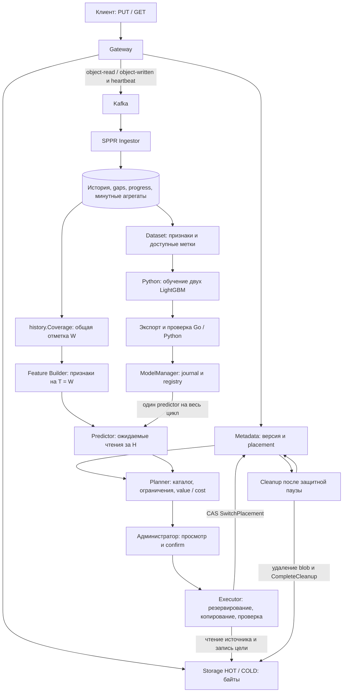

# Онбординг ML и технической части SPPR

Цель маршрута — самостоятельно объяснить путь от клиентского чтения до безопасного переноса версии и отличить качество прогноза от эффективности размещения. Читать и выполнять учебные шаги по порядку: следующий слой опирается на предыдущий.

**Срез проверки: 28.10.2026.** Основной исходный код прочитан в `/Users/grishinid/home/01_Coding/s3-sppr`. Локальные результаты дополнительно просмотрены в `/Users/grishinid/home/01_Coding/s3-sppr/build/wt-sim/build`. Эксперименты, обучение, тесты и сетевые команды при подготовке этого документа не запускались. Наличие теста означает наличие проверки в коде; результат чужого запуска отдельно обозначен как запись в отчёте.

Далее пути без начального `/` относятся к корню `s3-sppr`. Для компактности в маршруте чтения используются сокращения: **S** = `services/sppr`, **I** = `services/sppr/internal`, **ML** = `services/sppr/ml/sppr_ml`. Сноски в конце содержат пути первоисточников. Оценки времени — предлагаемый учебный бюджет на чтение и пересказ, а не измеренная длительность программы.

> [!important] Как пользоваться материалом
> После каждого шага закрой код и объясни его своими словами. Затем найди функцию, которая подтверждает объяснение. Команды ниже — инструкции для будущего самостоятельного запуска, они могут создавать большие наборы данных и отдельные Docker-стенды. В рамках подготовки этого файла они не выполнялись.

## 1. Общая картина

### 1.1. Какую задачу решаем

У OpenS3 есть версии объектов и два класса хранения: **HOT** и **COLD**. В постановке работы HOT быстрее и ограничен по вместимости; COLD вмещает основной каталог. СППР прогнозирует востребованность версий, оценивает пользу переноса и предлагает администратору план с учётом места и бюджета копирования. Администратор подтверждает действия, после чего исполнитель переносит данные. Единица переноса — **версия**, а действующее расположение хранит Metadata. Это не прогноз задержки и не автоматическое удаление «ненужных» объектов. [^architecture] [^metadata] [^diploma]

*Предиктор отвечает «сколько чтений ожидается», Planner — «что имеет смысл перенести при этих ограничениях», executor — «как выполнить разрешённое действие безопасно».* Разделение видно в интерфейсе `Predictor`, `planner.Build` и реализации executor. [^interfaces] [^planner] [^executor]

### 1.2. Путь данных



Диаграмма объединяет рабочие потоки из `internal/app/planner_provider.go`, `service/planner`, `service/modelmanager`, `service/executor` и `service/cleanup`. Между SPPR и Storage копирование идёт напрямую, минуя Gateway. [^architecture] [^wiring] [^executor] [^cleanup]

Что происходит по шагам:

1. **Gateway обслуживает запрос.** Metadata сообщает расположение, Storage отдаёт или принимает байты. Новый ключ записывается в COLD; перезапись HOT-объекта может остаться в HOT, если размер известен и место позволяет. [^architecture] [^metadata]
2. **Gateway публикует телеметрию.** `object-read` относится к GET, `object-written` — к PUT. HTTP не ждёт подтверждения Kafka. При этом отправка в локальный producer имеет ограниченное ожидание: формулировка «совсем без ожидания при любых обстоятельствах» неверна. [^kafka]
3. **Ingestor сохраняет событие.** Проверяет контракт, отличает повтор от нового события, фиксирует пропуски и увеличивает спрос только для `read + client + success`. Событие, progress, gap и агрегат записываются одной транзакцией. [^ingestor]
4. **Coverage определяет полноту.** Отсутствие чтений становится достоверным нулём только при известном покрытии истории без пересекающихся пропусков. Heartbeat позволяет обнаружить и потерю хвоста потока. [^coverage]
5. **Feature Builder замораживает прошлое на T.** Входные чтения строго раньше T. Predictor получает только признаки и горизонт, возвращает ожидаемое число чтений. [^features] [^lgbm]
6. **Planner строит ревизию плана.** Учитывает прогноз, размер, параметры задержки, ёмкости с копиями, бюджет, pins, выполняющиеся действия и минимальный интервал переноса. [^snapshot] [^planner]
7. **Администратор подтверждает выбранные рекомендации.** Проверяются актуальность ревизии и зависимости. Confirm создаёт действия, но не означает, что байты уже перенесены. [^commands]
8. **Executor выполняет протокол, cleanup освобождает старое место.** Переключение placement и удаление старого blob — разные события. [^executor] [^cleanup] [^metadata]

### 1.3. Три вещи, которые нельзя путать

| Вещь | Смысл | Где увидеть |
|---|---|---|
| Идентификатор события `(gateway_id, stream_id, sequence)` | Какой факт обращения уже принят | `I/repository/event/store.go` |
| Координаты Kafka `(topic, partition, offset)` | Какая запись доставлена брокером | `I/model/event.go`, consumer handlers |
| Версия и поколение placement | Какие данные переносим и не успело ли измениться расположение | `I/model/migration.go`, Metadata PlacementService |

Один `sequence` не уникален во всей системе; offset не заменяет идентификатор события; `generation` расположения не является номером события или ML-модели. [^ingestor] [^metadata]

### 1.4. Где документация уже отстаёт от кода

- Начало `S/ONBOARDING.md` утверждает, что прогнозирования ещё нет, а heartbeat описывает как будущую работу. Используй этот файл для знакомства с Ingestor, но проверяй текущий контур по `S/README.md` и коду. [^navigation] [^coverage] [^wiring]
- В `CLAUDE.md` и `AGENTS.md` сохранились фрагменты об отсутствии горячей активации ModelManager. В основном checkout она подключена через `planner_provider.go`, `modelmanager.Manager` и `planner.Plan`. Overhead действительно измеряет отдельный запуск обучения без проверки горячей активации; это ограничение конкретного режима. [^architecture] [^wiring] [^lifecycle] [^stand]
- `docs/experiment-sim-report.md` — исторический отчёт проверки инструментов. Утверждение оттуда о неподдерживаемом `stand` не описывает нынешний checkout, где есть `internal/experiment/stand`. [^simreport] [^stand]
- В `Диплом.md` есть результаты, выделенные `==…==`. Их нельзя выдавать за измерения только на основании текста ВКР. Для защиты нужны соответствующие JSON, манифесты и логи. [^diploma]

## 2. Маршрут чтения и учебные проверки

### 2.1. Порядок файлов и функций

Время ниже включает спокойное чтение, схему на бумаге и устный пересказ. Установка окружения, ожидание Docker и полный расчёт матрицы в эти оценки не входят.

| Шаг | Файлы и функции в порядке чтения | Что здесь понять | Учебное время |
|---|---|---|---|
| 1 | `CLAUDE.md` → `AGENTS.md` → `S/README.md`: архитектура и основные сценарии → `Диплом.md`: постановка и математическая модель | Границы сервисов; что является требованием, реализацией и результатом | 40–60 мин |
| 2 | `S/ONBOARDING.md`: Ingestor → `docs/kafka-spec.md` → `shared/api/events/v1/access.proto` → `I/model/event.go` | Кто создаёт событие; версия, поток, offset; что считается спросом | 40–60 мин |
| 3 | `I/service/consumer/access/handlers.go` → `I/service/ingestor/service.go`: `Ingest`, `Heartbeat` → `I/repository/event/store.go`: `Store`, `addDemand` | Ошибка БД вызывает retry; непригодное событие отклоняется; повтор не удваивает спрос; граница транзакции | 60–90 мин |
| 4 | `docs/history-completeness-spec.md` → `I/repository/event/heartbeat.go` → `I/repository/history/repository.go`: `Coverage`, `coverageOf`, `ReadsSince` → `I/service/planner/snapshot.go` | Почему W общая; почему MAX времени события недостаточен; зачем фильтровать до SQL-группировки | 60–90 мин |
| 5 | `I/model/features.go` → `I/service/features/build.go`: `Build`, `Quality` → `build_test.go` | Вывести каждый из 17 признаков, единицы, missing, warmup, границы окон | 60–90 мин |
| 6 | `I/experiment/dataset/rows.go`: `Rows` → `options.go`: `DefaultPeriods`, `Periods.Split` → `history.go`: `FromHistory` → `S/cmd/dataset/main.go` | Отдельное прикрепление метки, purged, eligible; различие synthetic dataset и live history | 45–75 мин |
| 7 | `I/service/predictor/ewma/predict.go` → `baseline/predict.go`, `baseline/map.go` → `ML/baselines.py` | Как все baseline получают одинаковые единицы «чтения за H»; зачем age/recency нужна обученная карта | 40–60 мин |
| 8 | `S/ml/README.md` → `docs/ml-spec.md` → `ML/data.py` → `ML/model.py`: `fit`, `_rounds` → `ML/evaluate.py`: `grid`, `better`, `tune` → `ML/metrics.py` | Что именно обучается; почему два дерева ансамблей; кто выбирает параметры и число деревьев; какие данные закрыты | 90–120 мин |
| 9 | `ML/export.py`: `write`, `control_rows` → `I/service/predictor/lgbm/load.go`: `Load`, `checkParity` → `model.go`: `Predict`, `predictRaw`, `checkHeader` → `parity_test.go` | Контракт экспорта, порядок столбцов, raw score и link function, допуск паритета | 60–90 мин |
| 10 | `I/service/planner/build.go`: `Build` → `evaluate` → `rebalance` → `candidates` → `promote` → `displacements` → `evaluateSwap` → `apply` → `evictNoncurrent` → `finish` | Вручную восстановить value/cost, набор вытеснения, ограничения и объяснение | 90–120 мин |
| 11 | `I/service/planner/cycle.go`: `Plan` → `snapshot.go` → `commands.go`: `Execute`, `confirm`, `lockLatest`, `missingDependencies` → `I/service/migration/submit.go` | Как чистый Build встраивается в сервис; почему старый план нельзя подтверждать; повтор команды | 60–90 мин |
| 12 | `services/metadata/README.md`: перенос → `I/service/executor/process.go`: `process`, `start`, `copyAndSwitch`, `abort` → `copy.go`: `copyBlob`, `failure` → `I/service/cleanup/cleanup.go`: `Step`, `releaseDependents` | Резервирование, проверка, CAS, recovery; почему зависимость ждёт cleanup | 75–105 мин |
| 13 | `I/app/planner_provider.go` → `I/service/modelmanager/manager.go`: `Restore`, `importArtifact`, `validate`, `Capture` → `train.go`: `Reserve`, `Run`, `parameters`, `train` → `I/repository/modelversion/repository.go` | Версия модели в журнале и на диске; одна попытка обучения; fallback; неизменяемый predictor на цикл | 75–105 мин |
| 14 | `I/experiment/synthetic/generator.go`: `Next` → `I/experiment/sim/config.go`, `prepare.go`: `Prepare`, `Forecast`, `Replay` → `engine.go`: `Plan`, `Advance`, `Finish` | Логические часы; общие входы и независимые состояния политик; причинные обновления модели | 90–120 мин |
| 15 | `I/experiment/runner/run.go` → `S/cmd/experiment/main.go` → `S/experiments/*.json` → `ML/experiment.py`: `process`, `paired` | Пара, матрица, checkpoint, resume, bootstrap; что значит выполнение критерия | 60–90 мин |
| 16 | `I/experiment/loadgen/loadgen.go`: `Schedule`, `Run` → `I/experiment/stand/{config,compose,run,api}.go` → `S/cmd/loadgen/main.go` | Реальное время, открытая нагрузка, очередь, последний байт, квота контейнера, границы наблюдаемости | 60–90 мин |
| 17 | `ML/final_evaluation.py` → `S/cmd/bench-admin/main.go` → `S/cmd/bench-plan/main.go` → `Makefile`: этап 11 → `docs/ml-report.md` и найденные результаты | Где TEST; что измеряет каждый CLI; что можно утверждать по имеющимся данным | 60–90 мин |

Маршрут составлен по фактическим файлам и функциям перечисленных модулей. Подробные первоисточники: [^navigation] [^ingestor] [^coverage] [^features] [^dataset] [^train] [^lgbm] [^planner] [^commands] [^executor] [^lifecycle] [^sim] [^runner] [^stand] [^stage11]

### 2.2. Маленькие задания до большого запуска

Это предложенные упражнения на понимание, а не отчёт об уже проведённых испытаниях.

1. **Событие и повтор.** На бумаге обработай последовательность `1 → повтор 1 → 3`. Покажи, почему принято два события, потерян номер 2 и спрос повторно не увеличен. Затем найди соответствующие ветки в `Store`. [^ingestor]
2. **Ноль против неизвестности.** Нарисуй окно признаков, W и пересекающийся gap. Объясни, почему одинаковый пустой список чтений может означать разные `DataQuality`. [^features] [^coverage]
3. **Граница T.** Поставь чтение точно в T. Оно не входит в признаки среза T, но входит в его метку `[T,T+H)`. Проверь условия `Before` в `features.Build` и `dataset.Rows`. [^features] [^dataset]
4. **Один признак.** Восстанови `short_long_ratio` из `reads_5m` и `reads_1h`, включая ветку нулевого знаменателя. Объясни множитель 12 через отношение длительностей окон. [^features]
5. **Один прогноз.** Открой существующий `parity.json`, проследи одну строку `features → raw_classifier → p → raw_regressor → m → expected_reads`. Сначала объясни порядок преобразований, потом сравни значения. [^lgbm]
6. **Одна рекомендация.** Возьми карточку рекомендации из существующего результата/стенда и найди прогноз, стоимость копирования, вытесняемые версии, бюджет и зависимости. Если карточки нет, восстанови символический расчёт по разделу 4. [^planner]
7. **Один сбой.** Нарисуй рестарт после `SwitchPlacement`, но до записи `succeeded` в SPPR. Объясни, почему target `promoted` восстанавливает успех, а не запускает второе логическое переключение. [^executor]
8. **Один вывод.** Сопоставь validation `Cov_K` и системную mean latency. Сформулируй, какие дополнительные ограничения между ними стоят. [^metrics] [^planner] [^sim]

Готовность к защите: можешь без подсказки нарисовать архитектуру, вывести признаки и формулы, разобрать отказ переноса, объяснить протокол эксперимента и показать источник каждого объявленного результата.

## 3. ML: от понятного объяснения к точному контракту

### 3.1. Простыми словами

Для каждой версии в момент T собирается «карточка прошлого»: размер, возраст, последние чтения, частоты, сглаженный спрос и активность бакета. По ней оценивается число чтений **в следующий час**. У многих наборов данных много нулевых меток, поэтому прогноз разделён на два вопроса: «будет ли хотя бы одно чтение?» и «сколько чтений будет, если спрос появится?». Ответы перемножаются. Разреженность характерна для рассмотренных трасс, но не для всех синтетических сценариев. [^features] [^train] [^mlreport]

LightGBM здесь — обучаемые ансамбли деревьев. Каждое дерево проверяет условия над признаками и выбирает лист с численным вкладом; вклады деревьев образуют сырой прогноз. При бустинге следующие деревья корректируют ошибки текущего ансамбля относительно выбранной функции потерь. В проекте так отдельно обучаются binary- и poisson-ансамбли. На инференсе Go проводит строку признаков через экспортированные деревья и преобразует raw scores. Модель не хранит «правильный HOT для каждого ключа»: размещение рассчитывается отдельно. Объяснение `pred_contrib` в Python относится к сырым выходам соответствующего ансамбля; его нельзя напрямую объявлять вкладом в задержку или в окончательное решение Planner. [^train] [^lgbm] [^planner]

### 3.2. Что является строкой данных

Строка — версия объекта на срезе T, а не отдельный HTTP-запрос. `FeatureSnapshot` хранит идентификатор версии, T, размер, `features-v1`, значения признаков и качество. Dataset добавляет прогноз EWMA для сравнения, split, метку и `eligible`. [^features] [^dataset]

Точная цель:

$$
N_i(T)=\#\{\text{клиентские успешные чтения версии }i:\ T\le t<T+H\},\qquad H=1\ \text{ч}.
$$

`label.available_at = T+H`. До этой границы метка ещё не полностью наблюдаема. Для нулевой метки тоже требуется полное покрытие окна; отсутствие данных не заменяется нулём. Часовой горизонт закреплён у synthetic dataset и симулятора; live ModelManager поддерживает горизонт из сохранённых настроек при соблюдении ограничений подготовки данных. [^dataset] [^sim] [^lifecycle]

Утечка будущего предотвращается на нескольких уровнях:

- `features.Build` игнорирует чтения с `occurred_at >= T`;
- метка прикрепляется отдельно от расчёта признаков;
- окна меток не пересекают границы split;
- live-метки допускаются только до W, без gap;
- текущий класс хранения, измеренная задержка и скрытая группа генератора не входят в набор признаков. [^features] [^dataset] [^coverage]

### 3.3. Все 17 признаков в порядке экспорта

В таблице `a = T−t` — возраст чтения, `n` — число чтений в минутном агрегате. Для отдельных событий `n=1`. Основное окно истории — 24 ч. Таблица выведена из `features.Build`; порядок проверен по Python `FEATURES` и Go `featureNames`. [^features] [^lgbm] [^data]

| № | Имя | Точный смысл и единицы | Что нужно уметь объяснить |
|---|---|---|---|
| 1 | `log_size` | `ln(1 + size_bytes)` | Размер преобразуется логарифмом; это не логарифм числа чтений |
| 2 | `age_seconds` | Время от создания версии до T, секунды | Возраст версии, а не время жизни ключа во всём хранилище |
| 3 | `overwrites_24h` | Число известных созданий версий того же `(bucket,key)` за последние 24 ч, у которых есть строго более ранняя известная версия | Первое известное создание не считается перезаписью; качество зависит от полноты каталога |
| 4 | `last_read_seconds` | Время от последнего доступного чтения до T, секунды; nullable | Missing означает отсутствие чтения во входной истории, а не обязательно за всё существование объекта |
| 5 | `previous_read_seconds` | Время от предпоследнего доступного чтения до T, секунды; nullable | Это не интервал между последним и предпоследним чтениями |
| 6 | `reads_5m` | Число чтений с возрастом не больше 5 мин | Нижняя временная граница включена, T исключена |
| 7 | `reads_1h` | Число чтений с возрастом не больше 1 ч | Частота за окно, ещё не прогноз |
| 8 | `reads_6h` | Число чтений с возрастом не больше 6 ч | Более устойчивый уровень спроса |
| 9 | `reads_24h` | Число чтений с возрастом не больше 24 ч | Используется также baseline frequency |
| 10 | `ewma_1h` | Сумма `n·ln(2)·exp(−ln(2)·a_час)` в пределах входного 24-часового окна | Интенсивность в чтениях/ч с полураспадом 1 ч |
| 11 | `ewma_6h` | Сумма `n·ln(2)/6·exp(−ln(2)·a_час/6)` в том же окне | Интенсивность с полураспадом 6 ч |
| 12 | `short_long_ratio` | `12·reads_5m/reads_1h`; при `reads_1h=0` — 0 | Отношение интенсивностей, а не просто отношение счётчиков |
| 13 | `reads_day_ago` | Чтения с `23 ч < a <= 24 ч`, то есть `[T−24ч,T−23ч)` | Это фиксированное часовое окно внутри реализации `features-v1` |
| 14 | `mean_read_fraction` | За 24 ч сумма прочитанных байтов / размер версии / число чтений; при отсутствии чтений — 0 | Range увеличивает число чтений, но может давать долю меньше полного объекта |
| 15 | `bucket_reads_1h` | Все входные demand-чтения бакета за последний час | Общий сигнал по бакету, а не только по данной версии |
| 16 | `bucket_active_fraction` | Доля активных на T версий бакета с `reads_1h>0` | Знаменатель — активные версии каталога, не число событий |
| 17 | `observed_seconds` | `T−max(T−24ч, created_at, Coverage.Start)`, если начало раньше T; иначе 0 | Наблюдаемая длительность ограничена окном; качество дополнительно хранится отдельно |

Два практических нюанса. При минутном входе чтения датируются началом минуты; два чтения в одной минуте могут иметь одинаковые `last_read_seconds` и `previous_read_seconds`. Если минута началась до создания версии, время для расчёта ограничивается моментом создания. Live Planner читает только последние 24 ч: отсутствие давности в этом пути нельзя уверенно назвать «объект никогда не читали». [^features] [^snapshot]

**Missing не равно нулю.** Отсутствующие давности представлены указателями в Go, `null` в JSON и NaN во входе LightGBM. Нулевая давность и неизвестная давность имеют разный смысл. Другие признаки из таблицы вычисляются численно по своим правилам. [^features] [^lgbm] [^data]

**Quality не является восемнадцатым ML-признаком.** Это отдельный контракт пригодности: `complete`, `warmup`, `unknown_completeness`, `unobserved`, `watermark_behind`, `gap`, `no_history`. Например, тёплая неполная по длительности история может быть usable с причиной `warmup`; gap в нужном окне делает строку непригодной. Бакетные признаки заставляют проверять покрытие шире времени жизни одной молодой версии. [^features]

### 3.4. Coverage и W: почему это часть ML

Открытый поток Gateway публикует heartbeat с последним **выданным**, а не только доставленным номером. Heartbeat номер не расходует. По умолчанию интервал — 5 с, потеря heartbeat дольше 30 с приводит к lost-check; общий предел отставания Planner — 60 с. Это defaults протокола, а не измеренные задержки. [^coverage]

W вычисляется по всем известным потокам обоих топиков: минимум `complete_until` открытых потоков. Открытый поток без известной границы делает общую полноту неизвестной. Если открытых нет, берётся максимум границ закрытых, ограниченный временем последнего закрытия. Без потоков полнота неизвестна. Закрытие потерянного потока не стирает gaps. [^coverage]

Planner рассчитывает на `T=W`; при неизвестной W или недопустимом отставании сохраняет `history_incomplete`. `ReadsSince` фильтрует `occurred_at < W` **до** `GROUP BY date_trunc('minute',…)`: готовая текущая минута уже могла содержать чтение после W. Поэтому наличие `read_aggregates` не означает, что Planner может безусловно читать всю их текущую строку. [^snapshot] [^coverage]

При lost-check того же потока возобновление возможно; непрерывные номера позволяют удалить только gap текущего lost-check. Graceful closing окончателен. Это тоньше утверждения «любой закрытый поток больше не может продолжиться». [^coverage]

Ограничение: протокол опирается на зарегистрированные потоки и их порядок. Он не доказывает отсутствие неизвестного системе производителя. Кроме того, live Planner расширяет `Coverage.Start` до старейшей версии каталога, сохраняя W; live dataset ModelManager использует настоящую Coverage без этого допущения. Эти пути нельзя описывать как полностью одинаковые по предположениям о начале наблюдения. [^coverage] [^snapshot] [^dataset]

### 3.5. Train, tune и test

Для семисуточной синтетики задано временное разбиение:

| Период | Границы от начала истории | Назначение |
|---|---|---|
| train | `[0,48ч)` | Подгонка деревьев, карт baseline; хвост train — ранняя остановка |
| validation / tune | `[48ч,72ч)` | Выбор гиперпараметров и сравнение качества этапа 8 |
| test | `[72ч,168ч)` | Итоговая проверка после фиксации решений |
| purged | Срезы, чей полный горизонт не помещается в один период | Исключены из обучения/оценки соответствующего split |

`Periods.Split` проверяет не только T, но и `T+H <= конец периода`. Нельзя случайно перемешать строки разных моментов: соседние срезы одной версии используют пересекающуюся историю и метки. [^dataset]

Train прореживается до одного среза в 15 мин. Для основного синтетического профиля исходный шаг — 300 с; validation/test сохраняют полный шаг этого набора. У трасс отдельно зафиксирован шаг 15 мин для всех периодов и границы 2/7, 1/7, 4/7 наблюдаемого диапазона. Не переносить параметры синтетики на трассы автоматически. [^data] [^traces] [^train]

На этапе 8 test закрыт по умолчанию в `data.load`: для его использования требуется `include_test=True`. Для CSV.gz это позволяет вообще не открывать файл test; в общем JSONL логически отбрасываются test-строки. Итоговый CLI этапа 11 открывает test явно после обучения. [^data] [^stage11]

У **live ModelManager** другое разбиение: `FromHistory` берёт ограниченное окно до доступной границы, отводит последние 1/7 окна под validation, остальные 6/7 — train, строит срезы каждые 15 мин, test оставляет пустым. Метки должны целиком помещаться в период и доступную историю. Источник каталога — нынешний Metadata: удалённые в окне версии и часть перезаписанных COLD-версий могут отсутствовать. [^dataset]

У **симуляторных обновлений** ещё один режим: скользящие 48 ч train, пустые validation/test в датасете обучения, фиксированные параметры и `--fit-only`. Не следует объяснять все три режима одной схемой split. [^sim]

### 3.6. Hurdle LightGBM точно

Обозначим признаки версии через x, число будущих чтений — N. Обучаются два ансамбля:

$$
p(x)\approx P(N\ge1\mid x),\qquad
y(x)\approx E[N-1\mid N\ge1,x],
$$

$$
m(x)=1+y(x),\qquad \hat N(x)=p(x)\,m(x).
$$

Классификатор `objective=binary` обучается на всех пригодных train-строках с меткой `N>=1`. Регрессор `objective=poisson` обучается только на положительных строках с меткой `N−1`. Поскольку регрессор описывает чтения сверх первого, условное ожидание восстанавливается прибавлением единицы. Это не два альтернативных прогноза для голосования. [^train]

В Go используются сырые выходы:

$$
p=\frac{1}{1+e^{-z_c}},\qquad y=e^{z_r},\qquad m=1+e^{z_r},\qquad \hat N=p(1+e^{z_r}).
$$

`leaves` загружается с отключёнными output transforms, sigmoid и exp применяет сам Go. Применить преобразование дважды — ошибка контракта. [^lgbm]

Если все положительные train-метки равны 1, метка регрессора всегда ноль. Python в этом случае оценивает модель с `m=1`, но не экспортирует её для рабочего Go-контракта, которому нужны оба файла. Если положительных строк вообще нет, `fit` возвращает ошибку. Неудача получить экспорт — осмысленный исход, а не основание выдумать регрессор. [^train] [^export]

### 3.7. Сетка и early stopping

В `ML/evaluate.py` задана одна сетка для источников — 24 комбинации:

| Параметр | Значения | Что меняет |
|---|---|---|
| `num_leaves` | 15, 31, 63 | Допустимая сложность дерева |
| `learning_rate` | 0.03, 0.1 | Размер шага бустинга |
| `min_data_in_leaf` | 20, 200 | Минимум данных в листе |
| `lambda_l2` | 0.0, 1.0 | L2-регуляризация |

Параметры выбираются по validation `Cov_K`; если абсолютная разница покрытия не больше `COVERAGE_TIE=0.001`, выбирается меньший Brier. Это конкретное правило `better`, а не произвольный выбор самого красивого графика. [^train]

Число итераций каждой части выбирается отдельно: последние 8 ч train отводятся под раннюю остановку, максимум 2000 итераций, остановка после 50 итераций без улучшения. Затем соответствующий ансамбль заново обучается на **всём train** с найденным числом итераций. Validation не участвует в подгонке деревьев. В `_rounds` есть fallback 100 итераций для предусмотренных случаев пустого/непригодного разделения хвоста; это не универсальное число деревьев модели. [^train]

Точная граница гарантии: `Periods.Split` очищает пересечения меток между внешними train/validation/test. Внутри `_rounds` хвост train выделяется маской по T без отдельного дополнительного purge у его начала. Поэтому этот внутренний holdout не стоит описывать как полностью независимые непересекающиеся часовые метки. [^dataset] [^train]

Базовые настройки обучения: `seed=0`, `deterministic=True`, `force_row_wise=True`, `num_threads=2`. Регулярное переобучение получает фиксированные `--params`, поэтому сетка заново не перебирается. В `main.json` явно записаны `15 / 0.03 / 20 / 1.0`; это параметры серии, но один JSON не доказывает, как они были выбраны на tune. Прямой `sim.DefaultConfig` содержит другую точку: `15 / 0.1 / 200 / 1.0`. Для воспроизведения нужно назвать конкретный конфиг. [^train] [^lifecycle] [^configs] [^sim]

### 3.8. Baseline: четыре честных соперника

| Политика | Прогноз | Что не перепутать |
|---|---|---|
| age | Монотонная карта `age_seconds → ожидаемая интенсивность`, затем масштабирование на H | Это не правило «чем моложе, тем горячее» с вручную выбранным порогом |
| recency | Аналогичная карта для `last_read_seconds`, отдельное значение для missing | Направление зависимости выбирается по train, не предполагается заранее |
| frequency | `reads_24h / 24 × H_час` | Суточный средний спрос, а не точное число будущих чтений |
| EWMA | `ewma_1h × H_час` | Сглаженная интенсивность с полураспадом 1 ч, а не скользящее арифметическое среднее |

Для age/recency используются до 50 квантильных интервалов, направление определяется знаком Spearman, монотонность обеспечивается PAV. Карты подгоняются только на train. Go-формат — `isotonic-quantile50-v1`, `horizon_seconds=3600`; модель карты имеет версию с хешем. Для вероятностных метрик baseline получают `p=1−exp(−N̂)`. [^baselines]

Все пять политик используют общий Feature Builder и общий Planner. Сравнивается способ оценки спроса при одинаковом алгоритме размещения. В симуляторе карты age/recency обучаются по первым двум суткам и затем не обновляются, ML при включённой настройке обновляется; эта асимметрия — часть текущего протокола, которую нужно назвать. [^sim] [^baselines]

### 3.9. Как читать метрики

| Метрика | Что проверяет | Направление и ограничение |
|---|---|---|
| PR-AUC | Различение события «хотя бы одно чтение»; реализация — average precision | Больше лучше; равные оценки образуют общий порог |
| Brier | Средний квадрат ошибки вероятности относительно `N>=1` | Меньше лучше; это вероятностная ошибка, а не измерение задержки |
| MAE | Среднюю абсолютную ошибку ожидаемого числа чтений | Меньше лучше; на этапе 11 нормируется к чтениям на объект в час |
| Poisson deviance | Ошибку счётного прогноза через пуассоновское отклонение | Меньше лучше; дополнительная метрика этапа 8 |
| `Cov_K` | Долю фактических чтений, покрываемую top-K по прогнозу | Больше лучше; оценивает ранжирование при заданном K |
| mean / p95 latency | Время чтения в системном эксперименте | Меньше лучше; зависит от исполнения, очередей и миграций |

$$
\operatorname{Cov}_K=
\frac{\sum_T\sum_{i\in\operatorname{top}_K(T)}N_i(T)}
{\sum_T\sum_iN_i(T)}.
$$

Это **отношение сумм**, а не среднее покрытие срезов с одинаковым весом. В offline-метрике `K=floor(0.0921×N_каталога)`, то есть 921 для 10 000 объектов. Равные прогнозы разрешаются случайно с seed 0. В Planner при равных оценках используется порядок version ID: это другой механизм для другой задачи. [^metrics] [^planner]

Доверительные интервалы качества этапа 8 строятся bootstrap по моментам среза; сравнение с baseline — парное. У этих процедур в `metrics.py` default 1000 повторов. Системное сравнение политик использует **10 000 повторов по seed**. Эти два bootstrap нельзя смешивать. При отсутствии положительных меток некоторые метрики не определены; итоговый TEST CLI записывает null, а не «идеальный ноль». [^metrics] [^statistics] [^stage11]

Высокое покрытие ещё не означает выигрыш по задержке: объекты могут не успеть попасть в HOT из-за бюджета, задержки подтверждения, минимального интервала, занятых workers или стоимости вытеснения. Кроме того, offline top-K по числу объектов не решает задачу разнокалиберных размеров: Planner учитывает байты и value/cost. [^planner] [^sim]

### 3.10. Экспорт и паритет Python / Go

Комплект модели содержит четыре контрактных файла:

| Файл | Что в нём |
|---|---|
| `classifier.txt` | Деревья классификатора LightGBM |
| `regressor.txt` | Деревья пуассоновского регрессора |
| `manifest.json` | Версия артефакта/метода/признаков, порядок 17 столбцов, H, provenance, интервалы, параметры, версии библиотек, validation metrics, SHA-256 |
| `parity.json` | Контрольные признаки и ожидаемые Python raw scores, p, m, N̂ |

`report.json`, если создан CLI обучения, — дополнительный отчёт, а не пятый обязательный файл контракта Go. [^export] [^lgbm]

Загрузка `lgbm.Load(dir,H)` проверяет хеши исходных моделей, `lgbm-hurdle-v1`, `features-v1`, имена и порядок признаков, горизонт, поддерживаемые objective и контрольные прогнозы. Go принимает обычные LightGBM text v3/v4; заголовок v4 адаптируется в памяти под закреплённый `leaves` после проверки хеша. Linear trees и random forest этим путём не поддерживаются. [^lgbm]

Для каждого обязательного контрольного выхода:

$$
|\operatorname{Go}-\operatorname{Python}|
\le 10^{-9}|\operatorname{Python}|.
$$

При нулевом эталоне требуется точный ноль. NaN/Inf в выходах недопустимы; `null` в признаках превращается в NaN. Контрольные строки включают отсутствующие значения и граничные случаи. *Паритет доказывает согласованность применения конкретного экспорта, но не качество его обучения, отсутствие утечки или пользу размещения.* [^lgbm] [^export]

### 3.11. Жизненный цикл модели

В runtime `PLANNER_PREDICTOR=lgbm` включает ModelManager; `ewma|age|recency|frequency` закрепляют один предиктор для сравнения. Журнал `model_versions` хранится в PostgreSQL, файлы — в writable registry. `PLANNER_MODEL_DIR` служит bootstrap только при пустом журнале, а не указателем, который постоянно перечитывается перед каждым объектом. [^wiring] [^lifecycle]

| Этап | Реализация | Поведение |
|---|---|---|
| Старт | `Restore` | Прерванные попытки фиксируются как неуспешные; активная версия восстанавливается из журнала и registry |
| Bootstrap | `importArtifact` | Импорт четырёх файлов в отдельный каталог версии; существующая версия не перезаписывается |
| Допуск к обучению | `Reserve` | Проверка полноты и минимальной истории; одновременно идёт одна попытка |
| Dataset | `FromHistory` | Настоящая Coverage, доступные метки, пустой test |
| Обучение | `train`, `RunCommand` | Фиксированные параметры; два потока; общий timeout на подготовку, процесс и проверку |
| Проверка кандидата | `validate` | `lgbm.Load`, реальные интервалы, не будущие метки, пробные прогнозы на последних признаках каталога |
| Активация | `repo.Activate` и atomic pointer | Версия становится active, новый predictor доступен следующим захватам |
| Планирование | `Capture` в начале `Plan` | Весь цикл использует один неизменяемый predictor и записывает его версию |
| Неудача обновления | `reject` | Причина записывается; прежняя допустимая модель продолжает работать |
| Устаревание/смена H | `Capture` | `model_stale` / `horizon_changed`, переход на EWMA |

Таблица описывает код основного checkout. При проблеме самого журнала восстановление может вернуть ошибку запуска: нельзя обещать fallback при абсолютно любой инфраструктурной неисправности. Ошибка прогноза отдельной версии приводит к `no_forecast`, а не обязательно к глобальному переключению метода. [^lifecycle] [^wiring] [^snapshot]

Defaults из `config/env/planner.go`: обновление каждые 24 ч, минимум истории 26 ч, окно 168 ч, максимальный возраст 72 ч, timeout 30 мин, registry `/var/lib/sppr/models`. Возраст считается от `trained_to`, а не от времени копирования файлов. Это defaults env; сохранённые настройки Planner, включая H, имеют приоритет при работе сервиса. [^lifecycle] [^wiring]

Ручная команда `retrain` проходит журнал команд; повтор того же `command_id` не должен создавать новую попытку. Кнопка переобучения и `/admin/models` позволяют увидеть исход, но не гарантируют, что каждый кандидат улучшает ML-метрики. В коде активации проверяются совместимость и допустимость прогнозов; отдельного обязательного барьера «новая Cov_K выше старой» нет. При отсутствии активной модели параметры стартуют с `15 / 0.03 / 20 / 1.0`, затем наследуются из активного манифеста без старого `rounds`. [^commands] [^lifecycle]

### 3.12. Что известно о качестве сейчас

В `docs/ml-report.md` приведены **validation-результаты этапа 8**, а не итоговый TEST размещения:

| Источник | Что записано в отчёте | Граница вывода |
|---|---|---|
| Meta CDN eag | `Cov_K` ML 0.670 против 0.531, разность +0.139, ДИ +0.120…+0.158 | Отчёт по подготовленной выборке |
| Docker syd01 | 0.960 против 0.866, разность +0.094, ДИ +0.078…+0.115 | В отчёте указано отсутствие подтверждённых условий использования данных |
| IBM COS 000 | 0.880 против 0.851, разность +0.029, ДИ +0.021…+0.038 | Дополнительно нужен разбор восстановления каталога |
| IBM COS 001 | Высокая оценка не засчитана | Каталог раскрывает будущие обращения; нет повторных чтений для рабочего комплекта регрессора |
| Синтетика 10 000, shift | 0.751 против EWMA 0.722, разность +0.029, ДИ +0.015…+0.047 | Один источник/профиль; это не доказательство порога задержки 5 % |

Числа здесь сверены с текстом отчёта, новые измерения не выполнялись и исходные полные наборы заново не пересчитывались. Для stable/burst/uniform на рабочей синтетике преимущество не доказано, для periodic/decay отчёт показывает ухудшение против лучшей базовой оценки. [^mlreport]

Ограничения трасс: успех GET в Meta/COS предполагается из-за отсутствующего HTTP-статуса; COS использует условное начало относительного времени; выборка ключей не масштабирует абсолютный спрос обратно; каталог COS реконструируется из обращений. Диагностика `never_read` в коде определяется через NaN в `last_read_seconds` и обнуляет прогнозы всех методов на этих строках перед повторным сравнением. Это диагностический срез, а не полное устранение всех смещений каталога. [^traces] [^train]

## 4. Planner, executor и cleanup

### 4.1. Из прогноза в ценность

Для текущей версии с размером s и средней долей чтения r Planner вычисляет ожидаемый объём `D̂ = N̂·r·s` и задержку на горизонте:

$$
L_C=\hat N\,c_C+\frac{\hat D_{\text{МиБ}}}{v_C},\qquad
\Delta=L_{COLD}-L_{HOT},\qquad
\rho=\frac{\Delta}{\max(s_{\text{байт}},1)}.
$$

`c_C` — мс на чтение, `v_C` — МиБ/мс, L и Δ — суммарные ожидаемые мс за горизонт. Плотность ρ имеет единицы мс/байт. Для нулевого размера знаменатель ограничен одним байтом. Некорректная доля чтения заменяется полным чтением. У нетекущих версий прогноз пользы в этом алгоритме нулевой. [^planner]

*Value — ожидаемая экономия чтений; cost — занимаемые байты и копирование в ограниченном бюджете.* ML не выбирает, какие объекты вытеснить: он предоставляет N̂, дальше работает общий алгоритм. [^planner]

### 4.2. Порядок жадного Build

1. **Проверить вход.** Положительные скорости/горизонт, допустимые утилизации, неотрицательные бюджет/коэффициенты, уникальные версии с корректным placement. [^planner]
2. **Определить доступное место.** `floor(capacity × min(planner_utilization, metadata_max_utilization))`, если ограничение Metadata задано. [^planner]
3. **Оценить версии.** Вычислить N̂, D̂, L, Δ и Δ/s. HOT-кандидаты для вытеснения упорядочить по возрастанию плотности; при равенстве нетекущие раньше текущих, затем version ID. [^planner]
4. **Rebalance.** Если HOT выше разрешённой загрузки, предложить выселения при наличии бюджета и места в COLD. Порог экономического выигрыша на этот шаг не распространяется: цель — восстановить допустимость. Если ресурсов недостаточно, Build не создаёт место из ничего. [^planner]
5. **Promote.** Рассматривать текущие COLD-версии с доступным прогнозом и положительной Δ по убыванию Δ/s. Pins, in-progress и минимальный интервал блокируют действие. [^planner] [^snapshot]
6. **Если HOT занят — сравнить наборы вытеснения.** Первый вариант набирает HOT-версии с наименьшей плотностью; второй — одну версию с минимальной потерей Δ, которая освобождает достаточно места. Лишнее освобождённое место может использовать группа следующих небольших COLD-кандидатов. [^planner]
7. **Проверить весь набор.** `set_gain = сумма Δ продвижений − сумма Δ выселений`; `penalty = P × копируемые МиБ`; `set_net_gain = set_gain − penalty`. Требуются порог, бюджет и возможность временно разместить выселяемые данные в COLD. Копирование оплачивается в обе стороны. [^planner]
8. **Записать зависимости.** Продвижения зависят от выселений, освобождающих им место. После основных действий остаток бюджета может выселять нетекущие HOT-версии через `evict_noncurrent`. [^planner]
9. **Сохранить объяснения и итог.** Выбранные и часть отклонённых рекомендаций, причины отказа, before/after ресурсов, copy bytes, net gain. [^planner]

Для разных размеров это эвристика: комментарий «maximises» не следует пересказывать как доказанную глобальную оптимальность общего случая. В коде есть проверки на маленьких входах против полного перебора и отдельная оптимизация одинаковых размеров, сохраняющая поведение общего пути. Ограниченные частные свойства не заменяют доказательство для любых входов. [^planner]

### 4.3. Бюджет Planner и бюджет исполнения

У Build бюджет — число байтов, доступное этому расчёту. Рабочий snapshot вычитает уже принятые pending-действия и учитывает ещё не зарезервированные цели. Сам executor ведёт долговечный учёт расходов: неудачные попытки могли передать реальные байты, повторная попытка требует нового списания; после прерывания копирования неизвестный расход консервативно считается плановым размером. В симуляторе отдельно проверяется бюджет каждого цикла. [^snapshot] [^executor] [^sim]

Поэтому выражения «бюджет за цикл», «скорость копирования» и «занятость класса» обозначают разные ограничения. Нельзя выдавать 256 МиБ за цикл за 256 МиБ/с или считать, что выселение не расходует бюджет. [^planner] [^sim]

### 4.4. Что содержит объяснение

Карточка связывает идентификаторы версии/рекомендации/плана с прогнозом и решением: метод, H, N̂, для ML p/m/EWMA, доля чтения, ожидаемые МиБ, L_HOT/L_COLD, Δ, потери вытесняемых версий, штраф, net gain, ёмкости и бюджет до/после, зависимости и причина отказа. Это проверяемая арифметика решения. `pred_contrib` из notebook объясняет другой уровень — ML-прогноз — и не заменяет карточку Planner. [^planner] [^train]

### 4.5. Confirm и актуальность

`confirm` принимает только актуальную ревизию с допустимым статусом, проверяет выбранные рекомендации и полноту зависимостей. Повтор команды определяется по `command_id` и нормализованному содержимому; повтор уже поданных рекомендаций не должен создавать новые действия. Даже подтверждённый план может устареть к моменту исполнения из-за нового placement, pin или нехватки места: runtime проверяет ограничения повторно. [^commands] [^executor]

### 4.6. Протокол переноса

```text
GetPlacement
  → проверка pin / минимального интервала
  → ReserveCopy(expected_generation, source_class, target_class)
  → RetrieveObject источника → StoreObject цели
  → сверка размера и MD5
  → SwitchPlacement по CAS
  → succeeded
  → ожидание cleanup_after
  → DeleteObject старого blob
  → CompleteCleanup
```

При ошибке до успешного переключения выполняется `AbortCopy`, а цель попадает в cleanup. `action_id` используется как идентификатор миграции, позволяя восстанавливать состояние через Metadata. [^executor] [^metadata]

Инварианты, которые нужно объяснить на защите:

- **Одно действующее расположение версии.** Физических копий временно может быть больше одной. [^metadata]
- **Никакого переключения на непроверенную копию.** Executor считает байты и MD5 прочитанного потока, сравнивает с результатом целевого Storage; Metadata принимает сведения о проверке от исполнителя. Metadata сам не читает физические blobs. MD5 здесь проверка целостности, а не криптографическая защита от намеренного подбора коллизий. [^executor] [^metadata]
- **CAS по поколению и исходному классу.** Устаревшее действие не должно перезаписать более новое placement. Для нетекущей версии допускается HOT → COLD, но не новое продвижение в HOT. [^metadata] [^executor]
- **Вместимость включает временные копии.** `reserved`, `cleanup_pending`, `cleanup_failed` продолжают занимать место. `promoted` учитывается уже через placement. [^metadata]
- **Удаление источника отложено.** Пауза должна превышать максимальную длительность чтения Gateway; уже открытое чтение может ещё использовать старый blob. [^metadata] [^cleanup]
- **Зависимое продвижение ждёт реального освобождения источника выселения.** Одного `succeeded` предшественника недостаточно; cleanup подтверждает Metadata и помечает источник очищенным. [^cleanup]
- **Пауза миграций не останавливает cleanup.** Продолжение уже running-действий и принятие новых pending-действий также нужно различать. [^cleanup] [^executor]
- **Восстановление следует состоянию Metadata.** `reserved` — копирование/проверка ещё нужны; `promoted` — переключение уже состоялось; `aborting` — продолжить отмену. Потерянный ответ `AbortCopy` после успешного CAS распознаётся, а не превращается в откат данных. [^executor]

## 5. Эксперименты и команды

### 5.1. Четыре разных проверки

| Проверка | Что подтверждает | Чего сама по себе не подтверждает |
|---|---|---|
| Offline ML, этап 8 / TEST этапа 11 | Вероятности, счётный прогноз, ранжирование | Эффект очередей и безопасное перемещение байтов |
| Логический симулятор 10a | Сравнение политик при явно заданной модели ресурсов/обслуживания | Реальные задержки дисков, Kafka, HTTP и cleanup |
| Живой стенд 10b | Полные PUT/GET, очередь, контейнерные ресурсы, реальные сервисы | Все промежуточные инварианты лишь по before/after снимкам |
| Отказные тесты и lifecycle smoke | Проверяемые отказы, recovery и активацию | Универсальную эффективность ML на любом спросе |

Основания разделения: [^mlreport] [^sim] [^stand] [^executor] [^stage11]

### 5.2. Как устроен симулятор

`Generator.Next` вычисляет следующий момент обращения арифметически и не ждёт реальное время. `Prepare` один раз создаёт спрос, минутную историю, признаки и прогнозы пары `(scenario,seed)`. `Replay` создаёт независимые Engine для каждой политики и бюджета; `Engine.Plan` вызывает рабочий `planner.Build`. Это позволяет сравнить решения на одном и том же спросе. [^generator] [^sim]

Основной профиль `experiments/main.json`:

| Параметр | Значение |
|---|---|
| Каталог | 10 000 объектов по 1 МиБ; `lifecycle=false` |
| Частота поступления | 20 чтений/с |
| Длительность | 7 логических суток; итоговое размещение проверяется в `[72ч,168ч)` |
| Сценарии | shift, stable, decay, periodic, burst, uniform |
| Seeds | 0–9 |
| Политики | age, recency, frequency, ewma, lgbm |
| Бюджеты | 64 / 256 / 512 МиБ за цикл |
| Ёмкости | HOT 1 ГиБ, COLD 12 ГиБ, утилизация 0.9 |
| Планирование | Каждые 300 с; подтверждение через 5 с |
| Обслуживание | 8 общих мест, не более одной миграции |
| Повторный перенос | Не ранее 3600 с после предыдущего |
| Чтение/запись | HOT 10 мс/МиБ, COLD 40 мс/МиБ |
| Штраф и порог | 0 в основной симуляции |
| Начальное размещение проверки | Все версии в COLD |
| Обновления ML | На 48/72/96/120/144-м часах; окно 48 ч |

Числа — параметры конкретного JSON и кода, **не измеренные характеристики оборудования**. Defaults рабочего Planner отличаются: например, у него ненулевые fixed latency, штраф и порог. [^configs] [^sim] [^lifecycle]

Полная матрица содержит `6×10×5×3 = 900` результатов, сгруппированных в 60 пар «сценарий–seed». Один seed воспроизводит одну реализацию случайного выбора; парность означает, что ML и baseline сравниваются на одной реализации. `workers` параллелит пары, а не создаёт новые статистические повторы. [^configs] [^runner]

Чтения обслуживаются FIFO; класс фиксируется при начале обслуживания. Копирование занимает одно общее место на сумму длительностей чтения источника и записи цели; на время копии место занято в обоих классах. Источник удаляется в момент переключения. Логический симулятор не воспроизводит задержку cleanup, физический MD5 и сбои устройств. Время `planner.Build` измеряется, но не сдвигает логический цикл. [^sim]

Обновление модели допускает только `T+H<=cutoff`. Новый экспорт проходит обычный `lgbm.Load`; применяется после `cutoff + измеренное время Python-процесса и Go-загрузки`, на подходящем цикле. В эту активационную задержку не входит вся предшествующая подготовка общего feature cache. Предыдущая модель действует до активации новой. Повторный replay кэша сохраняет записанные длительности, но новое измерение обучения может дать другие моменты активации. Это причинная адаптация по доступному прошлому, а не автоматический доступ к будущим меткам всего test. [^sim]

### 5.3. Что на самом деле означают сценарии

Обозначим `q=hot_fraction`, `p=hot_probability`. Генератор сначала выбирает объект равномерно из всего каталога и с вероятностью p **заменяет** выбор объектом из горячей группы. Поэтому доля запросов горячей группе равна `p+(1−p)q`, а не просто p. При параметрах main это `0.8+0.2×0.1=0.82` — вычисление по алгоритму, не измерение. [^generator] [^configs]

| Сценарий | Реальное поведение `Next` | Как объяснить ограничение |
|---|---|---|
| stable | Постоянные p и горячая группа | EWMA/frequency могут быстро найти практически тот же набор, что ML |
| shift | Номер горячей группы меняется каждые `shift_every_hours`; в main — 24 ч | Смена группы создаёт задачу адаптации; это не изменение общей частоты |
| decay | `p(t)=p₀·exp(−t/decay_hours)`; в main масштаб 24 ч | Частота всех поступлений остаётся 20/с; исчезает преимущество группы, спрос стремится к равномерному |
| periodic | `p(t)=p₀·(0.5+0.5·cos(2πt/period_hours))`; период main 24 ч | Колеблется вес той же группы, а не календарная активность каждого объекта |
| burst | Дополнительный вес группы есть только в `[burst_at, burst_at+duration)`; main: 100 ч и 0.5 ч | Общий offered rate не растёт; краткий всплеск предпочтения находится в test, а validation до него равномерен |
| uniform | `p=0`, независимый равномерный выбор | Предсказуемой разницы будущего спроса между ключами в механизме нет |

Само имя `decay` не доказывает моделирование «стареющих объектов с падением общей нагрузки». В late-test при масштабе 24 ч предпочтение уже сильно ослаблено. Это следует из формулы генератора; сценарий проверяет именно её. [^generator]

### 5.4. Насыщение HOT и предел различий

В основном профиле HOT вмещает `floor(0.9×1ГиБ/1МиБ)=921` версию. Горячая группа содержит 1000 версий. Это расчёт по конфигу. Даже правильное распознавание группы не позволяет держать её целиком в HOT. [^configs] [^planner]

Если политика уже держит 921 одинаково вероятную версию нужной группы, дальнейшее улучшение ранжирования внутри группы почти не меняет ожидаемую задержку. Для stable идеализированная доля HOT при таком размещении равна `0.8×921/1000 + 0.2×921/10000`; это верхний ориентир без разгона, миграций и очереди, а не замер серии. [^generator] [^configs]

В историческом контрольном полноразмерном stable-прогоне средние ML, EWMA и frequency действительно близки, а p95 равен 40 мс. Это запись отчёта отдельного seed. Считать по ней всю текущую основную матрицу завершённой нельзя. Корректный ответ на вопрос о насыщении: ёмкость и простой сильный baseline могут ограничивать выигрыш, даже если offline-прогноз улучшился. Фактическую траекторию заполнения HOT нужно подтверждать артефактами конкретного прогона; одна итоговая `hot_read_share` не является временным графиком занятости. [^simreport] [^local]

### 5.5. Критерий победы и bootstrap

Для каждой ячейки «сценарий × бюджет» и каждого baseline b по парным seed s рассчитывается:

$$
r_s=\frac{\operatorname{mean}_{b,s}-\operatorname{mean}_{ML,s}}
{\operatorname{mean}_{b,s}},\qquad
d_s=\frac{p95_{ML,s}-p95_{b,s}}{p95_{b,s}}.
$$

Обработка делает 10 000 bootstrap-перевыборок **seed**, seed самого bootstrap — 0. Внутри перевыборки сохраняется парность ML/baseline. 95-процентный интервал строится по среднему r; изменение p95 — среднее d, без отдельного условия на его ДИ. Худшее изменение p95 по seed также сохраняется. [^statistics]

Критерий текущей обработки требует одновременно:

1. нижнюю границу ДИ уменьшения mean не меньше 5 %;
2. среднее парное увеличение p95 не больше 5 %;
3. отсутствие ошибок/нарушений и выявленных history gaps;
4. не менее двух seed для машинного допуска; основной протокол задаёт десять;
5. выполнение относительно **каждой** из четырёх baseline, а не только возраста;
6. полную согласованную матрицу, актуальные хеши и завершённый манифест. [^statistics] [^configs]

Нельзя bootstrap-ить миллионы отдельных чтений вместо seed и выдавать их за независимые повторения всего эксперимента. Нельзя объединять сценарии или бюджеты, чтобы скрыть проигрыш отдельной ячейки. Порог 5 % здесь — относительное уменьшение задержки, а не прибавка 0.05 к `Cov_K`. [^statistics]

### 5.6. Точные команды: подготовка и ML

Все команды выполняются **из корня `s3-sppr`**. В этом документе они только приведены. Используй новые выходные каталоги; установочная цель обращается к pip, тяжёлые цели могут работать долго. Имена переменных сверены с `Makefile`: это `SPPR_ML_DATA`/`SPPR_ML_OUT`, а не встречающиеся в старом ТЗ `SOURCE`/`OUT`. [^make]

```bash
cd /Users/grishinid/home/01_Coding/s3-sppr

# Окружение; установка зависимостей.
make ml-sppr-venv

# Маленький учебный разбор и один synthetic dataset.
make demo-sppr-data
make dataset-sppr SPPR_SCENARIO=shift SPPR_SEED=0 SPPR_DATA_OUT=build/onboarding-data

# Шесть рабочих наборов и обучение шести моделей этапа 8.
make ml-sppr-data
make ml-sppr-train-all
make ml-sppr-report

# Одна модель на уже существующем наборе; новый каталог результата.
make ml-sppr-train SPPR_ML_DATA=build/ml-medium/shift-0 SPPR_ML_OUT=build/onboarding-model

# Подготовка трасс из заранее полученных локальных входов.
make ml-sppr-traces
make ml-sppr-train SPPR_ML_DATA=build/ml-traces/datasets/meta-eag SPPR_ML_OUT=build/onboarding-meta-model

# Notebook выполняет расчёты; это отдельный запуск, не просто просмотр.
make ml-sppr-notebook
make test-sppr-ml
make test-sppr
```

`dataset-sppr` по умолчанию использует `examples/data/small.json`, поэтому этот учебный вызов не равен профилю приёмки. `ml-sppr-train-all` использует `medium.json` с 1000 объектов и пропускает уже существующие каталоги. Трассы ожидаются по путям `SPPR_TRACE_DOWNLOADS` и `SPPR_META_TRACE`; цель сама не заменяет получение исходных данных и принятие условий использования. [^make] [^traces]

### 5.7. Точные команды: симуляция

```bash
# Короткая проверка инструментов, затем обработка.
make sim-smoke SIM_SMOKE_OUT=build/onboarding-sim-smoke
make experiment-report EXPERIMENT_OUT=build/onboarding-sim-smoke

# Основная матрица: 60 пар, 900 результатов.
make experiment CONFIG=services/sppr/experiments/main.json EXPERIMENT_OUT=build/onboarding-main
make experiment-report EXPERIMENT_OUT=build/onboarding-main

# Отдельный профиль измерения производительности одной пары.
make experiment CONFIG=services/sppr/experiments/performance.json EXPERIMENT_OUT=build/onboarding-performance
make experiment-report EXPERIMENT_OUT=build/onboarding-performance

# Дополнительные постановки, каждая — самостоятельная серия.
make experiment CONFIG=services/sppr/experiments/sizes.json EXPERIMENT_OUT=build/onboarding-sizes
make experiment CONFIG=services/sppr/experiments/ranges.json EXPERIMENT_OUT=build/onboarding-ranges
make experiment CONFIG=services/sppr/experiments/speed-1-1.json EXPERIMENT_OUT=build/onboarding-speed-1-1
make experiment CONFIG=services/sppr/experiments/speed-1-2.json EXPERIMENT_OUT=build/onboarding-speed-1-2
```

Для каждой дополнительной серии обработка вызывается отдельно с её `EXPERIMENT_OUT`. `sizes.json` задаёт циклические размеры от 64 КиБ до 64 МиБ и COLD 200 ГиБ; `ranges.json` — долю чтения 0.25. Смысл speed-серий определяется коэффициентами их JSON, а не фактом измерения устройств. [^configs]

После прерывания безопаснее использовать **тот же уже собранный бинарник**, не вызывая цель, которая его пересобирает:

```bash
build/bin/experiment -config services/sppr/experiments/main.json -out build/onboarding-main -resume
```

Если при первом запуске переопределялся Python, передай тот же `-python` и при resume. Проверяются конфиг, revision, бинарник и checkpoint; незавершённая пара пересчитывается, завершённые проверяются. Изменение исходников требует новой серии. Make-цели `sim-smoke`/`experiment` явно ставят `GOMAXPROCS=2`; внешнее `GOMAXPROCS=10 make experiment` не отменяет это присваивание внутри рецепта. `main.json` при этом задаёт `workers=5`: для замера длительности одного плана лучше отдельный последовательный профиль, а не wall time параллельной матрицы. [^make] [^runner]

Важно для текущего `main.json`: `drop_cache=true` удаляет тяжёлые `.gob` и последующие каталоги `train-*` **до** подсчёта checkpoint-хешей. Модели, карты baseline, логи, манифест и первый train-only набор сохраняются специально для стенда/overhead. Поэтому очистка replay-cache не означает удаления `cache/model-048` или `cache/train-048`. Всё равно проверь существование и происхождение входов перед стендом: сама незавершённая серия ещё не гарантирует наличие каждой требуемой пары. [^configs] [^runner]

### 5.8. Живой стенд

`cmd/loadgen` готовит объекты полными PUT и читает полными GET через Gateway, проверяя размер и SHA-256 результата. Расписание поступлений вычисляется заранее, workers берут запросы из FIFO, одновременно не больше 8 запросов. Задержка — от назначенного момента поступления до последнего байта, включая ожидание очереди. Это предотвращает искусственное снижение offered load при замедлении системы. [^stand]

После конца окна поступления очередь дочитывается. Процентили относятся к успешным полным чтениям; ошибки учитываются отдельно, должно выполняться `offered = completed + sum(errors_by_kind)`. Сжатие времени меняет только расписание: `×4` увеличивает реальную интенсивность в четыре раза, но не ускоряет heartbeat, обучение, timeout, горизонт или cleanup. [^stand]

Runner создаёт отдельные Compose-проекты с loopback-портами, выполняет политики последовательно и сбрасывает их тома. Сохраняет image IDs, config, stats, журналы и статусы. У SPPR проверяется квота 2 CPU / 2 GiB. Сброс томов не сбрасывает page cache ядра Docker. Перед ML/age/recency должны существовать согласованные экспорты и карты train-only; fallback предиктора считается ошибкой прогона. [^stand]

```bash
make stand-smoke STAND_SMOKE_OUT=build/onboarding-stand-smoke

# Полная шестичасовая постановка; много последовательных прогонов.
make stand-experiment STAND_CONFIG=services/sppr/experiments/stand-shift.json STAND_OUT=build/onboarding-stand-shift
make experiment-report EXPERIMENT_OUT=build/onboarding-stand-shift

# Более узкий отдельный профиль: shift, seed 0, ML/EWMA, бюджет 256 МиБ, 3 ч.
make stand-experiment STAND_CONFIG=services/sppr/experiments/stand-main.json STAND_OUT=build/onboarding-stand-main
make experiment-report EXPERIMENT_OUT=build/onboarding-stand-main
```

`stand-shift.json`: 6 ч на вариант, границы смены группы 1 и 3 ч, `time_compression=1`, seeds 0–9, пять политик и три бюджета. `stand-main.json` — отдельный сокращённый профиль; он не доказывает критерий против всех baseline. `stand-smoke` сравнивает EWMA/frequency и не содержит ML, поэтому общий `experiment-report` с требованием сравнения ML для него неприменим: проверяй сырые JSON и манифест. [^configs] [^statistics]

Живой стенд не выдаёт before/after за непрерывный аудит: `violations=null`, `invariants_verified=false`. Отсутствие заголовка класса у Gateway оставляет `hot_read_share=null`. Успешные GET не доказывают, что не было кратковременного превышения ёмкости; полный критерий требует отдельного подтверждения инвариантов. [^stand]

### 5.9. Overhead

Три парных режима: `no-extension`, `sppr-no-training`, `sppr-update`. В первом SPPR и публикация access events отключены, в остальных ingestion/Planner работают. Всё размещение фиксировано в COLD, миграции на паузе, подтверждения отключены. Это отделяет накладные расходы расширения/обучения от пользы смены размещения. [^stand]

```bash
make overhead OVERHEAD_CONFIG=services/sppr/experiments/overhead-smoke.json OVERHEAD_OUT=build/onboarding-overhead-smoke
make experiment-report EXPERIMENT_OUT=build/onboarding-overhead-smoke

# Основная постановка: 10 повторов, 5 мин прогрева + 30 мин измерения.
make overhead OVERHEAD_CONFIG=services/sppr/experiments/overhead.json OVERHEAD_OUT=build/onboarding-overhead
make experiment-report EXPERIMENT_OUT=build/onboarding-overhead

# Отдельный сокращённый профиль с тремя повторениями.
make overhead OVERHEAD_CONFIG=services/sppr/experiments/overhead-main.json OVERHEAD_OUT=build/onboarding-overhead-main
```

Обучение запускается на заранее подготовленном train-only наборе в том же контейнере и квоте SPPR. Режим проверяет нагрузку обучения/экспорта, но не реальную адаптацию ModelManager по накопленной истории. Нужно хотя бы одно успешное обучение в повторе. Обработка сравнивает средние парные относительные изменения mean/p95 с `no-extension`; оба роста должны быть не больше 5 %, ошибок нагрузки/прогрева быть не должно. Машинный минимум — два повтора, основной протокол — десять. [^stand] [^statistics]

### 5.10. CLI измерений этапа 11

**Качество на TEST.** Параметры фиксируются заранее. Команда последовательно создаёт временный dataset каждого seed, обучает на train с ранней остановкой по train-tail, затем открывает test. После оценки dataset/cache удаляются; остаётся `evaluate.json`, сводка печатается в stdout. По умолчанию сценарий stable, seeds `0 1 2`, профиль acceptance, параметры из `main.json`. [^make] [^stage11]

```bash
make forecast-quality FQ_SCENARIO=stable FQ_SEEDS="0 1 2" FQ_OUT=build/onboarding-fq-stable
make forecast-quality FQ_SCENARIO=shift FQ_SEEDS="0 1 2" FQ_OUT=build/onboarding-fq-shift
```

Изучить PR-AUC, Brier, MAE, `Cov_K`, количество строк и provenance. MAE нормируется множителем `3600/H_seconds`; `evaluate-report` даёт среднее по seed и min–max, это не bootstrap ДИ. Stage 11 CLI не экспортирует новую модель. [^stage11]

**Административный API и recovery.** Нужен уже запущенный выделенный стенд с готовым планом; `TOKEN` — собственный access token пользователя стенда. [^stage11]

```bash
make bench-admin BENCH_ADMIN_ARGS='-api http://localhost:8086 -token TOKEN -requests 100 -rate 5 -out build/onboarding-bench-admin.json'
make bench-admin BENCH_ADMIN_ARGS='-api http://localhost:8086 -token TOKEN -requests 100 -rate 5 -restart-command "docker compose restart sppr" -out build/onboarding-bench-recovery.json'
```

CLI измеряет чтение первой страницы рекомендаций и журналируемые команды, сохраняющие текущее значение паузы, без подтверждения переносов. Это реальные записи в журнал команд, не полностью read-only benchmark. Восстановление считается от запуска restart-команды до ready/status с тем же latest plan ID. Если при старте появилась новая ревизия, строгая проверка может не пройти, хотя старый план сохранён. Без `-restart-command` `recovery_seconds=null`. [^stage11]

**Цикл в памяти.** Сервисы не нужны; существующий экспорт Go загружает без Python. [^stage11]

```bash
make bench-plan BENCH_PLAN_ARGS='-objects 10000 -out build/onboarding-bench-plan-ewma.json'
make bench-plan BENCH_PLAN_ARGS='-objects 10000 -model build/ml-models/stable-0 -out build/onboarding-bench-plan-ml.json'
```

Время включает production features, прогнозы, подготовку PlanInput и Build; не включает генерацию входа, загрузку модели, БД/RPC и сохранение ревизии. Heap измеряется выборочно раз в 1 мс и на границах, поэтому это нижняя оценка пика наблюдаемой кучи. RSS — максимум за жизнь процесса, включая подготовку и предыдущие циклы. Эти величины нельзя назвать пиком памяти контейнера рабочего сервиса. [^stage11]

### 5.11. Отдельные проверки рабочего контура

```bash
make up-sppr-planner
make seed-planner-admin
make smoke-planner

# Только выделенный стенд: меняет сервисы, останавливает Kafka/Gateway.
make smoke-history-local

# Только выделенный стенд: проверка обучения, активации, restart и отказа trainer.
make smoke-ml-update-local
```

Lifecycle smoke использует сокращённый горизонт 2 мин и около 40 мин реальных чтений при неизменном шаге срезов 15 мин. Это проверка механизма, а не эксперимент качества часового прогноза. Стендовые команды выше не следует запускать на чужом работающем Compose-проекте. [^make] [^navigation]

### 5.12. Какие результаты действительно обнаружены

На момент чтения локальных файлов:

- `build/wt-sim/build/experiment-main/manifest.json` содержит конфигурацию всей матрицы и git SHA `c4c32a67b8bf993df7caf2ba84b1beec5589b7bf`, но не содержит завершённого `finished`. Есть результаты отдельных пар; это ещё не полный итоговый отчёт. Каталог мог продолжить меняться после проверки. [^local]
- `build/wt-sim/build/sim-smoke/manifest.json` имеет `finished`, две пары stable и десять результатов. Это проверка малого профиля, не основная матрица. [^local]
- `build/wt-sim/build/stand-smoke/manifest.json` имеет `finished`. В результате EWMA `offered=completed=2400`, ошибки нагрузки пусты, но `history_gaps=2`, `violations=null`, `invariants_verified=false`. Значит, успешное чтение нагрузки не подтверждает полноту истории и все инварианты. [^local]
- В `docs/experiment-sim-report.md` есть исторические измерения smoke, одного полноразмерного stable seed и малого прогона обновлений. Там критерий smoke не выполнен; одиночный полноразмерный seed также не доказывает его. Часть упомянутых каталогов исторического запуска в проверенных корнях не обнаружена; числа используются только как сведения отчёта. [^simreport]
- Готовых результатов `forecast-quality`, `bench-admin`, `bench-plan` и основной overhead-серии в просмотренных результатных каталогах основного checkout и `build/wt-sim/build` не обнаружено. Наличие CLI и конфигураций подтверждено; численные результаты этих измерений здесь не подтверждены. [^make] [^local]

Из `docs/ml-report.md` можно цитировать validation, явно называя источник и период. Из `Диплом.md` нельзя переносить выделенные условные числа в таблицу фактической приёмки. Из отдельного JSON основной серии можно обсуждать конкретный seed, но нельзя достраивать отсутствующие пары или общий доверительный интервал. [^mlreport] [^diploma] [^statistics]

## 6. Вопросы на защите и короткие ответы

### Архитектура и история

1. **Какова цель СППР?** Снизить задержку чтения при фиксированных ресурсах, предлагая переносы версий между HOT/COLD с учётом прогноза и ограничений. [^diploma] [^planner]
2. **Почему переносится версия, а не просто ключ?** События, размер и placement относятся к конкретной версии; ключ может быть перезаписан во время работы. [^features] [^metadata]
3. **Кто решает, где лежат байты?** Действующее placement хранит Metadata; Storage хранит сами blobs, Gateway маршрутизирует запрос по классу. [^architecture] [^metadata]
4. **Зачем Kafka между Gateway и SPPR?** Для асинхронной доставки истории; клиент не ждёт Kafka ack. Цена такого отделения — необходимость обнаруживать потери и повторы. [^kafka]
5. **Какие операции образуют спрос?** Только `read + client + success`; миграционное копирование не должно увеличивать востребованность. [^ingestor]
6. **Успешное событие GET доказывает получение всего объекта клиентом?** Нет. В текущем producer событие связано с успешным открытием чтения; последующий обрыв потока не обязательно отменяет телеметрию спроса. Полный GET отдельно проверяет loadgen. [^kafka] [^stand]
7. **Почему повтор доставки не удваивает частоту?** Ingestor проверяет `(gateway_id,stream_id,sequence)` и hash payload; при идентичном повторе агрегат не увеличивается. [^ingestor]
8. **Зачем heartbeat, если есть sequence?** Позволяет увидеть потерю последнего выданного номера даже без следующего обычного события и обозначить полноту во времени. [^coverage]
9. **Почему W не равна MAX времени события?** Последнее событие одного потока ничего не доказывает о другом; W собирается из границ полноты всех открытых потоков. [^coverage]
10. **Что делаем при неполной истории?** Не приравниваем её к нулевому спросу; непригодные окна исключаются, Planner может сохранить `history_incomplete`. [^features] [^snapshot]
11. **Можно ли продолжить потерянный поток?** Да, lost-check допускает возобновление того же stream; graceful closing — окончательное закрытие. [^coverage]
12. **Зачем фильтр до группировки по минутам?** Готовая минута может содержать чтения после W; включение всей минуты даст будущие сведения. [^coverage]

### ML

13. **Что предсказывает модель?** Ожидаемое число клиентских чтений версии на `[T,T+1ч)`, не задержку и не факт размещения в HOT. [^dataset] [^train]
14. **Что является одним примером обучения?** Срез одной версии в момент T с признаками прошлого и отдельной меткой будущего часа. [^dataset]
15. **Почему две стадии?** Одна оценивает вероятность ненулевого спроса, вторая — условное число чтений; итог равен p·m. [^train]
16. **Почему регрессор обучается на N−1?** Он моделирует число чтений сверх первого среди положительных примеров; единица возвращается при восстановлении m. [^train]
17. **Можно ли p·m назвать вероятностью?** Нет, это ожидаемое число чтений и оно может превышать единицу; вероятность — только p. [^train] [^lgbm]
18. **Зачем sigmoid и exp в Go?** Для восстановления вероятности binary и ожидания Poisson из raw scores экспортированных ансамблей. [^lgbm]
19. **Сколько признаков и где это гарантируется?** 17; порядок задан Python FEATURES, Go featureNames и проверяется по манифесту и обоим моделям. [^data] [^lgbm]
20. **Почему нет класса HOT/COLD и задержки среди признаков?** Предсказываем спрос по истории и свойствам версии, не закрепляем прежнее решение размещения через его последствия. [^features] [^diploma]
21. **Что означает missing у давности?** Чтение не найдено во входной истории; это не чтение «только что» и не обязательно отсутствие чтений за всю жизнь. [^features] [^snapshot]
22. **Чем previous_read_seconds отличается от интервала между чтениями?** Это время от предпоследнего чтения до T; интервал между последними двумя получился бы вычитанием двух давностей. [^features]
23. **Какая защита от утечки на границе T?** События строго раньше T идут в признаки, события начиная с T — в метку; split проверяет весь горизонт. [^features] [^dataset]
24. **Кто выбирает число деревьев и гиперпараметры?** Число деревьев — ранняя остановка на хвосте train; параметры сетки — validation. Test для выбора закрыт. [^train]
25. **Что такое 24 варианта сетки?** Произведение трёх значений num_leaves и двух значений каждого из learning_rate, min_data_in_leaf, lambda_l2. [^train]
26. **Почему не обучить всё на test после просмотра результата?** Это нарушит назначение итоговой проверки; текущий протокол требует фиксации параметров заранее. [^train] [^stage11]
27. **Что делать, если повторных чтений нет?** Python может оценить классификатор с m=1, но рабочий комплект без регрессора не экспортируется. [^train] [^export]
28. **Что измеряет Cov_K?** Долю суммарных будущих чтений top-K по прогнозу; не точность каждого счётного прогноза и не задержку. [^metrics]
29. **Почему высокий PR-AUC не гарантирует высокое покрытие?** Различить «будет/не будет чтение» недостаточно, чтобы правильно выбрать самые востребованные версии. [^metrics] [^diploma]
30. **Как переводятся возраст и давность в чтения?** Монотонными квантильными картами, обученными на train, с отдельным значением missing. [^baselines]
31. **Что доказывает parity.json?** Совпадение Go/Python для контрольных входов конкретной модели в заданном допуске; не качество на новых данных. [^lgbm]
32. **Может ли старая модель обслужить новый горизонт?** LightGBM экспорт привязан к H; смена H выводит несовместимую модель и включает EWMA до подходящего обучения. [^lifecycle]
33. **Что происходит при ошибке переобучения?** Попытка фиксируется, старая допустимая модель сохраняется; просроченная модель заменяется EWMA. [^lifecycle]
34. **Может ли половина объектов одного плана считаться новой моделью?** В штатном цикле нет: predictor захватывается один раз в начале Plan. [^wiring] [^lifecycle]
35. **Каждая новая модель обязана улучшить Cov_K, чтобы активироваться?** Такого обязательного сравнительного quality gate в прочитанном коде нет; проверяются контракт, временные границы и допустимость прогнозов. [^lifecycle]

### План и сохранность

36. **Почему ранжирование по Δ/s, а не только по чтениям?** При разных размерах ограничено место; нужна ожидаемая экономия на байт с учётом модели чтения. [^planner]
37. **Planner решает задачу глобально оптимально?** Общий случай — жадная эвристика с проверкой ограничений и наборами вытеснения; универсальная оптимальность не заявляется. [^planner]
38. **Почему выселение и продвижение считаются совместно?** Продвижение может стоить потери выгоды вытесняемых версий и копирования в обе стороны; важна чистая польза набора. [^planner]
39. **Зачем администратор подтверждает план?** СППР выдаёт объяснимые рекомендации, а исполнитель запускается по принятому действию; роль ЛПР сохранена. [^commands] [^diploma]
40. **Зачем CAS, если план уже подтвердили?** Между расчётом, подтверждением и исполнением placement мог измениться. Ожидаемое поколение защищает от устаревшего переключения. [^metadata]
41. **Одна версия — одна физическая копия?** Нет. Одно действующее placement, но источник и резервная цель временно существуют одновременно. [^metadata]
42. **Почему succeeded не значит «место уже свободно»?** CAS завершён, но старый blob удерживается до cleanup_after и CompleteCleanup. [^cleanup] [^metadata]
43. **Что происходит после рестарта между копированием и ответом CAS?** Executor читает состояния копий Metadata и продолжает нужный шаг; promoted означает уже совершившееся переключение. [^executor]
44. **Можно ли считать MD5 доказательством защиты от злоумышленника?** Нет; в этом протоколе он используется для проверки целостности переданной копии. [^executor]
45. **Пауза миграций останавливает очистку?** Нет, cleanup работает отдельно; иначе временные копии продолжали бы удерживать место. [^cleanup]

### Эксперимент и ограничения

46. **Что в эксперименте называется парой?** Сценарий и seed с общими входами; все политики/бюджеты имеют независимое состояние размещения. [^sim] [^runner]
47. **10 и 40 мс — измерения дисков?** Нет, заданные коэффициенты обслуживания симулятора на МиБ. Реальная задержка проверяется отдельным стендом. [^configs] [^stand]
48. **Что bootstrap-ится для критерия задержки?** Парные относительные эффекты по seed, 10 000 перевыборок; не отдельные чтения. [^statistics]
49. **Достаточно ли выиграть 5 % у возраста?** Нет, нижняя граница ДИ должна быть не ниже 5 % против каждой из четырёх baseline, при ограничении p95 и исправности проверки. [^statistics]
50. **Что значит ограничение p95 +5 % в обработке?** Среднее парных относительных изменений p95 по seed не больше 5 %; максимум по seed хранится отдельно. [^statistics]
51. **Почему на uniform ожидается отсутствие устойчивого выигрыша прогноза?** Механизм не даёт ключам разной будущей вероятности; прошлые случайные колебания не являются устойчивым сигналом. Возможны эффекты исполнения, их нужно отделять. [^generator] [^sim]
52. **Что именно затухает в decay?** Дополнительная вероятность выбора горячей группы; общий поток запросов не уменьшается. [^generator]
53. **Почему HOT ограничивает преимущество ML?** Он вмещает 921 из 1000 версий горячей группы; сильный baseline может уже занимать почти такой же полезный набор. Это ограничение профиля, не доказательство универсальной бесполезности ML. [^configs] [^generator] [^simreport]
54. **Можно ли ускорить стенд в 4 раза без изменения смысла?** Нет: ускоряется расписание запросов, но не служебные часы сервисов. Для итоговой серии установлен коэффициент 1. [^stand]
55. **Overhead проверяет горячую активацию новой модели?** Нет; он проверяет нагрузку обучения/экспорта при фиксированном размещении. Активация проверяется lifecycle smoke. [^stand]
56. **Что делать с неизвестной метрикой стенда?** Оставлять null/«н/д», а не превращать неизвестное число нарушений в ноль. [^stand]
57. **Можно ли объявить основную серию законченной по отдельным results/*.json?** Нет; нужны законченный manifest, вся матрица и проверенные checkpoint-хеши. При чтении текущего manifest завершение не подтверждено. [^statistics] [^local]
58. **Какой результат реально есть для ML?** В отчёте этапа 8 есть validation по синтетике и трассам. Итоговый TEST и системные выводы нужно подтверждать своими артефактами, не переносить условные числа ВКР. [^mlreport] [^diploma] [^local]
59. **Почему результат COS 001 не засчитан?** Каталог восстановлен по будущим касаниям, что создаёт утечку; нет пригодного полного рабочего экспорта регрессора при отсутствии повторных чтений. [^mlreport] [^train]
60. **Что не моделирует симулятор?** Физическую сверку байтов/MD5, дисковые отказы и защитную задержку очистки; эти свойства проверяются в другом контуре. [^sim]
61. **Есть ли доказательство обучения в 2 GiB рабочего контейнера?** В отчёте есть отдельный offline-замер; квота и overhead/lifecycle стенда требуют собственных артефактов. Ограничение num_threads само по себе не является лимитом памяти. [^mlreport] [^stand]
62. **Что измеряет bench-plan?** Feature Builder, прогноз и Build в памяти; не полный цикл с SQL/RPC. Его heap/RSS нельзя называть cgroup-пиком SPPR. [^stage11]

## 7. Глоссарий и карта источников

### 7.1. Термины

Определения ниже относятся к этой реализации; они сведены из моделей, контрактов и модулей, разобранных выше. [^features] [^coverage] [^planner] [^metadata] [^lifecycle] [^sim] [^statistics]

| Термин | Значение |
|---|---|
| SPPR / СППР | Система поддержки принятия решений о размещении версий |
| ЛПР | Лицо, принимающее решение; в рабочем процессе — администратор, подтверждающий рекомендации |
| HOT / COLD | Два класса хранения с различными параметрами и ограничениями |
| Version | Конкретная версия объекта; единица истории, прогноза и переноса |
| Blob | Физическое содержимое в Storage, адресуемое blob_id |
| Placement | Действующая связь версии с классом и blob_id |
| Generation | Поколение расположения для CAS, отдельно от version_id |
| Ingestor | Приём, проверка и транзакционное сохранение событий |
| Demand | Успешные клиентские чтения, выделенные `IsDemand` |
| Stream | Поток producer одного Gateway для конкретного топика |
| Sequence | Выданный producer номер внутри stream |
| Offset | Координата записи внутри Kafka partition |
| Deduplication / inbox | Подавление повторной обработки одного события с проверкой содержимого |
| Gap | Интервал потерянных/неизвестных событий или времени наблюдения |
| Heartbeat | Позиция и время потока, используемые для оценки полноты |
| Coverage | Начало наблюдения, W, gaps и сведения о потоках |
| Watermark W | Общая граница полноты истории по протоколу потоков |
| Snapshot T | Момент, на который замораживаются признаки |
| Horizon H | Будущее окно прогноза; основной профиль — один час |
| Label | Фактическое число чтений в будущем окне, доступное после его завершения |
| Eligible | Строка, допустимая по split и качеству признаков/метки |
| Warmup | История ещё короче полного окна, но может быть пригодна |
| Leakage | Использование сведений, недоступных на момент принятия решения |
| Purged | Срез, чей горизонт не помещается в выбранный период |
| Train / tune / test | Подгонка / выбор параметров / итоговая проверка |
| GBDT | Ансамбль деревьев, обучаемых бустингом; используемое семейство моделей |
| Hurdle | Разделение вероятности положительного спроса и его условного количества |
| p / m / N̂ | Вероятность хотя бы одного чтения / условное число / итоговое ожидание |
| Raw score | Выход ансамбля до sigmoid или exp |
| EWMA | Экспоненциально взвешенная оценка интенсивности прошлого спроса |
| Baseline | Базовый способ оценки спроса для сравнения с ML |
| PAV | Алгоритм объединения нарушающих монотонность соседних блоков для карт baseline |
| PR-AUC / AP | Метрика ранжирования бинарного спроса; здесь average precision |
| Brier | Средний квадрат ошибки вероятности |
| MAE | Средняя абсолютная ошибка численного прогноза |
| Cov_K | Доля чтений, покрытая top-K прогнозов |
| Parity | Проверка совпадения применения экспорта в Python и Go |
| Manifest | Описание версии, настроек и происхождения модели/набора/серии |
| Registry | Каталоги файлов версий моделей |
| Journal | Долговечные записи состояния моделей, команд или действий |
| Retrain | Переобучение с фиксированными параметрами на доступной истории |
| Fallback | Применение EWMA при отсутствии допустимой ML-модели |
| Δ / density | Ожидаемая экономия задержки / экономия на байт размера |
| Rebalance | Разгрузка HOT, превысившего разрешённую занятость |
| Pin | Запрет переноса закреплённого объекта |
| Recommendation | Предлагаемое действие с объяснением и зависимостями |
| Command | Принятое/отклонённое обращение администратора с command_id |
| Action | Единица исполнения переноса с долговечным состоянием |
| CAS | Условное переключение при совпадении ожидаемых generation/class |
| Cleanup | Удаление копий и подтверждённое освобождение занятого места |
| Logical time | Модельная шкала времени, не требующая реального ожидания |
| Open-loop load | Предварительно заданное поступление запросов независимо от ответов |
| Offered / completed | Запланированные поступления / успешно завершённые чтения |
| FIFO | Обслуживание в порядке поступления |
| p95 | Значение задержки по правилу nearest rank для 95-го процентиля |
| Paired seed | Один и тот же случайный спрос для сопоставляемых политик |
| Bootstrap CI | Интервал эффекта по повторным перевыборкам выбранной единицы наблюдения |
| Checkpoint / resume | Сохранённая завершённая пара с хешами / продолжение серии после их проверки |
| Overhead | Накладные расходы расширения и обучения при фиксированном размещении |
| Heap / RSS / cgroup | Память Go-объектов / резидентная память процесса / учёт и лимиты контейнера; разные границы измерения |

### 7.2. Неподтверждённые результаты и следующие свидетельства

Для завершённого рассказа о результатах пока не хватает:

1. Полного `finished` и обработанного отчёта текущей основной матрицы с проверкой всех пар. Во время чтения она была частично заполнена. [^local]
2. Артефактов выбора именно текущей точки `main.json` по tune, если на защите заявляется, что она получена подбором. Наличие этой точки в допустимой сетке такого выбора не доказывает. [^train] [^configs]
3. Итоговых TEST-оценок CLI этапа 11, измерений admin/recovery/plan и результатов полной overhead/stand-серии в просмотренных каталогах. [^local] [^stage11]
4. Непрерывного подтверждения инвариантов полного живого стенда: сам runner оставляет их неизвестными. [^stand]
5. Первичных логов для всех исторических чисел отчётов и условных таблиц `Диплом.md`; здесь они не пересчитывались и не приравнивались друг к другу. [^mlreport] [^simreport] [^diploma]

Эти пробелы не мешают изучить реализацию. Они ограничивают только то, какие формулировки о фактически измеренном результате можно использовать на защите.

### 7.3. Источники

Во всех сносках ниже относительные пути разрешаются от `/Users/grishinid/home/01_Coding/s3-sppr`. Сноска с несколькими файлами указывает границу подтверждения: код — для поведения, README/отчёт — для описанного запуска.

[^architecture]: `CLAUDE.md`, `AGENTS.md`, `services/sppr/README.md`, разделы «Архитектура и зависимости», «Данные и основные сценарии». [Основной README SPPR](/Users/grishinid/home/01_Coding/s3-sppr/services/sppr/README.md).
[^navigation]: `services/sppr/ONBOARDING.md` и `services/sppr/README.md`, включая runbook smoke/lifecycle. [Существующий онбординг](/Users/grishinid/home/01_Coding/s3-sppr/services/sppr/ONBOARDING.md).
[^diploma]: `/Users/grishinid/home/02_SecondBrain/public/40 - Projects/Диплом/Диплом.md`, разделы «Математическое и алгоритмическое обеспечение», «Подготовка данных и встраивание модели», «Оценка надёжности, качества и эффективности». [Исходник ВКР](<./Диплом.md>).
[^interfaces]: `services/sppr/internal/service/service.go`, `services/sppr/internal/model/features.go`, `services/sppr/internal/model/planner.go`.
[^kafka]: `docs/kafka-spec.md`, разделы producer/consumer/полнота истории; `shared/api/events/v1/access.proto`. [Контракт Kafka](/Users/grishinid/home/01_Coding/s3-sppr/docs/kafka-spec.md).
[^ingestor]: `services/sppr/internal/model/event.go`, `internal/service/consumer/access/handlers.go`, `internal/service/ingestor/service.go`, `internal/repository/event/store.go` — последние три пути внутри `services/sppr`. [Транзакционная обработка события](/Users/grishinid/home/01_Coding/s3-sppr/services/sppr/internal/repository/event/store.go).
[^coverage]: `docs/history-completeness-spec.md`; `services/sppr/internal/repository/event/heartbeat.go`, `services/sppr/internal/repository/history/repository.go`, `services/sppr/internal/service/ingestor/service.go`. В спецификации встречается запись окна метки `(t,t+H]`; фактические границы demand-метки проверены по dataset-коду и равны `[t,t+H)`. [Coverage и чтение до W](/Users/grishinid/home/01_Coding/s3-sppr/services/sppr/internal/repository/history/repository.go).
[^features]: `services/sppr/internal/model/features.go`; `services/sppr/internal/service/features/build.go`, `build_test.go`. [Расчёт features-v1](/Users/grishinid/home/01_Coding/s3-sppr/services/sppr/internal/service/features/build.go).
[^snapshot]: `services/sppr/internal/service/planner/snapshot.go`, `cycle.go`, `history_status_test.go`. [Рабочий snapshot Planner](/Users/grishinid/home/01_Coding/s3-sppr/services/sppr/internal/service/planner/snapshot.go).
[^dataset]: `services/sppr/internal/experiment/dataset/rows.go`, `options.go`, `history.go`; `services/sppr/cmd/dataset/main.go`. [Подготовка live-набора](/Users/grishinid/home/01_Coding/s3-sppr/services/sppr/internal/experiment/dataset/history.go).
[^data]: `services/sppr/ml/sppr_ml/data.py`; `services/sppr/ml/README.md`; `docs/ml-spec.md`. [Загрузка и ограничения split](/Users/grishinid/home/01_Coding/s3-sppr/services/sppr/ml/sppr_ml/data.py).
[^train]: `services/sppr/ml/sppr_ml/model.py`, `evaluate.py`, `__main__.py`; `docs/ml-spec.md`. [Обучение hurdle](/Users/grishinid/home/01_Coding/s3-sppr/services/sppr/ml/sppr_ml/model.py), [сетка и выбор](/Users/grishinid/home/01_Coding/s3-sppr/services/sppr/ml/sppr_ml/evaluate.py).
[^baselines]: `services/sppr/ml/sppr_ml/baselines.py`; `services/sppr/internal/service/predictor/baseline/map.go`, `predict.go`; `services/sppr/internal/service/predictor/ewma/predict.go`.
[^metrics]: `services/sppr/ml/sppr_ml/metrics.py`; `docs/ml-spec.md`. [Метрики и bootstrap по срезам](/Users/grishinid/home/01_Coding/s3-sppr/services/sppr/ml/sppr_ml/metrics.py).
[^export]: `services/sppr/ml/sppr_ml/export.py`, `__main__.py`; `docs/ml-spec.md`, «Схема файлов экспорта v1». [Экспорт](/Users/grishinid/home/01_Coding/s3-sppr/services/sppr/ml/sppr_ml/export.py).
[^lgbm]: `services/sppr/internal/service/predictor/lgbm/model.go`, `load.go`, `parity_test.go`, `manifest_test.go`; `docs/ml-spec.md`. [Go-инференс](/Users/grishinid/home/01_Coding/s3-sppr/services/sppr/internal/service/predictor/lgbm/model.go), [проверка экспорта](/Users/grishinid/home/01_Coding/s3-sppr/services/sppr/internal/service/predictor/lgbm/load.go).
[^lifecycle]: `services/sppr/internal/service/modelmanager/manager.go`, `train.go`; `services/sppr/internal/repository/modelversion/repository.go`; `services/sppr/internal/config/env/planner.go`. [ModelManager](/Users/grishinid/home/01_Coding/s3-sppr/services/sppr/internal/service/modelmanager/manager.go), [обучение в runtime](/Users/grishinid/home/01_Coding/s3-sppr/services/sppr/internal/service/modelmanager/train.go).
[^wiring]: `services/sppr/internal/app/planner_provider.go`; `services/sppr/internal/service/planner/cycle.go`. [Подключение lifecycle](/Users/grishinid/home/01_Coding/s3-sppr/services/sppr/internal/app/planner_provider.go).
[^planner]: `services/sppr/internal/service/planner/build.go`, `exact_test.go`, `uniform_test.go`; `services/sppr/internal/model/planner.go`. [Жадный Build и объяснения](/Users/grishinid/home/01_Coding/s3-sppr/services/sppr/internal/service/planner/build.go).
[^commands]: `services/sppr/internal/service/planner/commands.go`; `services/sppr/internal/service/migration/submit.go`. [Команды и confirm](/Users/grishinid/home/01_Coding/s3-sppr/services/sppr/internal/service/planner/commands.go).
[^executor]: `services/sppr/internal/service/executor/executor.go`, `process.go`, `copy.go`, recovery/failure tests; `services/sppr/README.md`, «Перенос версии». [Выполнение и recovery](/Users/grishinid/home/01_Coding/s3-sppr/services/sppr/internal/service/executor/process.go), [сверка копии](/Users/grishinid/home/01_Coding/s3-sppr/services/sppr/internal/service/executor/copy.go).
[^cleanup]: `services/sppr/internal/service/cleanup/cleanup.go`; `services/sppr/README.md`, «Очистка blobs». [Cleanup и зависимости](/Users/grishinid/home/01_Coding/s3-sppr/services/sppr/internal/service/cleanup/cleanup.go).
[^metadata]: `services/metadata/README.md`, «Регистрация версии», «Перенос версии между классами», «Удаление и Kafka». [Контракт placement](/Users/grishinid/home/01_Coding/s3-sppr/services/metadata/README.md).
[^generator]: `services/sppr/internal/experiment/synthetic/generator.go`, `Config`, `NewWithShifts`, `Generator.Next`. [Механизм сценариев](/Users/grishinid/home/01_Coding/s3-sppr/services/sppr/internal/experiment/synthetic/generator.go).
[^sim]: `services/sppr/internal/experiment/sim/config.go`, `prepare.go`, `engine.go`; `services/sppr/cmd/simulate/main.go`. [Подготовка/обновления/replay](/Users/grishinid/home/01_Coding/s3-sppr/services/sppr/internal/experiment/sim/prepare.go), [Engine](/Users/grishinid/home/01_Coding/s3-sppr/services/sppr/internal/experiment/sim/engine.go).
[^configs]: `services/sppr/experiments/main.json`, `smoke.json`, `performance.json`, `sizes.json`, `ranges.json`, `speed-1-1.json`, `speed-1-2.json`, `stand-shift.json`, `stand-main.json`, `stand-smoke.json`, `overhead.json`, `overhead-main.json`, `overhead-smoke.json`. [Основной профиль](/Users/grishinid/home/01_Coding/s3-sppr/services/sppr/experiments/main.json).
[^runner]: `services/sppr/internal/experiment/runner/run.go`, `drop_cache_test.go`; `services/sppr/cmd/experiment/main.go`; `services/sppr/README.md`, runbook 10a.
[^statistics]: `services/sppr/ml/sppr_ml/experiment.py`: `paired`, `process`, checkpoint validation и обработка overhead. [Критерий и bootstrap](/Users/grishinid/home/01_Coding/s3-sppr/services/sppr/ml/sppr_ml/experiment.py).
[^stand]: `services/sppr/internal/experiment/loadgen/loadgen.go`; `services/sppr/internal/experiment/stand/config.go`, `compose.go`, `run.go`, `api.go`; `services/sppr/README.md`, runbook 10b. [Открытая нагрузка](/Users/grishinid/home/01_Coding/s3-sppr/services/sppr/internal/experiment/loadgen/loadgen.go), [стенд](/Users/grishinid/home/01_Coding/s3-sppr/services/sppr/internal/experiment/stand/run.go).
[^stage11]: `services/sppr/ml/sppr_ml/final_evaluation.py`; `services/sppr/cmd/bench-admin/main.go`, `services/sppr/cmd/bench-plan/main.go`; `services/sppr/README.md`, «Измерения для ВКР (этап 11)». [TEST-оценка](/Users/grishinid/home/01_Coding/s3-sppr/services/sppr/ml/sppr_ml/final_evaluation.py).
[^make]: `Makefile`, цели dataset/ML, experiment/stand/overhead, smoke и этапа 11. [Точные рецепты make](/Users/grishinid/home/01_Coding/s3-sppr/Makefile).
[^mlreport]: `docs/ml-report.md`, validation-таблицы, ограничения источников и ресурсный замер. [Отчёт этапа 8](/Users/grishinid/home/01_Coding/s3-sppr/docs/ml-report.md).
[^traces]: `docs/traces.md`; `services/sppr/ml/scripts/trace_datasets.py`; `services/sppr/internal/experiment/traces/ibm_cos.go`, `meta.go`, `docker.go`. [Подготовка и ограничения трасс](/Users/grishinid/home/01_Coding/s3-sppr/docs/traces.md).
[^simreport]: `docs/experiment-sim-report.md`, историческая контрольная проверка от 28.10.2026; результаты не пересчитывались. [Контрольный отчёт 10a](/Users/grishinid/home/01_Coding/s3-sppr/docs/experiment-sim-report.md).
[^local]: Прочитанные локальные артефакты внутри `/Users/grishinid/home/01_Coding/s3-sppr/build/wt-sim/build`: `experiment-main/manifest.json`, отдельные `pairs/stable-0/results/*.json` и `pairs/shift-0/results/lgbm-268435456.json`; `sim-smoke/manifest.json`; `stand-smoke/manifest.json` и `stand-smoke/pairs/stable-0/results/ewma-67108864.json`. Проверка наличия итоговых файлов выполнена в результатных каталогах этого корня и основного `s3-sppr/build`; полный повторный аудит хешей runner не запускался. [Манифест основной серии](/Users/grishinid/home/01_Coding/s3-sppr/build/wt-sim/build/experiment-main/manifest.json).
