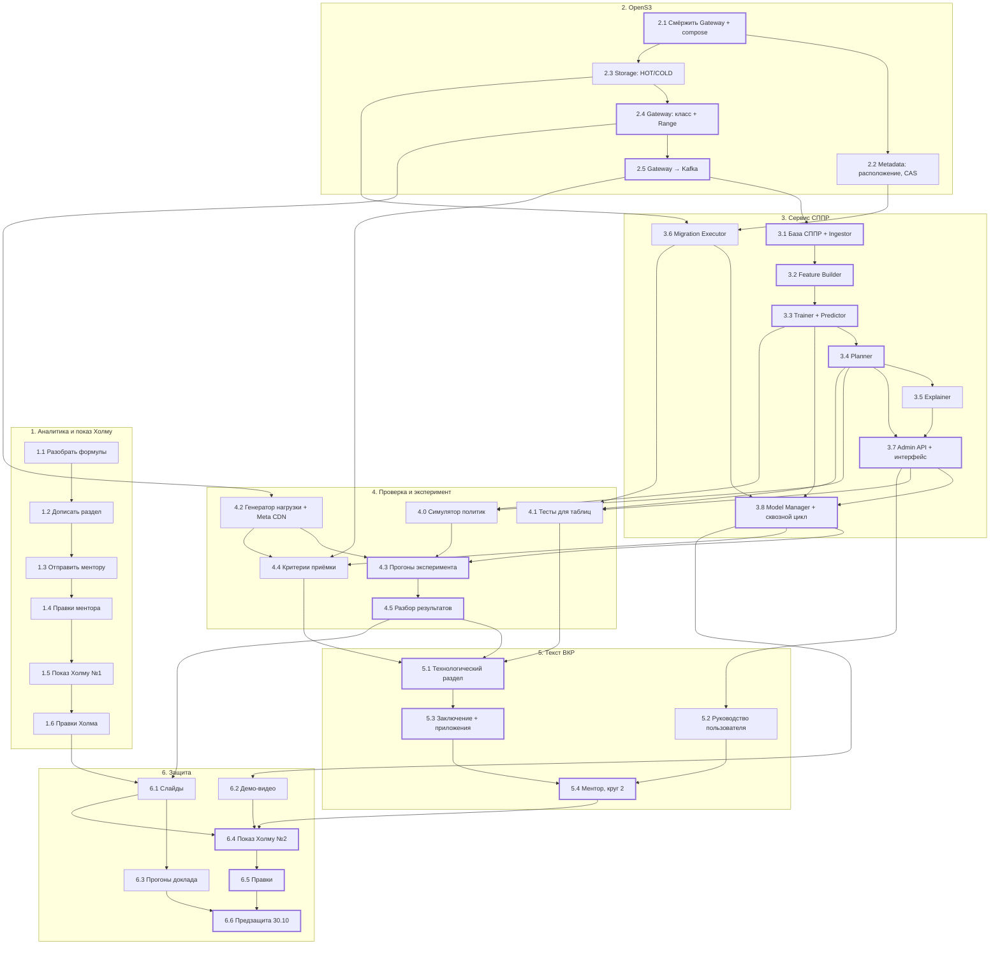
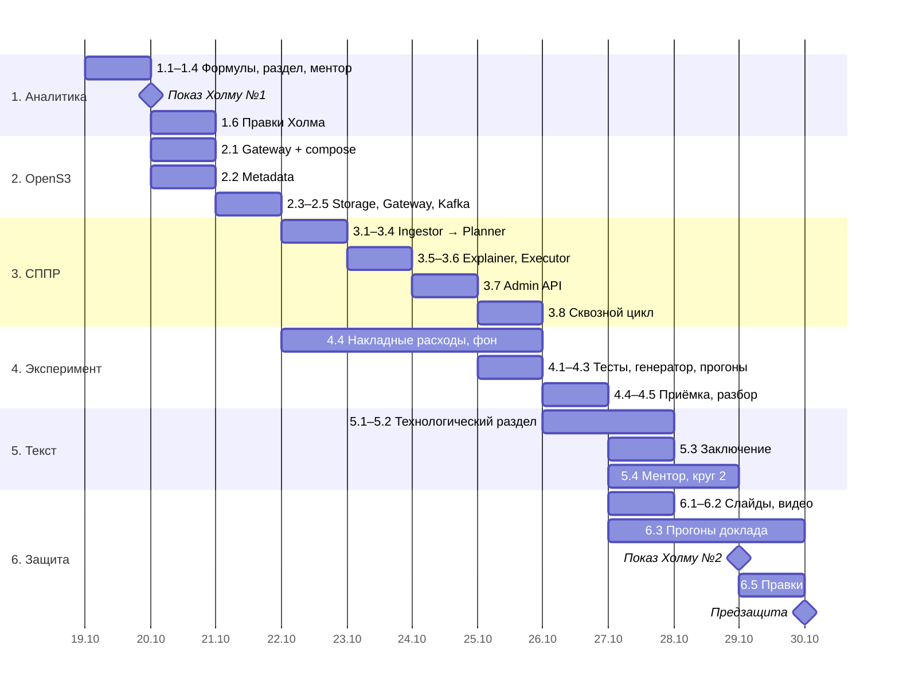

# План до предзащиты

Рабочий roadmap ВКР на 19–30 октября 2026: от аналитического раздела до предзащиты 30.10. Каждый шаг привязан к задаче в TickTick (проект `S3`, расписание — в календаре). Требования, на которые ссылаются шаги, — в [[Диплом_ГОСТ|тексте ВКР]], параметры испытаний — в [[Параметры будущего эксперимента|параметрах эксперимента]], формулы — в [[Математика аналитического раздела|заметке по математике]].

*Источник истины по датам и времени — TickTick. Эта заметка объясняет, что и зачем делается в каждом шаге и в каком порядке шаги зависят друг от друга.*

## Как читать

- **Номер шага** совпадает с префиксом задачи в TickTick: шаг 3.4 — задача «3.4 Planner: …».
- **Агент → N** — 10-минутная задача в TickTick: поставить фоновому агенту ТЗ на шаг N и уйти. Проверка результата — в самом шаге N.
- **Читать руками** — код, который проверяется построчно: инварианты, про них спросят на защите.
- **Критический путь** выделен в графе толстой рамкой: задержка любого шага на нём сдвигает предзащиту.

## Граф зависимостей

Стрелка A → B: B нельзя закончить без A. Шаги в разных колонках идут параллельно.

## План по дням

Не рабочие для диплома окна: ученики (пн и чт 16:00–18:15, чт до 19:30), пробное занятие вт 20.10 в 18:00, ВУЦ по средам до 18:00, пятничные пары с 16:20, Лиза — вечер пятницы и суббота с 12:00.

## Контрольные точки

| Когда | Что должно быть | Если нет |
|---|---|---|
| пн 19.10, 20:30 | Аналитика у ментора | Отправить как есть: показ Холму важнее полировки |
| вт 20.10, 17:00 | Стек OpenS3 поднят, PUT/GET проходит из main | 2.2 и 2.3 проверять на ветке, мёрж — в ср |
| чт 22.10, 11:00 | Событие чтения доходит до базы СППР | Отладка 2.5 до обеда, 3.2 сдвигается на вечер |
| вс 25.10, 10:45 | Сквозной цикл: чтение → план → подтверждение → перенос | Вечерний запуск прогонов переносится, разбор — во вторник |
| пн 26.10, 13:30 | Сводка результатов с ДИ | В слайды и текст идут предварительные числа с пометкой |
| вт 27.10, 21:30 | Полный DOCX и слайды у ментора | Ментору — по частям, по мере готовности |

## Риски

**R1. Время работы стенда.** По методике интеграционный прогон длится 6 ч на каждый из трёх бюджетов (18 ч), а проверка накладных расходов — 10 повторов по 35 мин в трёх режимах (~17,5 ч). Это ~35 ч непрерывной работы машины, которые не помещаются в одну ночь.
*Решение:* стенд — отдельная машина (настольный ПК или рабочий MacBook), а не ноутбук для разработки. Режим «без расширения» запускается сразу после 2.1, режим «без обучения» — после 2.5, остальные — после 3.8. Если к вс 25.10 видно, что не успевается, — до итогового теста зафиксировать новую версию параметров (методика это прямо допускает) и отразить её в тексте.

**R2. Симулятор не был в списке задач.** Основное сравнение пяти политик по шести сценариям и десяти значениям seed методика проводит в симуляции (четверо тестовых суток), а не на стенде. Нужен шаг 4.0: дискретно-событийный прогон с логическим временем, использующий те же Predictor и Planner. *В TickTick под него задачи пока нет — нужно решение, куда поставить.*

**R3. Gateway не в main.** PUT/GET лежат в ветке `feat/gateway-put-lifecycle`. Конфликт при мёрже съест шаг 2.1. *Решение:* мёрж первым делом во вторник, при конфликте — работать от ветки.

**R4. Ментор отвечает медленно.** Круг 1 рассчитан на ответ к утру вторника. *Решение:* показывать Холму версию с теми правками, что успели прийти; остальное — в 1.6.

## Этап 1. Аналитика и показ Холму

### 1.1 Разобрать формулы аналитики

- **TickTick:** «1.1 Разобрать формулы аналитики · 1,5ч» — пн 19.10, 12:30–14:00.
- **Зависит от:** — · **Открывает:** 1.2.
- **Кто:** ты + Claude в роли репетитора по разделу 0 [[Математика аналитического раздела|заметки по математике]].
- **Сделать:**
  1. Пройти формулы по порядку: время одного чтения (2.1) → задержка версии за горизонт (2.2) → выигрыш (2.3) → задача выбора (2.4–2.8) → бустинг и перевод выхода в прогноз (2.9–2.11) → потеря Пуассона (2.13) → признаки и метки (2.14–2.16).
  2. По каждой ответить вслух: что считает, откуда каждая переменная, что будет, если её увеличить.
  3. Разобрать пример из раздела 7 заметки руками.
  4. Ответить на вопросы самопроверки из раздела 9.
- **Готово, когда:** на любую формулу можешь за 30 секунд объяснить смысл и происхождение чисел (раздел 1.4 заметки).

### 1.2 Дописать аналитический раздел

- **TickTick:** «1.2 Дописать аналитический раздел · 1ч20м» — пн 19.10, 14:30–15:50; «1.2 Дописать аналитику + 1.3 отправить ментору · 1,5ч» — пн 19.10, 19:00–20:30.
- **Зависит от:** 1.1 · **Открывает:** 1.3.
- **Сделать:**
  1. Пройти чек-лист гайда [[Ревью от преподователя/Как писать аналитический раздел|по аналитическому разделу]].
  2. Убедиться, что каждый рисунок имеет подробное пояснение: в технологическом разделе на них будут ссылки.
  3. Убрать слово «прототип» (раздел 11 гайда по технологическому разделу).
  4. Выводы по разделу — с ответом на «и что из этого следует», а не перечнем действий.
  5. Вписать параметры эксперимента так, чтобы их можно было пересмотреть (риск R1).
- **Готово, когда:** раздел читается от постановки задачи до выводов без пометок «доделать».

### 1.3 Отправить ментору

- **TickTick:** входит в блок пн 19.10, 19:00–20:30.
- **Зависит от:** 1.2 · **Открывает:** 1.4.
- **Сделать:** DOCX целиком + короткое сообщение: что изменилось, на что смотреть в первую очередь (постановка задачи, модель, протокол переноса), к какому времени нужен ответ — показ Холму во вторник в 9:00.
- **Готово, когда:** файл у ментора до 20:30.

### 1.4 Правки ментора

- **TickTick:** «1.4 Правки ментора · 2ч» — пн 19.10, 20:40–22:40.
- **Зависит от:** 1.3 · **Открывает:** 1.5.
- **Сделать:** закрыть замечания по смыслу, не по стилю. Стилистику — в 1.6. Если ответа нет — делать 2.1, правки внести утром в дороге.
- **Готово, когда:** у каждого замечания есть исправление или ответ, почему нет.

### 1.5 Показ аналитики Холму

- **TickTick:** «1.5 Показ аналитики Холму · ожидание 2–3ч» — вт 20.10, 9:00–12:10; дорога 8:00–9:00 и 12:10–13:10.
- **Зависит от:** 1.4 · **Открывает:** 1.6.
- **Принести:** аналитический раздел с правками ментора (распечатка или файл).
- **Спросить:**
  1. Подходит ли основная проверка на синтетике и Meta CDN как дополнительный источник?
  2. Что обязательно показать на предзащите 30.10: работающую систему, эксперимент, полный текст?
  3. Есть ли требования к презентации и времени доклада?
  4. Можно ли пересмотреть параметры эксперимента до итогового теста (риск R1)?
- **В ожидании:** проверять черновик агента по 2.2.
- **Готово, когда:** записаны все замечания и ответы на четыре вопроса.

### 1.6 Правки по замечаниям Холма

- **TickTick:** «1.6 Правки по замечаниям Холма · 1ч40м» — вт 20.10, 13:40–15:20.
- **Зависит от:** 1.5 · **Открывает:** 6.1 (слайд формального описания).
- **Сделать:** внести правки. Если замечание меняет требования ТЗ — менять согласованно во всех разделах и отметить, какие шаги этапов 2–4 это затрагивает.
- **Готово, когда:** раздел без открытых замечаний, ответы Холма перенесены в этот roadmap.

## Этап 2. OpenS3

Репозиторий: `alesplll/opens3-rebac`. Изменения компонентов — таблица «Изменения компонентов OpenS3» в [[Диплом_ГОСТ|аналитическом разделе]].

### 2.1 Смёржить Gateway, урезанный compose, smoke PUT/GET

- **TickTick:** «2.1 Смёржить Gateway, урезанный compose, smoke PUT/GET · 1,5ч» — вт 20.10, 15:30–17:00.
- **Зависит от:** — · **Открывает:** 2.2, 2.3.
- **Сделать:**
  1. Смёржить `feat/gateway-put-lifecycle` в `main`, решить конфликты.
  2. Профиль compose для стенда: `postgres-metadata`, миграторы, `metadata`, `storage` ×2 (после 2.3), `kafka`, `zookeeper`, `gateway`, `auth`, `authz` при необходимости. Без neo4j, elasticsearch, kibana, jaeger — иначе не уложиться в ресурсную квоту.
  3. Запустить `cmd/smoke`: PUT → GET → байты совпадают.
- **Готово, когда:** одна команда поднимает стек, smoke зелёный из `main`.
- **Фон:** после шага можно запустить на стенде режим «без расширения» для 4.4 (риск R1).

### 2.2 Metadata: расположение версий и CAS

- **TickTick:** «Агент → 2.2» — пн 19.10, 22:40; «2.2 Metadata: проверить CAS, тесты · 1ч45м» — вт 20.10, 19:45–21:30.
- **Зависит от:** 2.1 · **Открывает:** 3.6. **Требования:** F-02, основа F-09.
- **Агенту:** миграция с таблицами `version_placements` (одна действующая запись на версию, поле `generation`) и `placement_copies` (временные и ожидающие очистки копии); RPC для чтения классов, занятости и расположения; условное переключение расположения CAS по `generation`; тесты на конкурентное переключение.
- **Читать руками:** условие CAS в SQL и обработку конфликта — это инвариант «Metadata не указывает на непроверенную копию».
- **Готово, когда:** тесты проходят, два конкурентных переключения дают ровно одного победителя.

### 2.3 Storage: два экземпляра HOT/COLD

- **TickTick:** «Агент → 2.3» — пн 19.10, 15:50; проверка — в блоке «2.3 + 2.4 Проверить Storage и Gateway» ср 21.10, 18:45–20:45.
- **Зависит от:** 2.1 · **Открывает:** 2.4, 3.6.
- **Агенту:** два экземпляра Storage на разных томах в compose; необязательный идентификатор blob при записи (нужен исполнителю, чтобы копия имела известный id); задержка COLD для стенда — по параметрам эксперимента (HOT 10 мс, COLD 40 мс на 1 МиБ) и фиксируется в протоколе.
- **Готово, когда:** запись с заданным blob id в оба экземпляра и чтение со смещением работают.

### 2.4 Gateway: выбор Storage по классу и Range

- **TickTick:** «Агент → 2.4» — вт 20.10, 12:15 (в дороге); проверка — ср 21.10, 18:45–20:45.
- **Зависит от:** 2.3 · **Открывает:** 2.5, 4.2.
- **Агенту:** Gateway узнаёт класс версии из Metadata и читает из нужного Storage; новые версии пишутся в COLD (аналитический раздел, «Изменения компонентов OpenS3»); HTTP Range через уже существующее чтение со смещением в Storage.
- **Готово, когда:** GET объекта, перенесённого в HOT, обслуживается HOT-экземпляром; Range возвращает нужный диапазон.

### 2.5 Gateway → Kafka

- **TickTick:** «Агент → 2.5 + 3.1» — вт 20.10, 21:30; «2.5 Gateway → Kafka: проверить · 1ч35м» — ср 21.10, 20:55–22:30.
- **Зависит от:** 2.4 · **Открывает:** 3.1, 4.4. **Требование:** F-01 (сторона Gateway).
- **Агенту:** после ответа на клиентское чтение или запись — событие с монотонным номером в ограниченную асинхронную очередь, оттуда — в Kafka через `shared/pkg/go-kit/kafka/producer`. Миграции помечаются отдельно от клиентских обращений.
- **Читать руками:** при переполнении очереди или отказе Kafka чтение не блокируется и не падает; пропуск виден по номерам.
- **Готово, когда:** выключенная Kafka не меняет задержку GET; после включения номера показывают пропуск.

## Этап 3. Сервис СППР

Компоненты — «Компонентная модель» и «Соответствие требованиям» в [[Диплом_ГОСТ|аналитическом разделе]]. Сервис на Go, обучение на Python.

### 3.1 База СППР и Ingestor

- **TickTick:** «Агент → 2.5 + 3.1» — вт 20.10, 21:30; «3.1 База СППР + Ingestor: проверить, сквозной PUT → Kafka → Ingestor · 2ч05м» — чт 22.10, 8:55–11:00.
- **Зависит от:** 2.5 · **Открывает:** 3.2. **Требования:** F-01, F-11 (база).
- **Сделать:** схема базы СППР по ER-модели (события, отметки актуальности, агрегаты, реестр моделей, планы с ревизиями, команды, миграции); Ingestor читает Kafka, отбрасывает дубли по номеру, фиксирует пропуски.
- **Готово, когда:** повтор события не увеличивает спрос, пропуск номеров записан и виден.

### 3.2 Feature Builder

- **TickTick:** «Агент → 3.2 + 4.2» — ср 21.10, 22:30; «3.2 Feature Builder: проверить разделение по времени · 2ч20м» — чт 22.10, 11:10–13:30.
- **Зависит от:** 3.1 · **Открывает:** 3.3. **Требование:** F-03.
- **Сделать:** окна признаков до момента прогноза t, метка — число чтений за следующие 60 мин; новые объекты и неполная история (формулы 2.14–2.16).
- **Читать руками:** ни один признак не использует события после t; пример попадает в обучение только после окончания часа метки.
- **Готово, когда:** тест с событием ровно на границе t проходит.

### 3.3 Trainer и Predictor

- **TickTick:** «Агент → 3.3» — чт 22.10, 8:45; «3.3 Trainer + Predictor: проверить, сверка Go и Python · 1ч45м» — чт 22.10, 14:00–15:45.
- **Зависит от:** 3.2 · **Открывает:** 3.4, 3.8, 4.0. **Требования:** F-04 (часть), F-12.
- **Сделать:** Trainer на Python — двухэтапная LightGBM: классификатор вероятности спроса и регрессор числа чтений с пуассоновской потерей, экспорт модели. Predictor на Go через `leaves`, EWMA и эвристики по возрасту, давности, частоте как базовые политики.
- **Читать руками:** сверка прогнозов Go и Python на контрольной выборке — без неё модель не вводится.
- **Готово, когда:** прогнозы совпадают в пределах допуска, базовые политики выдают оценки в том же формате.

### 3.4 Planner

- **TickTick:** «Агент → 3.4 + 3.5» — чт 22.10, 15:45; «3.4 Planner: проверить по формулам аналитики · 2ч35м» — чт 22.10, 20:15–22:50.
- **Зависит от:** 3.3 · **Открывает:** 3.5, 3.7, 4.0, 4.1. **Требование:** F-05.
- **Сделать:** жадный алгоритм по задаче 2.4–2.8: выигрыш на единицу ёмкости, ограничения ёмкости, резерва, бюджета, запретов; зависимости «освободить место в HOT перед входом».
- **Читать руками:** соответствие кода формулам и сложность O(n log n).
- **Готово, когда:** план на 10 000 объектах считается меньше 30 с; разобранный пример из [[Математика аналитического раздела|раздела 7 заметки]] даёт тот же ответ.

### 3.5 Explainer

- **TickTick:** «3.5 Explainer: проверить · 1ч05м» — пт 23.10, 14:00–15:05.
- **Зависит от:** 3.4 · **Открывает:** 3.7. **Требование:** F-06.
- **Сделать:** объяснение из величин планировщика: прогноз спроса, ожидаемый эффект, ограничения и зависимости. Сценарии проверки — «Пример проверки объяснений» в [[Параметры будущего эксперимента|параметрах эксперимента]] (объекты А и Б).
- **Готово, когда:** три административных сценария дают объяснения, по которым можно принять решение.

### 3.6 Migration Executor

- **TickTick:** «Агент → 3.6» — чт 22.10, 22:50; «3.6 Executor: протокол переноса · 2ч15м» и «3.6 Executor: рестарт, бюджет, тесты · 2ч20м» — пт 23.10, 8:45–13:30.
- **Зависит от:** 2.2, 2.3 · **Открывает:** 3.8, 4.1. **Требования:** F-08, F-09, F-10.
- **Сделать:** протокол из подраздела «Протокол безопасного переноса»: повторная проверка версии, расположения, запретов и ресурсов → копия → сверка MD5 → CAS по `generation` → отложенное удаление старой копии. Состояние миграции в базе, идемпотентность по ключу команды, продолжение после рестарта, бюджет и одна миграция одновременно.
- **Читать руками:** весь протокол. Это ядро «безопасного переноса» и самый вероятный источник вопросов.
- **Готово, когда:** обрыв на границе каждого этапа и повтор команды не теряют данные и не создают вторую миграцию.

### 3.7 Admin API и веб-интерфейс

- **TickTick:** «Агент → 3.7» — пт 23.10, 15:05; «3.7 Admin API + веб-интерфейс: проверить, F-07 · 2ч50м» — сб 24.10, 9:00–11:50.
- **Зависит от:** 3.4, 3.5 · **Открывает:** 3.8, 4.1, 5.2. **Требования:** F-07, F-11.
- **Сделать:** проверка токена через Auth и прав через AuthZ; подтверждение всего плана или допустимой части, отклонение, отмена ожидающих действий, пауза; ключ идемпотентности, ответ 202 со ссылкой на статус, постраничная выдача; серверные HTML-страницы с теми же обработчиками.
- **Готово, когда:** подтверждение переноса в заполненный HOT без освобождения места отклоняется; p95 первой страницы рекомендаций меньше 2 с.

### 3.8 Model Manager и сквозной цикл

- **TickTick:** «Агент → 3.8 + 4.3» — сб 24.10, 11:50; «3.8 Model Manager + сквозной цикл · 2ч» — вс 25.10, 8:45–10:45.
- **Зависит от:** 3.3, 3.6, 3.7 · **Открывает:** 4.3, 4.4, 6.2. **Требования:** F-04, F-12.
- **Сделать:** проверки перед вводом модели, замена модели вместе с правилами признаков, сохранение пригодной модели при ошибке, переход на базовую политику после 12 ч устаревания. Затем прогнать один объект через весь цикл.
- **Готово, когда:** чтения → события → признаки → прогноз → план → подтверждение → перенос → чтение из HOT проходит на стенде; цикл одного объекта восстанавливается по журналу (F-11).

## Этап 4. Проверка и эксперимент

### 4.0 Симулятор политик

- **TickTick:** задачи нет — см. риск R2.
- **Зависит от:** 3.3, 3.4 · **Открывает:** 4.3.
- **Сделать:** прогон по логическому времени: генератор обращений → Predictor → Planner → применение плана с бюджетом → расчётная задержка по модели классов (10/40 мс). Одинаковые seed для всех политик.
- **Готово, когда:** четверо тестовых суток одного сценария считаются за минуты, результаты пишутся в формате для 4.5.

### 4.1 Тесты для таблиц технологического раздела

- **TickTick:** «4.1 Тесты под таблицы технологического раздела · 1ч50м» — вс 25.10, 10:55–12:45.
- **Зависит от:** 3.4, 3.6, 3.7 · **Открывает:** 5.1.
- **Сделать:** три теста с тестовыми случаями: перенос с проверкой копии (F-08–F-10), план при ограничениях (F-05), подтверждение и отмена плана (F-07). Сохранить вывод: входные данные, шаги, ожидаемый и фактический результат.
- **Готово, когда:** есть файлы с выводом, из которых агент соберёт таблицы по форме гайда.

### 4.2 Генератор нагрузки и Meta CDN

- **TickTick:** «Агент → 3.2 + 4.2» — ср 21.10, 22:30; «4.2 Генератор нагрузки + Meta CDN · 2ч15м» — вс 25.10, 14:45–17:00.
- **Зависит от:** 2.4 · **Открывает:** 4.3, 4.4.
- **Сделать:** 10 000 объектов по 1 МиБ, 20 чтений/с, не больше 8 одновременных; шесть сценариев из методики; seed 0–9. Довести `Research Data/Meta CDN/analyze_sample.py` до таблицы для текста.
- **Готово, когда:** один seed дважды даёт одинаковую последовательность.

### 4.3 Прогоны эксперимента

- **TickTick:** «4.3 Пробный прогон эксперимента · 1ч50м» — вс 25.10, 17:10–19:00; «4.3 Все политики и бюджеты → запуск на ночь · 3ч» — вс 25.10, 20:00–23:00.
- **Зависит от:** 3.8, 4.0, 4.2 · **Открывает:** 4.5.
- **Сделать:** симуляция — пять политик × шесть сценариев × десять seed; стенд — 6-часовые прогоны со сменой набора через 1 и 3 ч на бюджетах 64, 256, 512 МиБ. Роль администратора — тестовый сценарий, подтверждающий план через 5 с.
- **Готово, когда:** сырые результаты с версией кода, конфигом и seed лежат рядом.

### 4.4 Критерии приёмки

- **TickTick:** «4.4 Критерии приёмки из ТЗ · 2ч15м» — пн 26.10, 8:45–11:00. Фоновые прогоны накладных расходов — с ср 21.10 (риск R1).
- **Зависит от:** 2.5, 3.8, 4.2 · **Открывает:** 5.1.
- **Сделать:** таблица «Измеримые требования к прототипу»: время плана ≤ 30 с, ресурсы 2 ядра и 2 ГиБ, подготовка модели ≤ 30 мин и обновление ≤ 300 с, рост задержки и p95 ≤ 5 % без расширения, с расширением и при обновлении модели, p95 Admin API ≤ 2 с.
- **Готово, когда:** у каждого параметра есть измеренное значение и вывод «соответствует / нет».

### 4.5 Разбор результатов

- **TickTick:** «4.5 Разбор прогонов: сводка, ДИ, графики · 2ч20м» — пн 26.10, 11:10–13:30.
- **Зависит от:** 4.3 · **Открывает:** 5.1, 6.1.
- **Сделать:** для каждого сценария и бюджета — уменьшение средней задержки относительно каждой базовой политики с 95 % ДИ по парным seed; p95; доля чтений из HOT; число переносов. Сценарии не усреднять.
- **Готово, когда:** таблица и 2–4 графика, по которым видно, где прогноз выигрывает и где нет; отсутствие выигрыша описано как граница метода.

## Этап 5. Текст ВКР

### 5.1 Технологический раздел

- **TickTick:** «5.1 Технологический раздел: 3.1 + ML-пайплайн · 1ч45м» — пн 26.10, 14:00–15:45; «5.1 … тесты и метрики · 1ч50м» — пн 26.10, 19:00–20:50; «5.1 … вывод + вычитка · 2ч15м» — вт 27.10, 8:45–11:00.
- **Зависит от:** 4.1, 4.4, 4.5 · **Открывает:** 5.3, 5.4.
- **Кто:** агент пишет по [[Ревью от преподователя/Как писать технологический раздел|гайду]], ты даёшь факты и вычитываешь.
- **Сделать:**
  1. Матрица трассировки: F-01…F-12 → структура кода → рисунок модели → листинг и строки → тест → метрика. Пустые ячейки — сначала закрыть.
  2. 3.1 — структуры кода по формуле гайда: имя курсивом, назначение, ссылки на ТЗ, модель и Приложение.
  3. ML-пайплайн на 5–10 страниц: данные и их качество, предобработка, баланс классов в тестовой выборке, обучение, ввод модели.
  4. Тесты — таблицы из 4.1; метрики — сводка из 4.4 и 4.5.
  5. Назвать модель жизненного цикла и методологию разработки.
- **Готово, когда:** чек-лист гайда пройден, нет ни одного `[уточнить: …]`.

### 5.2 Руководство пользователя

- **TickTick:** «5.2 Руководство пользователя: скриншоты, ошибки · 2ч» — пн 26.10, 21:00–23:00.
- **Зависит от:** 3.7 · **Открывает:** 5.4.
- **Сделать:** сценарии администратора: состояние классов и рекомендации → подтверждение или отклонение плана → пауза переносов → разбор отказа. 15–20 скриншотов с выделенным элементом; таблица ошибок: код, ситуация, причина, что делать (отказ миграции, устаревшая рекомендация, недоступная модель).
- **Готово, когда:** основные сценарии в тексте, остальное — в Приложении со ссылкой.

### 5.3 Заключение и приложения

- **TickTick:** «Агент → 5.3» — пн 26.10, 23:00; «5.3 Заключение + приложения: проверить · 2ч20м» — вт 27.10, 11:10–13:30.
- **Зависит от:** 5.1 · **Открывает:** 5.4.
- **Сделать:** по [[Ревью от преподователя/Как писать заключение и приложения|гайду]]: задачи из введения дословно, практическая и теоретическая значимость, перспективы, финальная фраза. Приложение А — слайды, далее листинги; на каждое приложение есть ссылка в тексте.
- **Готово, когда:** ни одна задача из введения не потеряна и не подменена.

### 5.4 Ментор, круг 2

- **TickTick:** «5.4 Ментору DOCX + слайды; 6.3 прогон доклада №1 · 2ч» — вт 27.10, 19:30–21:30; «5.4 Правки ментора (круг 2) · 2ч» — ср 28.10, 18:45–20:45.
- **Зависит от:** 5.1, 5.2, 5.3, 6.1 · **Открывает:** 6.4.
- **Готово, когда:** правки внесены до выезда к Холму в чт 8:00.

## Этап 6. Защита

### 6.1 Слайды

- **TickTick:** «6.1 Слайды · 3ч» — вт 27.10, 14:00–17:00.
- **Зависит от:** 1.6, 4.5 · **Открывает:** 6.3, 6.4.
- **Сделать:** по [[Ревью от преподователя/Как готовить презентацию и защиту ВКР|гайду]]: титульный → актуальность → методы → аналоги с целью внизу → **формальное описание** (пайплайн цикла, двухэтапная модель, задача выбора) → процессы → **архитектура** → **демо** → тесты и метрики против ТЗ → заключение → «Спасибо за внимание». Без отдельного слайда целей и задач.
- **Готово, когда:** доклад по слайдам укладывается в 8 минут.

### 6.2 Демо-видео

- **TickTick:** «6.2 Демо-видео 30–60 с · 1ч50м» — вт 27.10, 17:10–19:00.
- **Зависит от:** 3.8 · **Открывает:** 6.4.
- **Сделать:** рекомендации с объяснением → подтверждение → ход переноса → чтение из HOT. Запись экрана, вставить в слайд 7.

### 6.3 Прогоны доклада

- **TickTick:** №1 — вт 27.10, 19:30–21:30; №2 — ср 28.10, 20:55–22:30; №3 — чт 29.10, 20:15–23:00; финальный — пт 30.10, 8:45–10:45.
- **Зависит от:** 6.1 · **Открывает:** 6.6.
- **Сделать:** вслух, с таймером, не читая со слайдов. Тема и цель — наизусть. Подготовить ответы на «откуда это число» по разделу 1.4 [[Математика аналитического раздела|заметки по математике]].

### 6.4 Показ Холму №2

- **TickTick:** «6.4 Показ Холму: весь DOCX + слайды · ожидание» — чт 29.10, 9:00–12:10; дорога 8:00–9:00 и 12:10–13:10.
- **Зависит от:** 5.4, 6.1, 6.2 · **Открывает:** 6.5.
- **Принести:** полный DOCX, слайды, демо-видео.

### 6.5 Правки

- **TickTick:** «6.5 Правки по замечаниям Холма · 2ч05м» — чт 29.10, 13:40–15:45; «6.5 Правки + 6.3 прогон доклада №3 · 2ч45м» — чт 29.10, 20:15–23:00.
- **Зависит от:** 6.4 · **Открывает:** 6.6.
- **Готово, когда:** финальные DOCX и слайды в облаке и на флешке.

### 6.6 Предзащита

- **TickTick:** «6.6 Предзащита» — пт 30.10, время уточнить.
- **Зависит от:** 6.3, 6.5.
